# GitHub Repository Intelligence Platform — Architecture Document

**Document type:** Technical architecture specification  
**Derived from:** [problemStatement.md](file:///d:/Pranjali_projects/Github_code_analyser/docs/problemStatement.md)  
**Initial target stack:** Java 21 LTS + Spring Boot 4.x (backend), React 19 (frontend), PostgreSQL 16+ (database). Use the current stable versions at implementation time, see §18  
**Architecture style:** Modular monolith with pluggable analyzer packs  
**Primary constraint:** Fully functional without any AI provider or API key

---

## 1. Architecture Overview

The GitHub Repository Intelligence Platform is a **deterministic-first, AI-assisted** developer tool that analyzes GitHub repositories and produces structured, evidence-backed reports about code health, architecture, dependencies, security, and testing.

### 1.1 Core Design Principles

| Principle | Implication |
|---|---|
| **Deterministic-first** | Parsers and static analyzers produce facts; AI only explains or synthesizes them |
| **AI is optional** | The app starts, ingests, and reports without any AI provider configured |
| **Provider independence** | AI calls go through a neutral abstraction; no SDK leaks into business logic |
| **Evidence before explanation** | Every finding carries commit SHA, file path, line range, rule ID, and analysis method |
| **Incremental & cacheable** | Results keyed by (repo, commit SHA, analyzer version); unchanged files are not reprocessed |
| **Multi-language extensible** | Technology-independent core; language support added via analyzer packs |
| **Safe by default** | Untrusted repo code is never executed on the API server |

### 1.2 High-Level System Diagram

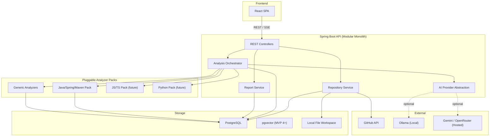

### 1.3 End-to-End Project Flow — Architecture Diagram

This diagram traces the **complete lifecycle** of a repository analysis request — from the moment a developer submits a GitHub URL to the final rendered report — across every layer of the system.

```mermaid
flowchart TD
    %% ───────── USER ENTRY ─────────
    USER(["👤 Developer"]) -->|"Enters GitHub URL"| UI["React SPA\n(Dashboard)"]

    %% ───────── FRONTEND LAYER ─────────
    subgraph FRONTEND["Frontend Layer"]
        UI -->|"Client-side validation\n(URL format, GitHub host)"| VALIDATE_UI{"Valid URL?"}
        VALIDATE_UI -- No --> ERR_UI["Show validation error"]
        VALIDATE_UI -- Yes --> SUBMIT["POST /api/v1/repositories/analyze\n{url}"]
    end

    %% ───────── API LAYER ─────────
    subgraph API_LAYER["REST API Layer (Spring Boot Controllers)"]
        SUBMIT -->|"HTTP Request"| CTRL["RepositoryController"]
        CTRL --> VALIDATE_BE["Server-side validation\n• Parse owner/repo (strict charset)\n• GitHub host allowlist\n• Never fetch user URL (SSRF)\n• Sync: metadata + resolve commit SHA\n• Reuse check (SHA + analyzer set)"]
        VALIDATE_BE --> ACCEPT["Return 202 Accepted {analysisRunId}\n(or 200 reused: true)"]
    end

    ACCEPT -->|"analysisRunId"| POLL["Frontend polls\nGET /api/v1/analysis-runs/{runId}\n(shows progress bar)"]

    %% ───────── REPOSITORY INGESTION ─────────
    subgraph INGESTION["Repository Ingestion Pipeline (Async)"]
        ACCEPT -->|"AFTER_COMMIT event\n→ @Async job"| REPO_SVC["Ingestion Service"]
        REPO_SVC --> GH_API["GitHub REST API"]
        GH_API --> TARBALL["Download tarball at SHA\nGET /repos/{o}/{r}/tarball/{sha}\n(redirect only to codeload.github.com)"]
        TARBALL --> SIZE_CHK{"Within size, file\n& entry limits?\n(checked while streaming)"}
        SIZE_CHK -- No --> REJECT["Mark snapshot REJECTED\n(reason: limits exceeded)"]
        SIZE_CHK -- Yes --> EXTRACT["Safe extraction into workspace\n• zip-slip check\n• skip symlinks/hard links\n• skip binaries from analysis"]
        EXTRACT --> FILTER["Filter exclusions\n(.git, node_modules, target,\nbuild, dist, vendor, ...)\n+ allowlist (jacoco*.xml)"]
        FILTER --> HASH["Compute content hashes\n(SHA-256 per file)"]
        HASH --> CLASSIFY["Classify files\n• Language (by extension + content)\n• Type (source / test / config /\n  resource / build / docs)"]
        CLASSIFY --> STORE_FILES["Store FileRecords\nin PostgreSQL"]
        STORE_FILES --> SNAP_DONE["Mark snapshot: INGESTED"]
    end

    %% ───────── TECHNOLOGY DETECTION ─────────
    subgraph TECH_DETECT["Technology Detection Phase"]
        SNAP_DONE --> DETECTORS["Run all registered\nTechnologyDetectors"]
        DETECTORS --> DET_GENERIC["Generic Detector\n• File extensions → languages\n• File distribution stats"]
        DETECTORS --> DET_MANIFEST["Manifest Detector\n• pom.xml → Maven\n• package.json → Node.js\n• go.mod → Go\n• pyproject.toml → Python\n• .csproj → .NET"]
        DETECTORS --> DET_JAVA["Java/Spring Detector\n• spring-boot-starter in pom\n• @SpringBootApplication\n• application.yml"]
        DET_GENERIC --> TECH_RESULTS["Technology Findings\n(with confidence levels)"]
        DET_MANIFEST --> TECH_RESULTS
        DET_JAVA --> TECH_RESULTS
        TECH_RESULTS --> STORE_TECH["Store TechnologyFindings\nin PostgreSQL"]
    end

    %% ───────── ANALYZER SELECTION ─────────
    subgraph SELECTION["Analyzer Selection"]
        STORE_TECH --> REGISTRY["Analyzer Registry\n(Spring component scan)"]
        REGISTRY --> MATCH["Match detected technologies\nagainst analyzer descriptors\n(language, framework, build tool)"]
        MATCH --> CAPABILITY["Build Capability Matrix\n• GENERIC / BASIC / DEEP /\n  UNSUPPORTED / UNAVAILABLE\n• per detected technology × category"]
        CAPABILITY --> PLAN["Execution Plan\n(ordered list of analyzers to run)"]
    end

    %% ───────── PARALLEL ANALYSIS ─────────
    subgraph ANALYSIS["Analysis Execution (Parallel, Fault-Isolated)"]
        PLAN --> ORCH["Analysis Orchestrator"]

        ORCH --> A_DEP["Dependency Analyzer\n━━━━━━━━━━━━━━━━\nMaven: parse pom.xml,\nresolve parent/child,\nlist deps + scopes +\nvulnerability check\n━━━━━━━━━━━━━━━━\nGeneric: basic manifest\ninventory"]

        ORCH --> A_CODE["Code Quality Analyzer\n━━━━━━━━━━━━━━━━\nJava: PMD 7 curated\nruleset: complexity,\nlarge classes, smells\n━━━━━━━━━━━━━━━━\nOther stacks: UNSUPPORTED"]

        ORCH --> A_SEC["Security Analyzers\n━━━━━━━━━━━━━━━━\nGeneric (all repos):\nsecret scanner\n━━━━━━━━━━━━━━━━\nSemgrep (if installed):\nSQL injection, unsafe\ndeserialization, weak\ncrypto + coverage report\n━━━━━━━━━━━━━━━━\nOSV dep lookup (opt-in)"]

        ORCH --> A_TEST["Test Analyzer\n━━━━━━━━━━━━━━━━\nJava: detect JUnit,\ncount test classes/\nmethods, parse JaCoCo\ncoverage reports\n━━━━━━━━━━━━━━━━\nGeneric: detect test\ndirs + frameworks"]

        ORCH --> A_STRUCT["Structure Analyzer\n━━━━━━━━━━━━━━━━\nDirectory tree,\nmodule boundaries,\nentry points,\nconfig files,\nsize distribution"]

        A_DEP --> |"✅ / ❌ / ⚠️"| RESULTS
        A_CODE --> |"✅ / ❌ / ⚠️"| RESULTS
        A_SEC --> |"✅ / ❌ / ⚠️"| RESULTS
        A_TEST --> |"✅ / ❌ / ⚠️"| RESULTS
        A_STRUCT --> |"✅ / ❌ / ⚠️"| RESULTS
    end

    subgraph RESULTS["Results Aggregation"]
        FINDINGS["Normalized Findings\n• severity, category, rule ID\n• file path + line range\n• evidence excerpt\n• analysis method label"]
        EXEC_STATUS["Analyzer Execution Status\n• Completed / Failed /\n  Skipped / Unavailable\n• Duration + error details"]
        CAP_MATRIX["Capability Matrix\n• Technology → Analyzer\n• Capability Level\n• What was actually run"]
    end

    %% ───────── PERSISTENCE & REPORT ─────────
    subgraph PERSIST["Persistence Layer"]
        FINDINGS --> DB[("PostgreSQL\n━━━━━━━━━━━\nrepository\nrepository_snapshot\nanalysis_run\nanalyzer_execution\nfile_record\ntechnology_finding\nanalyzer_capability\nanalysis_finding\ndependency\nmodule_record\ntest_record\ncoverage_record")]
        EXEC_STATUS --> DB
        CAP_MATRIX --> DB
    end

    DB --> REPORT_SVC["Report Service\n• Aggregate findings by category\n• Attach capability matrix\n• Attach evidence references\n• Mark AI features as unavailable\n  (when no provider configured)"]

    %% ───────── REPORT DELIVERY ─────────
    subgraph DELIVERY["Report Delivery"]
        REPORT_SVC --> REPORT_API["GET /api/v1/repositories/{id}\n/reports/{snapshotId}"]
        REPORT_API --> RENDER["React Dashboard renders:"]
        RENDER --> R1["📋 Overview\n(repo, commit, tech stack, stats)"]
        RENDER --> R2["📦 Dependencies\n(inventory, scopes, vulnerabilities)"]
        RENDER --> R3["🔍 Code Quality\n(smells, complexity, duplication)"]
        RENDER --> R4["🔒 Security\n(findings with file + line refs)"]
        RENDER --> R5["🧪 Tests\n(coverage, test gaps)"]
        RENDER --> R6["📊 Capability Matrix\n(what was analyzed vs. detected)"]
        RENDER --> R7["⚠️ Limitations\n(failed analyzers, unsupported techs)"]
    end

    POLL -.->|"status updates"| RENDER

    %% ───────── FUTURE MVP FLOWS (dashed) ─────────
    subgraph FUTURE["Future MVP Extensions (not in MVP 0–1)"]
        direction LR
        MVP2["MVP 2: Architecture\nDiscovery\n(JavaParser, Spring\nannotations, layer\ndetection, Mermaid\ndiagrams)"]
        MVP3["MVP 3: AI Insights\n(explain findings,\nsuggest refactorings,\nvia provider\nabstraction)"]
        MVP4["MVP 4: RAG Q&A\n(code chunking,\nembeddings, pgvector,\nhybrid retrieval,\ngrounded answers)"]
        MVP5["MVP 5: Impact\nAnalysis\n(dependency graph,\ncaller/callee,\ntest mapping,\nrisk scoring)"]
        MVP6["MVP 6: Agentic\nIntelligence\n(multi-step\ninvestigations,\nspecialist roles,\nconsolidated reports)"]
    end

    DB -.-> MVP2
    DB -.-> MVP3
    DB -.-> MVP4
    DB -.-> MVP5
    MVP5 -.-> MVP6

    %% ───────── STYLING ─────────
    style USER fill:#E3F2FD,stroke:#1565C0,color:#000
    style FRONTEND fill:#E8F5E9,stroke:#2E7D32
    style API_LAYER fill:#FFF3E0,stroke:#E65100
    style INGESTION fill:#F3E5F5,stroke:#6A1B9A
    style TECH_DETECT fill:#E0F7FA,stroke:#00695C
    style SELECTION fill:#FFF9C4,stroke:#F57F17
    style ANALYSIS fill:#FFEBEE,stroke:#B71C1C
    style RESULTS fill:#FCE4EC,stroke:#880E4F
    style PERSIST fill:#E8EAF6,stroke:#283593
    style DELIVERY fill:#E8F5E9,stroke:#1B5E20
    style FUTURE fill:#F5F5F5,stroke:#9E9E9E,stroke-dasharray: 5 5
```

#### Flow Summary

| Phase | What happens | Key components |
|---|---|---|
| **① Submit** | Developer enters a GitHub URL; frontend validates and sends to API | React SPA → `RepositoryController` |
| **② Validate** | Server parses owner/repo strictly, enforces the GitHub host allowlist, then **synchronously** fetches metadata and resolves the exact commit SHA; reuses an existing run for the same SHA + analyzer set unless `forceRescan` | `RepositoryController`, `GitHubUrlParser`, `RepositorySubmissionService` |
| **③ Accept** | Returns `202 Accepted` with `analysisRunId` (or `200` with `reused: true`); frontend begins polling for status | REST response + polling loop |
| **④ Ingest** | After commit, an async job downloads the tarball at the SHA and extracts it safely into a bounded workspace; files are hashed, classified and catalogued | `IngestionService` → GitHub API → `WorkspaceManager` → `FileRecord` storage |
| **⑤ Detect** | All registered `TechnologyDetector` implementations scan files for languages, frameworks, and build tools | Generic + language-specific detectors |
| **⑥ Select** | `AnalyzerRegistry` matches detected technologies to available analyzers; builds capability matrix | Registry pattern + capability levels |
| **⑦ Analyze** | Orchestrator runs each applicable analyzer **in parallel with fault isolation** — one failure doesn't block others | `AnalysisOrchestrator` → SPI implementations |
| **⑧ Persist** | The orchestrator (never the analyzers) redacts evidence and persists each analyzer's results in its own transaction, keyed by snapshot and run ID | Spring Data JPA → PostgreSQL |
| **⑨ Report** | Report service aggregates results; API serves consolidated report with evidence and limitations | `ReportService` → REST endpoint |
| **⑩ Render** | React dashboard displays categorized findings, capability matrix, and honest status labels | Dashboard components with filters/sorting |

> [!TIP]
> The entire flow from ① to ⑩ works **without any AI provider configured**. AI-powered features (explanations, Q&A, impact summaries) are layered on top in MVP 3–6 and are always optional.

---

## 2. Component Architecture

### 2.1 Frontend — React SPA

| Aspect | Detail |
|---|---|
| **Framework** | React 19 with TypeScript |
| **Build tool** | Vite (dev server on port 5173, `/api` proxied to 8080) |
| **Routing** | React Router v7 |
| **State management** | React Query (TanStack Query) for server state; React context or Zustand for UI state |
| **UI components** | Component library (e.g., Radix UI / Shadcn/ui) + Tailwind CSS 4 |
| **HTTP client** | Axios or fetch wrapper with interceptors |
| **Diagrams** | Mermaid.js (`securityLevel: 'strict'`) for architecture diagrams, Recharts for metrics |
| **Testing** | Vitest + React Testing Library + MSW |
| **Rendering safety** | Repository-derived text rendered as plain text; never `dangerouslySetInnerHTML` |

#### Frontend Page Structure (progressive by MVP)

```
/                           → Dashboard / repository list
/repositories/new           → Add repository (URL input + analyze)
/repositories/:id           → Repository overview
/repositories/:id/tech      → Technology stack
/repositories/:id/structure → Structure & modules
/repositories/:id/deps      → Dependencies
/repositories/:id/quality   → Code quality findings
/repositories/:id/security  → Security findings
/repositories/:id/tests     → Test analysis
/repositories/:id/arch      → Architecture diagram (MVP 2)
/repositories/:id/insights  → AI insights (MVP 3)
/repositories/:id/qa        → Repository Q&A (MVP 4)
/repositories/:id/impact    → Impact analysis (MVP 5)
/settings/ai                → AI provider configuration & usage
```

> [!IMPORTANT]
> Only implement screens required for the current MVP phase. Future routes are listed for planning only.

### 2.2 Backend — Spring Boot Modular Monolith

The backend is organized as a **modular monolith** — a single deployable Spring Boot application with well-defined internal module boundaries enforced by package structure and interface contracts.

#### Module Dependency Diagram

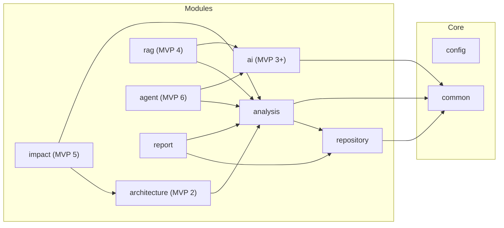

---

## 3. Package Structure

```text
com.repointelligence
├── config/                          # Spring config, profiles, security beans
├── common/
│   ├── exception/                   # Global exception handling, error DTOs
│   ├── logging/                     # Structured logging, sensitive-data redaction
│   ├── security/                    # URL validation, SSRF prevention, sanitization
│   ├── validation/                  # Reusable validators
│   └── model/                       # Shared value objects (Severity, Status, etc.)
│
├── repository/
│   ├── api/                         # REST controllers, request/response DTOs
│   ├── application/                 # Submission (sync SHA resolution, reuse) + ingestion services
│   ├── domain/                      # TrackedRepository (@Table "repository"), RepositorySnapshot, FileRecord
│   └── infrastructure/
│       ├── github/                  # GitHub API client (metadata, SHA, tarball), rate-limit policy
│       └── storage/                 # WorkspaceManager: safe extraction, WorkspaceView, cleanup
│
├── analysis/
│   ├── api/                         # Analysis REST controllers, report DTOs
│   ├── application/                 # Analysis orchestration service
│   ├── domain/                      # AnalysisRun, AnalyzerExecution, AnalysisFinding, TechnologyFinding, ...
│   ├── orchestration/               # Orchestrator, executors, deadlines, cancellation, restart recovery
│   ├── capability/                  # CapabilityMatrixBuilder (technology × category)
│   ├── registry/                    # Analyzer registration, discovery, analyzer-set hash
│   ├── spi/                         # ═══ ANALYZER CONTRACTS (interfaces) ═══
│   │   ├── AnalyzerDescriptor.java
│   │   ├── AnalysisContext.java     # read-only: snapshot/SHA, WorkspaceView, files, techs, deadline, cancellation
│   │   ├── AnalyzerResult.java      # returned DTOs; analyzers never persist
│   │   ├── TechnologyDetector.java
│   │   ├── RepositoryAnalyzer.java
│   │   ├── DependencyAnalyzer.java
│   │   ├── CodeAnalyzer.java
│   │   ├── SecurityAnalyzer.java
│   │   ├── TestAnalyzer.java
│   │   ├── ArchitectureAnalyzer.java   # added in MVP 2
│   │   └── ImpactAnalyzer.java         # added in MVP 5
│   ├── vulnerability/               # VulnerabilitySource interface + OSV implementation (opt-in)
│   ├── generic/                     # Technology-independent analyzers
│   │   ├── GenericLanguageDetector.java
│   │   ├── ManifestTechnologyDetector.java   # data-driven signature rules
│   │   ├── GenericStructureAnalyzer.java
│   │   ├── GenericSecretScanAnalyzer.java    # runs for every repository
│   │   └── SemgrepSecurityAnalyzer.java      # multi-language; reports actual coverage
│   └── packs/
│       ├── java/                    # ═══ JAVA ANALYZER PACK (MVP 1) ═══
│       │   ├── JavaSpringTechDetector.java
│       │   ├── MavenPomParser.java
│       │   ├── MavenDependencyAnalyzer.java
│       │   ├── JavaCodeAnalyzer.java            # PMD 7
│       │   ├── JavaTestAnalyzer.java            # + JacocoReportParser
│       │   ├── semgrep-rules/                   # Java rules contributed to Semgrep
│       │   ├── SpringArchitectureAnalyzer.java  # MVP 2
│       │   └── JavaImpactAnalyzer.java          # MVP 5
│       ├── javascript/              # MVP 1: NpmManifestDependencyAnalyzer (BASIC); deeper later
│       ├── python/                  # (future)
│       ├── go/                      # (future)
│       └── dotnet/                  # (future)
│
├── architecture/                    # MVP 2
│   ├── api/
│   ├── application/
│   ├── parser/                      # Shared parser abstractions
│   └── graph/                       # Layer/module/symbol graph
│
├── ai/                              # MVP 3+
│   ├── api/                         # AI REST controllers
│   ├── application/                 # AI orchestration service
│   ├── domain/                      # AIRequest, AIResponse, AIUsageRecord
│   ├── provider/
│   │   ├── AIModelService.java      # ═══ PROVIDER INTERFACE ═══
│   │   ├── AIProviderCapabilities.java
│   │   ├── ollama/                  # OllamaAIModelService
│   │   ├── gemini/                  # GeminiAIModelService
│   │   └── openrouter/              # OpenRouterAIModelService
│   ├── prompt/                      # Versioned prompt templates
│   ├── usage/                       # Token/cost tracking
│   └── cache/                       # Response caching
│
├── rag/                             # MVP 4
│   ├── ingestion/
│   ├── chunking/
│   ├── embedding/
│   ├── retrieval/
│   └── vectorstore/
│
├── impact/                          # MVP 5
│   ├── api/
│   ├── application/
│   └── graph/                       # Dependency graph queries
│
├── agent/                           # MVP 6
│   ├── orchestrator/
│   ├── roles/
│   └── execution/
│
└── report/
    ├── api/                         # Report controllers, export
    ├── application/                 # Report generation service
    └── domain/                      # ConsolidatedReport, ReportSection
```

> JPA entities and Spring Data repositories are co-located with their owning module (`<module>.domain` / `<module>.infrastructure`); there is no shared `persistence` package. Core packages must not import from `analysis.packs.*` (enforce with an ArchUnit test).

---

## 4. Analyzer Architecture (Plugin Model)

This is the central extensibility mechanism of the platform. All analyzers implement common contracts defined in the `analysis.spi` package.

### 4.1 Analyzer Contract Hierarchy

```mermaid
classDiagram
    class AnalyzerDescriptor {
        +String id
        +String name
        +String version
        +Set~String~ supportedLanguages
        +Set~String~ supportedFrameworks
        +CapabilityLevel capabilityLevel
        +Set~String~ requiredTools
        +String description
    }

    class TechnologyDetector {
        <<interface>>
        +AnalyzerDescriptor descriptor()
        +List~TechnologyFinding~ detect(AnalysisContext ctx)
    }

    class DependencyAnalyzer {
        <<interface>>
        +AnalyzerDescriptor descriptor()
        +Applicability applicability(AnalysisContext ctx)
        +DependencyReport analyze(AnalysisContext ctx)
    }

    class CodeAnalyzer {
        <<interface>>
        +AnalyzerDescriptor descriptor()
        +Applicability applicability(AnalysisContext ctx)
        +List~AnalysisFinding~ analyze(AnalysisContext ctx)
    }

    class SecurityAnalyzer {
        <<interface>>
        +AnalyzerDescriptor descriptor()
        +Applicability applicability(AnalysisContext ctx)
        +List~AnalysisFinding~ analyze(AnalysisContext ctx)
    }

    class TestAnalyzer {
        <<interface>>
        +AnalyzerDescriptor descriptor()
        +Applicability applicability(AnalysisContext ctx)
        +TestReport analyze(AnalysisContext ctx)
    }

    class ArchitectureAnalyzer {
        <<interface>>
        +AnalyzerDescriptor descriptor()
        +Applicability applicability(AnalysisContext ctx)
        +ArchitectureReport analyze(AnalysisContext ctx)
    }

    class ImpactAnalyzer {
        <<interface>>
        +AnalyzerDescriptor descriptor()
        +Applicability applicability(AnalysisContext ctx)
        +ImpactReport analyzeImpact(AnalysisContext ctx, ImpactQuery query)
    }

    class AnalysisContext {
        +UUID snapshotId
        +UUID runId
        +String commitSha
        +WorkspaceView workspace
        +List~FileInfo~ files
        +List~DetectedTechnology~ technologies
        +Instant deadline
        +CancellationToken cancellation
    }

    class CapabilityLevel {
        <<enumeration>>
        GENERIC
        BASIC
        DEEP
        UNSUPPORTED
        UNAVAILABLE
    }

    TechnologyDetector --> AnalyzerDescriptor
    DependencyAnalyzer --> AnalyzerDescriptor
    CodeAnalyzer --> AnalyzerDescriptor
    SecurityAnalyzer --> AnalyzerDescriptor
    TestAnalyzer --> AnalyzerDescriptor
    ArchitectureAnalyzer --> AnalyzerDescriptor
    ImpactAnalyzer --> AnalyzerDescriptor
    AnalyzerDescriptor --> CapabilityLevel
```

> Analyzers receive a read-only `AnalysisContext` (never JPA entities) and **return** results (`AnalyzerResult`, `DependencyReport`, …). `applicability()` returns `APPLICABLE`, `NOT_APPLICABLE` or `UNAVAILABLE(reason)`. Only the orchestrator persists results, each analyzer in its own transaction, which keeps failures isolated.

### 4.2 Analyzer Registration & Selection Flow

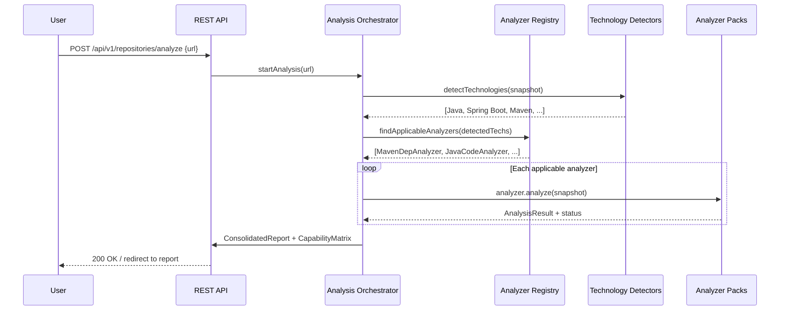

### 4.3 Capability Matrix

Every report includes a **capability matrix** with one row per **detected technology × analysis category**, showing what was detected vs. what was actually analyzed. Technologies that were not detected produce no rows (a React-only repository shows no Java rows).

| Technology | Category | Analyzer | Capability Level | Execution Status | Note |
|---|---|---|---|---|---|
| Java 17 | Code quality | java-pmd v1.0 | BASIC | Completed | No auxclasspath, so type-resolution rules are limited |
| Java 17 | Security | semgrep v1.0 | BASIC | Unavailable | Semgrep CLI not found |
| Java 17 | Tests | java-tests v1.0 | BASIC | Completed | Coverage unavailable: no JaCoCo report |
| Maven | Dependencies | maven-deps v1.0 | DEEP | Completed | Direct deps only; remote parent unresolved |
| (all files) | Security / secrets | generic-secrets v1.0 | GENERIC | Completed | |
| (all files) | Structure | generic-structure v1.0 | GENERIC | Completed | |
| TypeScript | Code quality | — | UNSUPPORTED | Not supported | No analyzer pack yet |
| npm | Dependencies | npm-manifest v1.0 | BASIC | Completed | Declared ranges, no lockfile |
| Docker | — | — | GENERIC | Detected only | |

---

## 5. Data Architecture

### 5.1 Entity-Relationship Diagram

```mermaid
erDiagram
    REPOSITORY ||--o{ REPOSITORY_SNAPSHOT : "has snapshots"
    REPOSITORY_SNAPSHOT ||--o{ FILE_RECORD : "contains files"
    REPOSITORY_SNAPSHOT ||--o{ ANALYSIS_RUN : "has analysis runs"
    REPOSITORY_SNAPSHOT ||--o{ TECHNOLOGY_FINDING : "detects technologies"
    REPOSITORY_SNAPSHOT ||--o{ ANALYZER_CAPABILITY : "reports capabilities"
    REPOSITORY_SNAPSHOT ||--o{ DEPENDENCY : "has dependencies"
    REPOSITORY_SNAPSHOT ||--o{ MODULE_RECORD : "has modules"

    ANALYSIS_RUN ||--o{ ANALYSIS_FINDING : "produces findings"
    ANALYSIS_RUN ||--o{ ANALYZER_EXECUTION : "one per analyzer"
    REPOSITORY_SNAPSHOT ||--o{ COVERAGE_RECORD : "has coverage (real reports only)"

    REPOSITORY_SNAPSHOT ||--o{ API_ENDPOINT : "exposes endpoints"
    REPOSITORY_SNAPSHOT ||--o{ CODE_SYMBOL : "contains symbols"
    REPOSITORY_SNAPSHOT ||--o{ DEPENDENCY_EDGE : "has dependency edges"
    REPOSITORY_SNAPSHOT ||--o{ TEST_RECORD : "has test records"

    REPOSITORY_SNAPSHOT ||--o{ AI_USAGE_RECORD : "logs AI usage"
    AI_USAGE_RECORD }o--|| AI_CACHE : "may hit cache"

    REPOSITORY {
        uuid id PK
        string host
        string owner
        string name
        string canonical_url
        string default_branch
        string visibility
        bigint github_repo_id
        timestamp created_at
        timestamp updated_at
    }

    REPOSITORY_SNAPSHOT {
        uuid id PK
        uuid repository_id FK
        char40 commit_sha "unique with repository_id; resolved before insert"
        string branch
        string ingestion_status
        string ingestion_error
        int file_count
        bigint total_bytes
        timestamp ingested_at
        timestamp created_at
    }

    FILE_RECORD {
        uuid id PK
        uuid snapshot_id FK
        string path
        string language
        string file_type
        bigint size_bytes
        string content_hash
        string git_blob_sha
        boolean is_binary
        string skipped_reason
    }

    ANALYSIS_RUN {
        uuid id PK
        uuid snapshot_id FK
        string status
        boolean force_rescan
        string analyzer_set_hash
        string failure_reason
        timestamp retry_after
        timestamp requested_at
        timestamp started_at
        timestamp completed_at
    }

    ANALYSIS_FINDING {
        uuid id PK
        uuid snapshot_id FK
        uuid run_id FK
        string analyzer_id
        string category
        string rule_id
        string severity
        string confidence
        string title
        text description
        string file_path
        string module_path
        int start_line
        int end_line
        jsonb evidence "redacted, length-capped"
        string analysis_method
        string fingerprint
        string suggested_next_step
    }

    TECHNOLOGY_FINDING {
        uuid id PK
        uuid snapshot_id FK
        uuid run_id FK
        string technology
        string kind
        string version
        string confidence
        jsonb evidence
        string detector_id
        decimal share_percent
    }

    ANALYZER_CAPABILITY {
        uuid id PK
        uuid snapshot_id FK
        uuid run_id FK
        string technology
        string category
        string analyzer_id "null when no analyzer exists"
        string analyzer_version
        string capability_level
        string execution_status
        string limitation_reason
    }

    ANALYZER_EXECUTION {
        uuid id PK
        uuid run_id FK
        uuid snapshot_id FK
        string analyzer_id
        string analyzer_version
        string category
        string status
        timestamp started_at
        timestamp completed_at
        bigint duration_ms
        jsonb config_summary
        string error_summary
        jsonb limitations
    }

    DEPENDENCY {
        uuid id PK
        uuid snapshot_id FK
        uuid run_id FK
        string analyzer_id
        string ecosystem
        string manifest_path
        string module_path
        string namespace
        string name
        string declared_version
        string resolved_version
        string version_source
        string scope
        boolean is_direct
        boolean is_management_entry
        string vulnerability_status
        jsonb vulnerability_ids
    }

    MODULE_RECORD {
        uuid id PK
        uuid snapshot_id FK
        uuid run_id FK
        string module_name
        string path
        string build_file_path
        string ecosystem
        string detected_responsibility
        jsonb evidence
    }

    COVERAGE_RECORD {
        uuid id PK
        uuid snapshot_id FK
        uuid run_id FK
        string report_path
        string scope
        string name
        int line_covered
        int line_missed
        int branch_covered
        int branch_missed
    }

    API_ENDPOINT {
        uuid id PK
        uuid snapshot_id FK
        string http_method
        string route
        string class_name
        string method_name
        string file_path
        int line_number
    }

    CODE_SYMBOL {
        uuid id PK
        uuid snapshot_id FK
        string symbol_type
        string fully_qualified_name
        string file_path
        int start_line
        int end_line
    }

    DEPENDENCY_EDGE {
        uuid id PK
        uuid snapshot_id FK
        uuid source_symbol_id FK
        uuid target_symbol_id FK
        string relationship_type
        text evidence
    }

    TEST_RECORD {
        uuid id PK
        uuid snapshot_id FK
        uuid run_id FK
        string test_file_path
        string test_symbol
        int test_method_count
        string framework
        string production_symbol
        string mapping_method
        string confidence
        jsonb evidence
    }

    AI_USAGE_RECORD {
        uuid id PK
        string provider
        string model
        string feature
        uuid snapshot_id FK
        int input_tokens
        int output_tokens
        decimal estimated_cost
        string status
        boolean cache_hit
        timestamp created_at
    }

    AI_CACHE {
        uuid id PK
        string cache_key
        string provider
        string model
        string prompt_version
        text response
        timestamp created_at
        timestamp expires_at
    }
```

### 5.2 Database Migrations

| Aspect | Decision |
|---|---|
| **Tool** | Flyway |
| **Naming** | `V{version}__{description}.sql` |
| **Strategy** | Forward-only migrations; no editing of applied migrations |
| **Indexes** | On `snapshot_id` (and `run_id`) for all snapshot-scoped tables; unique `(repository_id, commit_sha)`; `analysis_finding(snapshot_id, category, severity)` and `(snapshot_id, fingerprint)` |
| **Run model** | `analysis_run` = one analysis of a snapshot (rescans create new runs); `analyzer_execution` = one row per analyzer per run. Reports read the latest completed run unless a `runId` is given |
| **Tests** | Migrations are tested against real PostgreSQL started from embedded binaries (zonky `embedded-postgres`; no H2, no Docker) |

---

## 6. API Architecture

### 6.1 REST API Design Principles

- **Versioned:** All endpoints under `/api/v1/`
- **Resource-oriented:** Nouns for resources, HTTP methods for actions
- **DTO-based:** JPA entities never exposed directly; request/response DTOs at API boundary
- **Consistent errors:** Global exception handler returns `{error, message, details, timestamp}` envelope
- **Documented:** OpenAPI 3.0 via springdoc-openapi

### 6.2 MVP 1 API Endpoints

| Method | Endpoint | Purpose | Response |
|---|---|---|---|
| `POST` | `/api/v1/repositories/analyze` | Submit `{url, forceRescan}`; SHA resolved synchronously | `202 Accepted` with `analysisRunId`, or `200` with `reused: true` |
| `GET` | `/api/v1/repositories` | List analyzed repositories | Paginated list |
| `GET` | `/api/v1/repositories/{id}` | Repository details | Repository + latest snapshot/run summary |
| `GET` | `/api/v1/repositories/{id}/snapshots` | List analyzed commits | Paginated list with latest run status |
| `GET` | `/api/v1/analysis-runs/{runId}` | Analysis status | Status, phase, per-analyzer executions, failure reason, `retryAfter` |
| `POST` | `/api/v1/analysis-runs/{runId}/cancel` | Cancel a running analysis | `202 Accepted` |
| `GET` | `/api/v1/repositories/{id}/reports/{snapshotId}` | Consolidated report | Full report with capability matrix (latest completed run, or `?runId=`) |
| `GET` | `/api/v1/repositories/{id}/snapshots/{snapshotId}/findings` | Filtered findings | Paginated; filter by severity/category/module/file; sortable |
| `GET` | `/api/v1/repositories/{id}/snapshots/{snapshotId}/dependencies` | Dependency inventory | Filter by ecosystem/module/scope/vulnerability |
| `GET` | `/actuator/health` | Health check (Spring Boot Actuator) | `200 OK` with `UP` |

> Every repository-derived endpoint is scoped to one snapshot (commit). Results from different commits are never mixed in one response.

### 6.3 Async Analysis Flow

```mermaid
sequenceDiagram
    participant Client as React Client
    participant API as Spring REST API
    participant Svc as Repository Service
    participant Orch as Analysis Orchestrator
    participant DB as PostgreSQL
    participant GH as GitHub API

    Client->>API: POST /api/v1/repositories/analyze {url, forceRescan}
    API->>API: Parse owner/repo, rate-limit + job-cap check
    API->>GH: Fetch repo metadata (sync, short timeout)
    API->>GH: Resolve commit SHA (sync)
    API->>DB: Upsert Repository + Snapshot(sha); reuse existing run?
    API->>DB: Create AnalysisRun (QUEUED) + publish event
    API-->>Client: 202 Accepted {analysisRunId} (or 200 reused)

    Note over API,Orch: @TransactionalEventListener(AFTER_COMMIT) → @Async job
    API->>Orch: execute(runId)

    Orch->>DB: Update run (INGESTING)
    Orch->>GH: Download tarball at SHA (one request)
    Orch->>Orch: Safe extraction into bounded workspace
    Orch->>DB: Batch-insert FileRecords, snapshot INGESTED

    Orch->>DB: Update run (ANALYZING)

    par Technology Detection
        Orch->>Orch: Run all TechnologyDetectors
    end

    par Analyzer Execution (independent, fault-isolated)
        Orch->>Orch: Run DependencyAnalyzers
    and
        Orch->>Orch: Run CodeAnalyzers
    and
        Orch->>Orch: Run SecurityAnalyzers
    and
        Orch->>Orch: Run TestAnalyzers
    end

    Orch->>DB: Persist each analyzer's results (own transaction) + capability matrix
    Orch->>DB: Update run (COMPLETED / COMPLETED_WITH_WARNINGS / FAILED)
    Orch->>Orch: Clean up workspace (per retention config)

    Client->>API: GET /api/v1/analysis-runs/{runId}
    API-->>Client: Status: COMPLETED

    Client->>API: GET /api/v1/repositories/{id}/reports/{snapshotId}
    API-->>Client: ConsolidatedReport
```

> [!NOTE]
> MVP 1 uses polling for status updates. Server-Sent Events (SSE) or WebSocket can be added later for real-time progress.

---

## 7. AI Provider Architecture (MVP 3+)

### 7.1 Provider Abstraction Layer

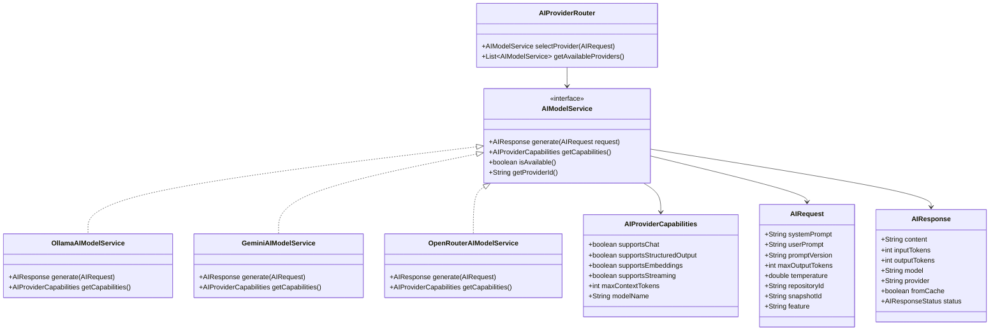

### 7.2 AI Feature Guardrails

```text
┌─────────────────────────────────────────────────────────────┐
│                     AI Feature Request                       │
├─────────────────────────────────────────────────────────────┤
│  1. Check: ai.enabled == true?                 → else SKIP  │
│  2. Check: provider available & healthy?       → else SKIP  │
│  3. Check: per-analysis call budget remaining? → else SKIP  │
│  4. Check: response cache hit?                 → return     │
│  5. Build bounded prompt (≤ max-input-tokens)               │
│  6. Set timeout (≤ timeout-seconds)                         │
│  7. Call provider with retry limit (≤ max-retries)          │
│  8. Validate response schema                                │
│  9. Log usage record (tokens, cost, status)                 │
│ 10. Cache response (keyed by content hash + prompt version) │
│ 11. Return response marked as AI-generated                  │
└─────────────────────────────────────────────────────────────┘
```

---

## 8. Security Architecture

### 8.1 Threat Model & Mitigations

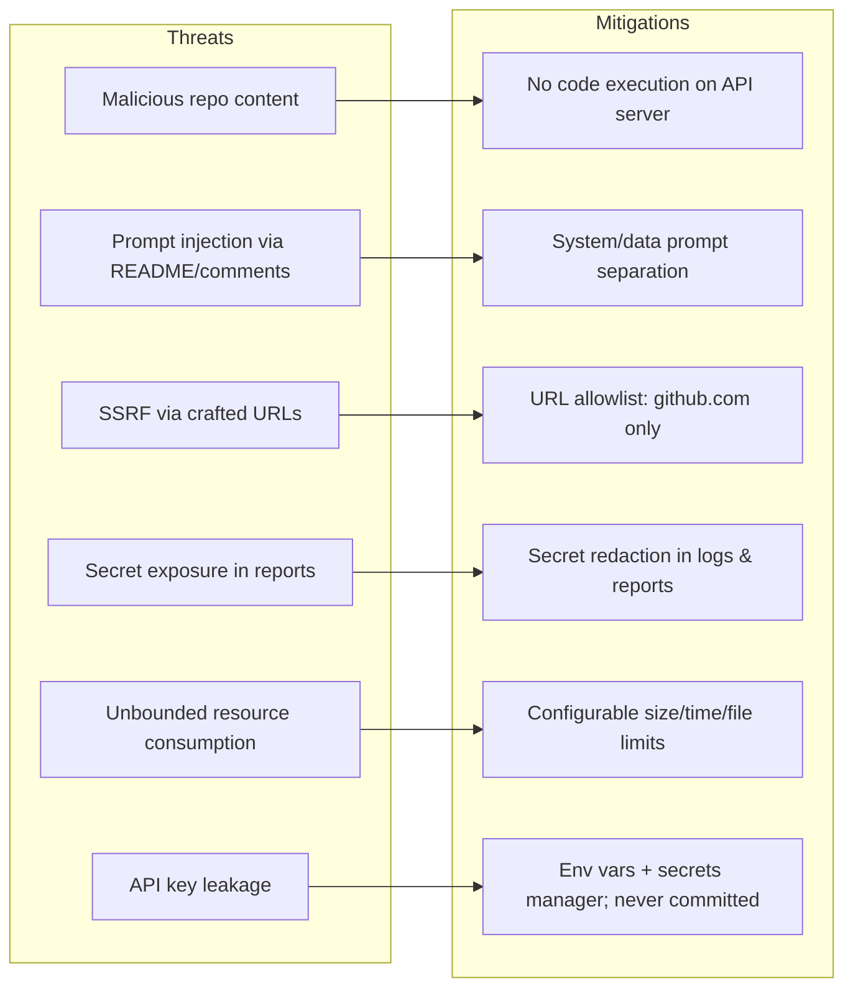

### 8.2 Security Controls Matrix

| Layer | Control |
|---|---|
| **URL validation** | Parse to `owner`/`repo` with strict character sets; only `github.com`; reject user-info, ports, non-HTTP schemes. The backend never fetches the user-supplied URL; it builds `api.github.com` URLs itself |
| **Outbound allowlist** | `api.github.com`, `codeload.github.com` (tarball redirect); optional endpoints (OSV, AI providers) only when enabled |
| **Repository ingestion** | Tarball size cap while streaming, decompressed-size and entry-count caps (bomb-safe), per-file size limit, zip-slip path check, symlinks/hard links skipped, binaries excluded from analysis, workspace cleanup |
| **Untrusted XML** | `pom.xml`, `jacoco.xml` and other XML parsed with external entities and external DTD loading disabled (XXE) |
| **External tools** | Semgrep runs as a subprocess with local rules, `--metrics=off`, timeouts, output caps, minimal environment, and is killed on deadline or cancel |
| **Code execution** | Disabled by default; if enabled, runs in an isolated worker/sandbox with no network, resource caps, read-only access. Must not make Docker a requirement for the rest of the platform |
| **AI prompts** | System prompt separated from repository data; repo content marked as untrusted data; model told not to follow instructions from data |
| **Secret handling** | A single `SecretRedactor` is applied to every evidence excerpt (from any analyzer), to logs (Logback converter), and to AI prompts; `GITHUB_TOKEN`/`Authorization` never logged; API keys via env vars only |
| **API security** | CORS configured; request size limits; rate limit on `POST /analyze`; queued-job cap (429); input validation on all endpoints. **No authentication in MVP 0–1: local single-user only, not for public exposure** |
| **Data isolation** | All queries scoped by snapshot_id; no cross-repository data leakage |

---

## 9. Repository Ingestion Pipeline

### 9.1 Ingestion Flow

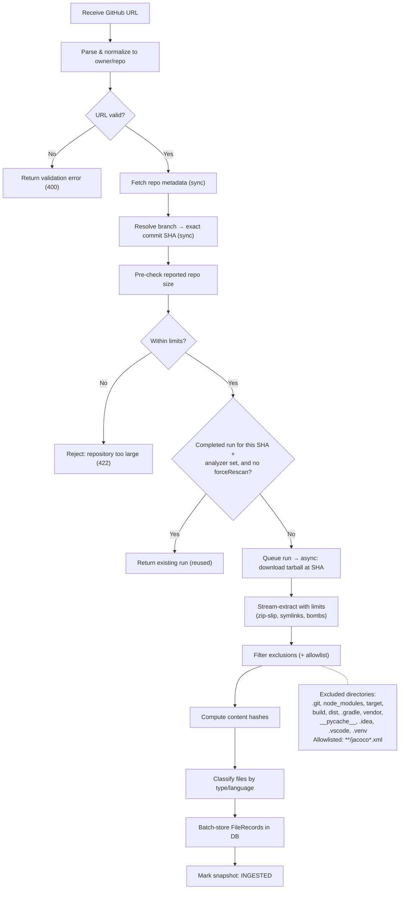

### 9.2 GitHub API Strategy

| Concern | Strategy |
|---|---|
| **Metadata** | `GET /repos/{owner}/{repo}` for repo info (synchronously at submission) |
| **Commit SHA** | `GET /repos/{owner}/{repo}/commits/{branch}` to resolve the exact SHA (synchronously at submission) |
| **File content** | **One tarball per commit**: `GET /repos/{owner}/{repo}/tarball/{sha}`, which redirects to `codeload.github.com` (the only redirect host allowed). Per-file content requests are not used: unauthenticated API access is limited to 60 requests/hour |
| **File tree** | Optional pre-check only: `GET /repos/{owner}/{repo}/git/trees/{sha}?recursive=1`; handle `truncated: true` |
| **Rate limits** | Read `X-RateLimit-*` / `Retry-After`. Primary limit exhausted → fail fast with reset time (never sleep a worker). Bounded backoff for secondary limits and 5xx |
| **Authentication** | Optional `GITHUB_TOKEN` (strongly recommended) for 5,000 req/hour; not required for public repos; never logged |

### 9.3 Configurable Limits

```yaml
repository:
  ingestion:
    max-repository-size-mb: 200
    max-tarball-size-mb: 200
    max-extracted-size-mb: 500
    max-file-size-kb: 1024
    max-file-count: 20000
    excluded-directories: [.git, node_modules, target, build, dist, .gradle, vendor, __pycache__, .idea, .vscode, .venv]
    excluded-exceptions: ["**/jacoco*.xml", "**/jacoco/*.xml"]
  workspace:
    root: ${WORKSPACE_ROOT:./.workspace}
    retain-after-analysis: PT0S     # delete source after analysis by default
analysis:
  max-analysis-duration: PT30M
  max-concurrent-jobs: 3
  max-queued-jobs: 20
```

Source code is not retained after analysis by default. Later features (MVP 3+) that need source again re-download the tarball by the immutable commit SHA.

---

## 10. Analysis Orchestration

### 10.1 Orchestration Strategy

The **Analysis Orchestrator** is the central coordination component. It:

1. Is started by an after-commit event for a queued `analysis_run` and computes the run deadline
2. Ingests the snapshot (or reuses an existing ingestion for the same SHA)
3. Runs all registered `TechnologyDetectors` to identify languages/frameworks
4. Asks each analyzer for its `applicability(context)` and builds the capability matrix
5. Executes each applicable analyzer **independently and fault-isolated** on a dedicated bounded executor, each with a timeout from the remaining budget and a cancellation token
6. Redacts evidence, then persists each analyzer's results in its own transaction and records its `analyzer_execution` status (completed, failed, timed out, unavailable, cancelled, …)
7. Computes the run status, updates the capability matrix, and cleans up the workspace

On startup, runs left in `QUEUED`/`INGESTING`/`ANALYZING` by a restart are marked `FAILED` ("interrupted") and their workspaces are removed.

### 10.2 Fault Isolation

> [!WARNING]
> A failure in one analyzer must **never** prevent other analyzers from completing or erase their results.

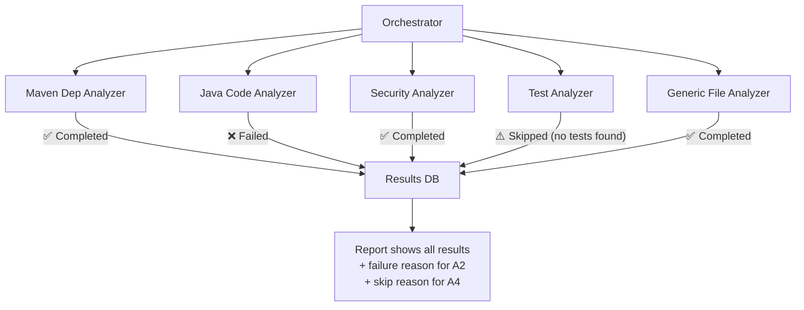

Each analyzer runs in a try-catch boundary with a timeout. Failures are logged with the analyzer ID and a redacted error summary, and the execution status is set to `FAILED` (or `TIMED_OUT`). Because analyzers only return results and never write to the database, a failing analyzer cannot leave partial rows behind. The report clearly shows which analyzers ran, which failed, and why.

---

## 11. Technology Detection

### 11.1 Detection Evidence Map

Technology detection is based on a **signature rule system** — a set of configurable rules that map file patterns, content patterns, and dependency declarations to technology identifications.

| Evidence Type | Examples | Confidence |
|---|---|---|
| **Build manifest** | `pom.xml` → Maven, `package.json` → Node.js, `go.mod` → Go | HIGH |
| **Framework dependency** | `spring-boot-starter-web` in pom.xml → Spring Boot | HIGH |
| **Config file** | `application.yml` → Spring Boot, `tsconfig.json` → TypeScript | HIGH |
| **File extension distribution** | `.java` files → Java, `.py` files → Python | MEDIUM |
| **Source annotations/imports** | `@SpringBootApplication` → Spring Boot | HIGH |
| **Deployment artifacts** | `Dockerfile`, `k8s/` → Containerized | MEDIUM |

### 11.2 Multi-Stack Support

A single repository may be polyglot or a monorepo. The detection system:
- Scans the entire file tree and runs **all** registered detectors
- Each detector reports independent findings with confidence levels
- Multiple technologies can coexist (e.g., Java backend + React frontend + Docker)
- The orchestrator runs **every compatible analyzer** for each detected technology

---

## 12. MVP Phase Architecture Mapping

### 12.1 Phase → Component Matrix

| Component | MVP 0 | MVP 1 | MVP 2 | MVP 3 | MVP 4 | MVP 5 | MVP 6 |
|---|---|---|---|---|---|---|---|
| React SPA shell | ✅ | ✅ | ✅ | ✅ | ✅ | ✅ | ✅ |
| Spring Boot API | ✅ | ✅ | ✅ | ✅ | ✅ | ✅ | ✅ |
| PostgreSQL + Flyway | ✅ | ✅ | ✅ | ✅ | ✅ | ✅ | ✅ |
| GitHub connector | | ✅ | ✅ | ✅ | ✅ | ✅ | ✅ |
| Analyzer SPI + registry | | ✅ | ✅ | ✅ | ✅ | ✅ | ✅ |
| Generic analyzers | | ✅ | ✅ | ✅ | ✅ | ✅ | ✅ |
| Java/Spring/Maven pack | | ✅ | ✅ | ✅ | ✅ | ✅ | ✅ |
| Report service | | ✅ | ✅ | ✅ | ✅ | ✅ | ✅ |
| Architecture discovery | | | ✅ | ✅ | ✅ | ✅ | ✅ |
| AI provider abstraction | | | | ✅ | ✅ | ✅ | ✅ |
| RAG / pgvector | | | | | ✅ | ✅ | ✅ |
| Impact graph | | | | | | ✅ | ✅ |
| Agent orchestrator | | | | | | | ✅ |

### 12.2 MVP Build Sequence


---

## 13. Infrastructure & Deployment

### 13.1 Local Development Stack

No Docker is required anywhere in the stack. Everything runs as a native process.

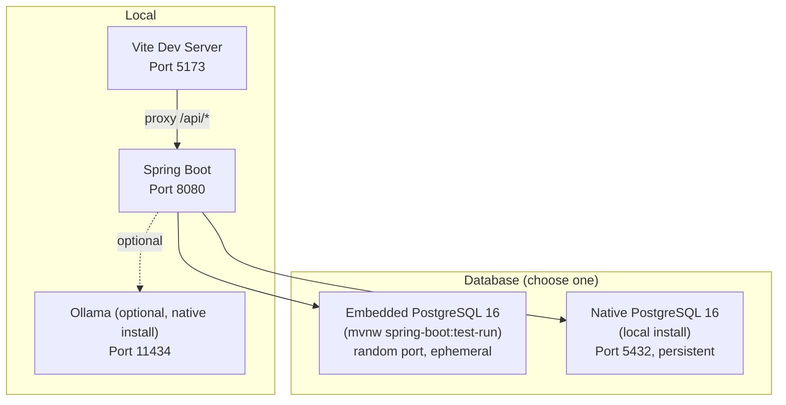

### 13.2 Configuration Profiles

| Profile | Purpose |
|---|---|
| `default` | Sensible defaults, AI disabled, local PostgreSQL |
| `dev` | Debug logging, relaxed limits, native or embedded PostgreSQL |
| `test` | Embedded PostgreSQL binaries (no H2, no Docker), WireMock-served GitHub fixtures (tarballs), no AI |
| `prod` | Secure defaults, externalized config, structured JSON logging |

### 13.3 Local Services (no Docker)

| Service | How it runs | Notes |
|---|---|---|
| **PostgreSQL (zero-install)** | `mvnw spring-boot:test-run` starts the app with embedded PostgreSQL binaries (`TestRepoIntelligenceApplication` + `EmbeddedPostgresConfig`) | Binaries version pinned via `embedded-postgres-binaries-bom`; data discarded on exit |
| **PostgreSQL (persistent)** | Native PostgreSQL 16 install (Windows: EDB installer); `scripts/db/create-dev-db.sql` creates the `repointel` role and `repointelligence` database | App uses the `DB_URL`/`DB_USERNAME`/`DB_PASSWORD` defaults with `mvnw spring-boot:run` |
| **pgvector (MVP 4)** | Native install adds the pgvector extension. Tests: open decision, either embedded binaries built with pgvector or a native test database (see the implementation plan) | Stock embedded binaries do not include pgvector |
| **Ollama (optional, MVP 3+)** | Native Ollama installer, pinned version | Only when local AI is enabled |

---

## 14. Cross-Cutting Concerns

### 14.1 Logging

| Concern | Implementation |
|---|---|
| **Format** | Structured JSON in production; human-readable in dev |
| **Framework** | SLF4J + Logback |
| **Sensitive data** | Redaction filter for API keys, tokens, secrets found by scanners |
| **Correlation** | MDC with `requestId`, `repositoryId`, `snapshotId`, `analyzerId` |

### 14.2 Error Handling

```text
Controller → @RestControllerAdvice → GlobalExceptionHandler
  ├── InvalidRepositoryUrlException / validation → 400 Bad Request
  ├── ResourceNotFoundException                  → 404 Not Found (incl. repo not found / not public)
  ├── AnalysisLimitException                     → 422 Unprocessable Entity (repo too large)
  ├── UpstreamRateLimitException                 → 429 Too Many Requests + Retry-After
  ├── TooManyJobsException                       → 429 Too Many Requests
  ├── UpstreamUnavailableException               → 502 / 503
  └── Unexpected                                 → 500 (correlation ID only, no stack trace/message)

AI unavailability is not an HTTP error: AI endpoints return 200 with status UNAVAILABLE and a reason.
```

### 14.3 Caching Strategy

| Data | Cache Key | TTL |
|---|---|---|
| GitHub repo metadata | `repo:{owner}/{name}` | 5 min |
| Analysis results (reuse) | `(repository_id, commit_sha, analyzer_set_hash)`: an existing completed run is returned unless `forceRescan` | Indefinite (immutable per commit) |
| File inventory | `(snapshot_id)`: `file_record` rows reused across runs of the same commit | Indefinite |
| AI responses | `ai:{provider}:{model}:{promptVersion}:{contentHash}` | Configurable |
| Technology detection | `tech:{snapshot_id}` | Indefinite (immutable per commit) |

### 14.4 Observability

| Signal | Tool |
|---|---|
| **Health checks** | Spring Boot Actuator (`/actuator/health`) |
| **Metrics** | Micrometer → Prometheus (optional) |
| **API docs** | springdoc-openapi → Swagger UI |
| **Analysis audit** | `analysis_run` + `analyzer_execution` tables |
| **AI audit** | `ai_usage_record` table |

---

## 15. Testing Architecture

### 15.1 Test Pyramid

```text
                    ┌─────────────┐
                    │  E2E Tests  │  ← Small number, full flow
                    │ (Playwright)│
                   ┌┴─────────────┴┐
                   │  Integration   │  ← Embedded PostgreSQL + fixtures
                   │    Tests       │
                  ┌┴───────────────┴┐
                  │   Unit Tests     │  ← Majority, fast, isolated
                  │ (JUnit 5 / Vitest)│
                  └──────────────────┘
```

### 15.2 Test Fixtures

Maintain a set of **known test repositories** (small, synthetic) with expected outcomes:

| Fixture | Purpose |
|---|---|
| `fixture-spring-boot-simple` | Known layers, endpoints, entities, deps, tests, PMD smells, committed jacoco.xml |
| `fixture-maven-multi-module` | Local parent, properties, BOM import, version inconsistency |
| `fixture-react-typescript` | Generic analysis fallback + npm manifest inventory for non-Java |
| `fixture-python-flask` | Generic analysis fallback for non-Java |
| `fixture-security-smells` | Known (fake) secrets in Java/YAML/.env/JS, Semgrep-detectable patterns |
| `fixture-malicious-archive` | Path traversal, symlinks, hard links, decompression bomb, oversized file, prompt-injection README |

Fixtures are packaged as tarballs at test-build time and served by WireMock as GitHub's tarball endpoint, so the real ingestion path runs in CI without calling GitHub. Live GitHub runs are a manual smoke test.

### 15.3 Backend Test Categories

| Category | Scope | Tools |
|---|---|---|
| Unit | Validators, parsers, mappers, service logic | JUnit 5, Mockito |
| Integration | DB operations (PostgreSQL only, no H2), GitHub client (WireMock), full analyzer runs | Spring Boot Test, embedded PostgreSQL (zonky), WireMock |
| Security | URL validation, archive extraction safety, XXE, secret redaction in responses and logs, prompt injection defense | Dedicated test suite |
| External tools | Semgrep integration tests | `@Tag("semgrep")`, excluded from default CI |
| Architecture rules | Core packages do not depend on `analysis.packs.*` | ArchUnit |
| AI-disabled | Full MVP 1 flow with no AI configured | Integration test with no `ai.*` configuration |

---

## 16. Key Architectural Decisions

| # | Decision | Rationale |
|---|---|---|
| ADR-01 | Modular monolith, not microservices | Simpler deployment, debugging, and transaction management for initial scope |
| ADR-02 | Plugin-style analyzer packs via SPI interfaces | Language support is additive; new packs don't require core changes |
| ADR-03 | PostgreSQL as primary store (no graph DB yet) | Sufficient for MVP 1–5; graph DB only if measured query complexity demands it |
| ADR-04 | Flyway for migrations | Simple, SQL-based, well-supported by Spring Boot |
| ADR-05 | Async analysis via after-commit events + `@Async` with separate bounded job and analyzer executors, deadlines, cancellation and restart recovery | Adequate for initial concurrency; avoids pre-commit races and nested-pool deadlock; message broker later if justified |
| ADR-06 | AI behind provider-neutral interface | Switch providers without changing business logic; graceful AI-off mode |
| ADR-07 | Evidence model carries commit SHA + file + line | All findings traceable; results from different commits never mixed |
| ADR-08 | No code execution on API server | Security: untrusted build scripts never run in the main process |
| ADR-09 | GitHub API for metadata/SHA; one tarball per commit for content (no `git clone`, no per-file requests) | One request per analysis fits rate limits; immutable per SHA; no git binary or hooks involved; bounded, safely extracted workspace |
| ADR-10 | React + Vite + TypeScript for frontend | Modern, fast DX, strong typing |
| ADR-11 | Capability matrix (detected technology × category) in every report | Transparency: users know what was analyzed vs. merely detected |
| ADR-12 | Commit SHA resolved synchronously at submission; results reused by SHA + analyzer-set hash | Immediate errors for bad repos; no duplicate snapshots; deterministic caching (Problem §5.5) |
| ADR-13 | Analyzers receive a read-only `AnalysisContext` and return results; the orchestrator persists | Keeps the SPI free of JPA; guarantees fault isolation |
| ADR-14 | Generic secret scanning for all repositories; Semgrep with vendored local rules; OSV for vulnerabilities (opt-in) | Security is not Java-only; no runtime rule downloads; no source code leaves the server |
| ADR-15 | Embedded PostgreSQL binaries (zonky `embedded-postgres`) for all DB tests (no H2). Supersedes the earlier Testcontainers decision | Migrations and `jsonb` behave identically in tests and production, without requiring Docker |
| ADR-16 | No Docker dependency for build, test or local run | Docker is not available on all developer machines; native processes and embedded PostgreSQL cover every need |

---

## 17. Future Architecture Extensions

These are **not implemented in MVP 0–1** but the architecture is designed to accommodate them without major refactoring:

| Extension | Architecture Hook |
|---|---|
| **Additional analyzer packs** (JS/TS, Python, Go, .NET) | New classes implementing SPI interfaces; register via Spring component scan |
| **Real-time progress** (SSE/WebSocket) | Replace polling endpoint with SSE emitter on existing analysis flow |
| **RAG / vector search** (MVP 4) | Add `rag` module; pgvector extension on existing PostgreSQL |
| **Dependency graph DB** (MVP 5+) | `dependency_edge` table already modeled; migrate to Neo4j only if justified |
| **Agent orchestration** (MVP 6) | `agent` module with step-based execution; reuse existing analyzers as tools |
| **Private repos** | Add GitHub App / OAuth flow to `repository.infrastructure.github` |
| **Multi-tenant** | Add `tenant_id` to `repository` and scope all queries |
| **Report export** | Add PDF/Markdown renderer to `report` module |
| **CI integration** | Webhook endpoint to trigger analysis on push/PR events |

---

## 18. Technology Stack Summary

Targets as of this revision. Verify the current stable, mutually compatible versions at implementation time, pin them, and record them in the README.

| Layer | Technology | Version (target) |
|---|---|---|
| **Language (backend)** | Java | 21 LTS (25 LTS acceptable) |
| **Framework (backend)** | Spring Boot | 4.x (latest 3.5.x only if a required library lacks Boot 4 support) |
| **Build (backend)** | Maven (wrapper) | 3.9+ |
| **Database** | PostgreSQL | 16+ |
| **Migrations** | Flyway + `flyway-database-postgresql` | 11+ |
| **ORM** | Spring Data JPA + Hibernate | (bundled) |
| **API docs** | springdoc-openapi | line compatible with the chosen Boot version |
| **Archive extraction** | Apache Commons Compress | current |
| **Language (frontend)** | TypeScript | 5.x |
| **Framework (frontend)** | React | 19 |
| **Routing (frontend)** | React Router | 7 |
| **Build (frontend)** | Vite | 7+ |
| **Server state** | TanStack Query | v5 |
| **Styling** | Tailwind CSS (`@tailwindcss/vite`) | 4.x |
| **Charts** | Recharts | pinned current |
| **Diagrams** | Mermaid.js | pinned current |
| **Testing (backend)** | JUnit 5, Mockito, zonky `embedded-postgres`, WireMock, ArchUnit | pinned current |
| **Testing (frontend)** | Vitest, React Testing Library, MSW | pinned current |
| **Maven model parsing** | `org.apache.maven:maven-model` (no resolver) | current |
| **Java parsing** | JavaParser (+ symbol solver in MVP 2) | 3.x current |
| **Code quality** | PMD (in-process, `PmdAnalysis`) | 7.x |
| **Security scanning** | Generic secret scanner (built-in) + Semgrep CLI (optional, local rules) | pinned current |
| **Dep vulnerability** | OSV.dev API via `VulnerabilitySource` (opt-in); OWASP Dependency-Check optional later | n/a |
| **Coverage** | JaCoCo report parsing | (not execution) |
| **Local runtime** | Native processes, no Docker; embedded PostgreSQL for tests and zero-install runs | n/a |
| **Vector store (MVP 4)** | pgvector | 0.7+ |
| **Local AI (MVP 3+)** | Ollama | pinned current |
