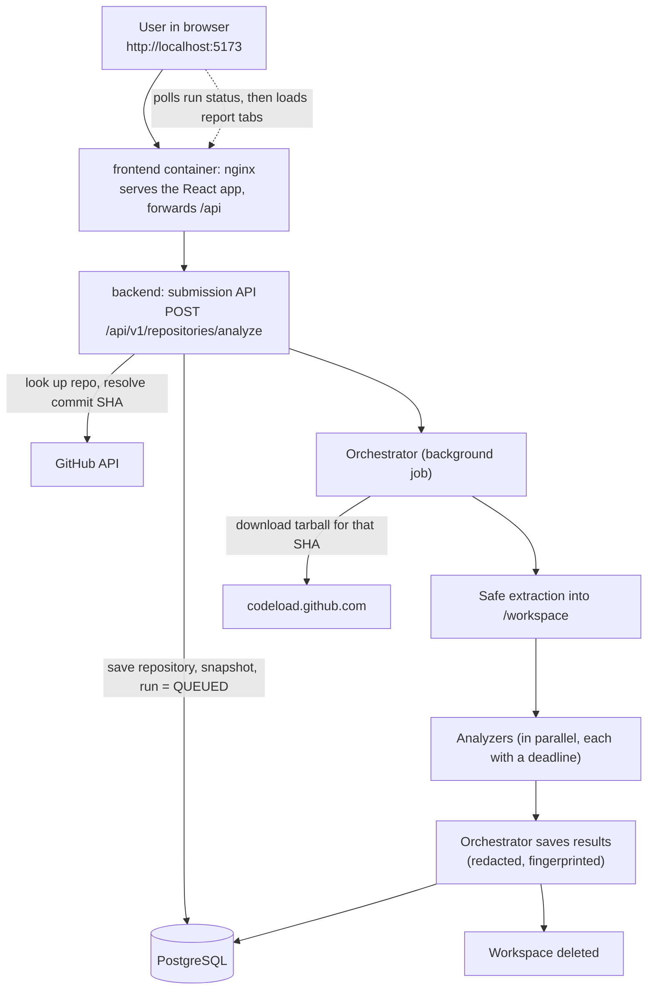
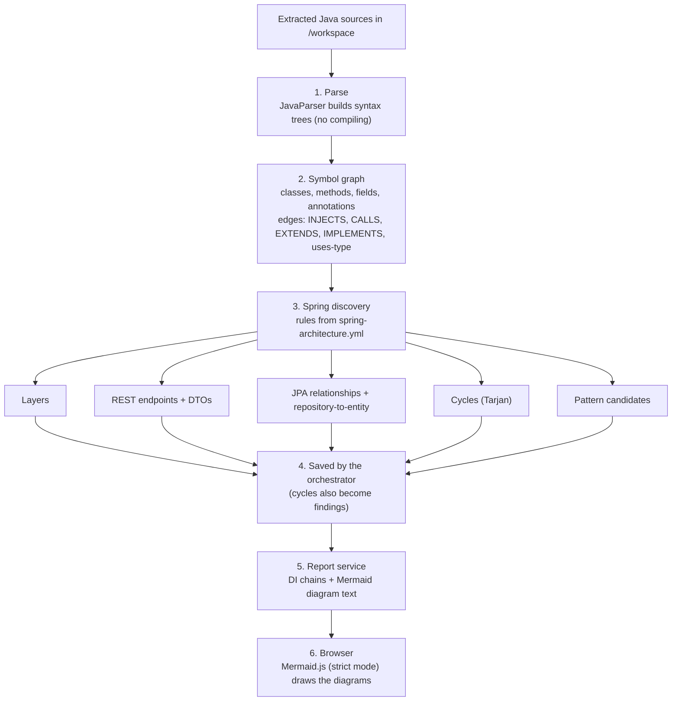
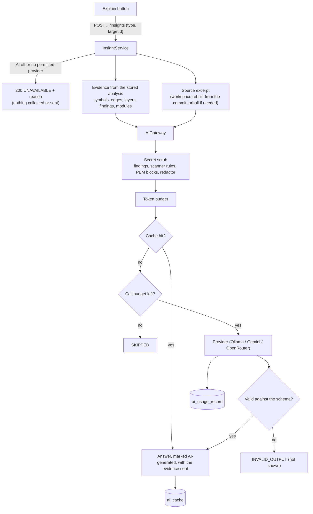
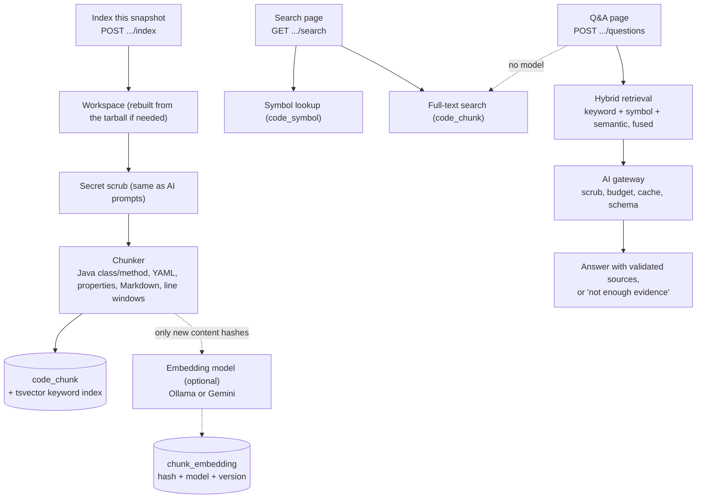

# MVP 1 and MVP 2 Overview: Steps and Flow

A short guide to what was built in MVP 1 (repository analysis) and MVP 2 (architecture intelligence), and how a repository flows through the platform. For full detail see [implementationPlan.md](implementationPlan.md), [architecture.md](architecture.md) and the completion reports for [MVP 1](mvp1-completion-report.md) and [MVP 2](mvp2-completion-report.md).

**In one sentence:** you give the platform a public GitHub URL; it downloads that exact commit, reads the code without ever running it, and produces an evidence-backed report of technologies, structure, dependencies, code quality, security, tests and (from MVP 2) architecture with diagrams.

**No AI is used in MVP 1 or MVP 2.** MVP 3 (section 4a) adds optional AI explanations on top, and MVP 4 (section 4b) code search (no AI) and optional Q&A; everything below still works with AI disabled. Every result comes from parsers and fixed, data-driven rules, so the same commit always gives the same report, and every statement points to its evidence (file, line, annotation). AI arrives in MVP 3 as an optional add-on that only explains what MVP 1 and 2 discovered.

---

## 1. MVP 1 steps: Basic GitHub Repository Analyzer

| Step | Title | One-liner |
|---|---|---|
| 1.1 | Database schema | Tables for repositories, commit snapshots, analysis runs, analyzer executions, files, findings, dependencies, tests and coverage. |
| 1.2 | JPA entities and repositories | Java classes mapping those tables, plus Spring Data repositories to read and write them. |
| 1.3 | GitHub API client | Talks to GitHub to look up a repository, resolve a branch to an exact commit, and download its archive, with rate-limit handling and token redaction. |
| 1.4 | Repository submission API | `POST /api/v1/repositories/analyze`: validates the URL, resolves the commit up front, reuses an earlier result for the same commit, or forces a rescan. |
| 1.5 | Snapshot workspace and ingestion | Downloads the commit's tarball and extracts it safely into a per-snapshot workspace (size, file-count and path-traversal limits; no links or devices). |
| 1.6 | Analyzer SPI, registry and capability matrix | A plug-in contract for analyzers, a registry that picks the ones that apply, and a matrix that honestly says what was and was not analyzed per technology. |
| 1.7 | Analysis orchestrator and run status API | Runs the analyzers in the background with time limits, cancellation and isolation (one failing analyzer never erases the others), saves results, and reports progress. |
| 1.8 | Generic analyzers | Work for every repository: language breakdown, technology detection from manifests, structure (modules, entry points, sizes) and test-file discovery. |
| 1.9 | Consolidated report API | One commit-scoped report endpoint combining technologies, structure, capability matrix, section summaries and limitations. |
| 1.10 | Frontend vertical slice | First working UI: add a repository, watch progress, list repositories, see the overview. |
| 1.11 | Java pack: Spring detection and Maven dependencies | Detects Spring Boot, Java version and databases with JavaParser, and lists Maven dependencies (versions from remote parents/BOMs labelled as unresolved). |
| 1.12 | Dependency vulnerability source | Optional OSV.dev lookup for known vulnerabilities; off by default, so dependencies show "Not checked" rather than "safe". |
| 1.13 | Code quality analyzer | Runs PMD with a project ruleset on Java code and stores findings with file, line and evidence. |
| 1.14 | Security analyzers | A secret scanner for every repository (values always redacted) plus Semgrep with bundled Java rules and honest coverage reporting. |
| 1.15 | Test analyzer and JaCoCo ingestion | Lists Java test classes and methods, and reads coverage only from a committed JaCoCo report (never shows 0% when there is no report). |
| 1.16 | Full report dashboard | Tabs for Overview, Dependencies, Code Quality, Security and Tests & Coverage, with filters, snapshot selector and finding details. |
| 1.17 | Integration and security testing | End-to-end tests for Java and non-Java repositories, malicious archives, SSRF, secret leakage, analyzer failure and running with AI disabled. |
| 1.18 | Documentation and completion report | README, OpenAPI annotations, `.env.example`, package-boundary test and the MVP 1 completion report. |
| 1.19 | Docker Compose | One command (`docker compose up --build`) runs PostgreSQL, the backend (with Semgrep included) and the nginx-served frontend locally. |

## 2. MVP 2 steps: Architecture Intelligence

| Step | Title | One-liner |
|---|---|---|
| 2.1 | Architecture database schema | New tables for code symbols, dependency edges, REST endpoints, layer assignments, module dependencies, JPA relationships and design-pattern candidates. |
| 2.2 | Symbol and edge extraction | Parses Java with JavaParser into classes, methods and fields, and records who injects, calls, extends or uses whom; library types are marked "unresolved", never guessed. |
| 2.3 | Spring architecture discovery | Works out controllers, services, repositories and entities, REST endpoints with request/response types, JPA relationships, DI chains, dependency cycles and pattern candidates. |
| 2.4 | Diagram generation | Builds the architecture report and turns it into Mermaid diagrams (layers, modules, API flow, entity relationships), with escaped labels and size caps; served at `GET .../snapshots/{snapshotId}/architecture`. |
| 2.5 | Architecture frontend | An Architecture tab with diagrams (Mermaid in strict mode), layer lists, endpoint table, entities, DI chains, cycle warnings and patterns; "Not supported" for non-Java repositories. |
| 2.6 | Integration testing | End-to-end checks on Spring Boot and multi-module fixtures and a non-Java fixture, golden diagram files, docs and the MVP 2 completion report. |

---

## 3. End-to-end flow



Step by step:

1. **Submit.** You paste a public GitHub URL and press Analyze. The backend checks the URL strictly (it never fetches a user-supplied URL directly), asks GitHub for the repository and resolves the branch to an exact commit SHA.
2. **Reuse or queue.** If that commit was already analyzed with the same analyzers, the earlier result is reused; otherwise (or with *Force full rescan*) a run is saved as `QUEUED`.
3. **Ingest.** A background job downloads the archive of that exact commit and extracts it into a temporary workspace, enforcing size and file limits and rejecting unsafe archive entries.
4. **Analyze.** Applicable analyzers run in parallel, each with a time budget. They only read files; repository code is never compiled or executed. Analyzers return results and never write to the database themselves.
5. **Save.** The orchestrator redacts secrets, fingerprints findings and stores everything scoped to that one snapshot (commit). A failed analyzer is recorded as failed; the others' results are kept.
6. **Clean up.** The extracted workspace is deleted.
7. **Report.** The UI polls the run status, then loads the report: Overview, Dependencies, Code Quality, Security, Tests & Coverage and, for Java/Spring projects, Architecture. The capability matrix states what was not analyzed and why.

### Which analyzers run

| Analyzer | Category | Runs for | MVP |
|---|---|---|---|
| Language detector, manifest technology detector | Technology | All repositories | 1 |
| Structure analyzer | Structure | All repositories | 1 |
| Secret scanner | Security | All repositories | 1 |
| Test-file discovery | Tests | All repositories | 1 |
| npm dependency analyzer | Dependencies | Repositories with `package.json` | 1 |
| Java/Spring technology detector | Technology | Java | 1 |
| Maven dependency analyzer (+ optional OSV lookup) | Dependencies | Maven | 1 |
| Java code analyzer (PMD) | Code quality | Java | 1 |
| Semgrep security analyzer | Security | Java (when Semgrep is installed; always in Docker) | 1 |
| Java test analyzer (+ JaCoCo) | Tests | Java | 1 |
| Spring architecture analyzer | Architecture | Java / Spring Boot | 2 |

## 4. How the architecture is generated (MVP 2)



1. **Parse.** Every production `.java` file is parsed into a syntax tree. Nothing is compiled or run.
2. **Build the symbol graph.** Classes, interfaces, records, methods and fields are recorded with their annotations, and relationships between them become edges: injection (constructor/field, `@Autowired`, Lombok `@RequiredArgsConstructor`), method calls where the receiver's type is known, inheritance and type usage. There is no classpath, so a type from a library is kept as an **unresolved** edge with its imported name; ambiguous names are marked **ambiguous**.
3. **Discover the Spring architecture** using rules from [spring-architecture.yml](../backend/src/main/resources/architecture/spring-architecture.yml) (data, not code):
   - **Layers:** `@RestController`/`@Controller` → controller, `@Service` → service, `@Repository` or a Spring Data interface → repository, `@Entity` → entity, `@Configuration` → configuration; endpoint request/response types → DTO; package names (`service`, `repository`, ...) only as a fallback.
   - **Endpoints:** class-level and method-level mappings are combined (`@RequestMapping("/owners")` + `@GetMapping("/{id}")` → `GET /owners/{id}`), with request types from `@RequestBody` and response types unwrapped from `ResponseEntity<T>`.
   - **JPA:** `@OneToMany`, `@ManyToOne`, `@OneToOne`, `@ManyToMany`, and which entity each repository manages (`JpaRepository<Owner, Integer>` → `Owner`).
   - **Cycles:** Tarjan's algorithm finds loops in injection and type-usage edges (normal two-way JPA relationships are not reported).
   - **Patterns:** judged by structure, never by names. Strategy (an interface with 2+ implementations injected as a list or map), Factory (a method creating different implementations in branches), Adapter (a class implementing an interface by delegating to a wrapped object).
4. **Save.** The orchestrator stores everything for that snapshot; dependency cycles are also stored as findings.
5. **Report.** `GET /api/v1/repositories/{repositoryId}/snapshots/{snapshotId}/architecture` assembles layers, endpoints, entities, controller → service → repository → entity chains, cycles, patterns and limitations, and generates Mermaid diagram text: names are escaped (repository text is untrusted) and large diagrams are capped with a note.
6. **Draw.** The Architecture tab gives the Mermaid text to Mermaid.js in strict mode, which draws the SVG diagrams in the browser.

**Confidence labels:**

| Label | Meaning | Example |
|---|---|---|
| DETECTED | Proven by the code | `@RestController`; an interface extending `JpaRepository` |
| LIKELY | Strong signal, not proof | Class in a `service` package; type used as an endpoint request body |
| POSSIBLE | Weak hint | Plain `@Component`; a design-pattern candidate |

**Not analyzed (shown as limitations):** library code (no classpath), reflection and runtime proxies, `@Bean` factory methods and XML wiring, Gradle modules, functional (router) endpoints, request mappings on interfaces, and calls on chained expressions.

## 4a. MVP 3 steps: AI-Powered Code Insights (optional)

| Step | Title | One-liner |
|---|---|---|
| 3.1 | Provider abstraction | `AIModelService` with request, response, capability and health types, and a router that picks the preferred, feature-routed or default provider and only permitted fallbacks (a hosted provider needs an acknowledged data handling). |
| 3.2 | Provider implementations | Ollama, Gemini and OpenRouter adapters behind one bounded HTTP helper (allowlist, no redirects, timeout, at most one retry on connection errors and 5xx, never on 429); all off by default. |
| 3.3 | Guardrails, usage and cache | `AIGateway`: enabled check, routing, secret scrub, token budget, cache, per-run call budget, schema validation, usage record for every call; `ai_usage_record` and `ai_cache` tables; providers and usage endpoints. |
| 3.4 | Templates and insight features | Six versioned prompt templates, bounded evidence from the MVP 1/2 analysis plus source excerpts, and `POST .../insights` for classes, methods, findings, refactorings, modules and technical debt. |
| 3.5 | AI insights frontend | Explain buttons on findings, classes and methods, debt and module summaries, Markdown without raw HTML, evidence links, and an AI settings page with providers, limits, preferred provider and usage. |



AI only explains what the deterministic analysis found: it never changes a finding, a count or a status. Every answer says which provider and model wrote it, which prompt version was used and exactly which evidence was sent.

### 4a.1 MVP 3 for developers: workflow, tools, data, decisions and calculations

Full detail: [mvp3-completion-report.md](mvp3-completion-report.md). Everything here is switched off by default (`AI_ENABLED=false`); the app, tests and CI run without any AI.

**Workflow of one AI call** (`POST /api/v1/repositories/{repositoryId}/snapshots/{snapshotId}/insights`)

1. **Scope.** `InsightEvidenceBuilder.scope` resolves the snapshot like the report endpoints do (404 unless it belongs to the repository; latest completed run) and validates the target (a symbol, finding or module of that run).
2. **Evidence plan.** A TARGET block, source ranges, DECLARATION blocks of directly related types (at most 6, in the order EXTENDS, IMPLEMENTS, INJECTS, FIELD_TYPE, CALLS, PARAM_TYPE, RETURN_TYPE), FINDINGS blocks and limitations. Everything is sorted, so the same commit gives the same prompt and the same cache key.
3. **Routing.** The router picks a permitted, healthy provider. If none exists the answer is `200 UNAVAILABLE` with the reason, and nothing else happens (no download, no usage row).
4. **Source.** Line ranges come from the workspace; if it was deleted after the analysis (the default), it is rebuilt once from the commit tarball with the ingestion limits.
5. **Gateway guardrails, in this order:** enabled check, route, secret scrub, trim to the token budget, cache lookup, per-run call budget, provider call, schema validation, drop evidence references that name no block, redact the answer's strings, write a usage row, store in the cache.
6. **Answer.** The DTO carries the answer, `aiGenerated`, provider, model, prompt version, cache and fallback flags and every evidence block as sent (with GitHub permalinks). Failures are statuses, never errors: `UNAVAILABLE`, `SKIPPED`, `RATE_LIMITED`, `TIMEOUT`, `INVALID_OUTPUT`.

**Tools and technology added in MVP 3**

| Area | Choice | Why |
|---|---|---|
| Providers | Ollama (local), Gemini and OpenRouter (hosted), behind one `AIModelService` interface | Local-first with optional hosted models; adding a provider is one class plus settings |
| HTTP | JDK HTTP client wrapped in `ProviderHttp`: base-URL allowlist, https for hosted, `Redirect.NEVER`, 4 MB body cap, timeout per attempt, retries only for connection errors and 5xx | A model server is an outbound call to an untrusted party |
| Output control | networknt json-schema-validator 3.0.8 (draft 2020-12) | Every answer must match the template's schema before it is shown |
| Prompts | Six versioned YAML templates (`ai/prompt/<feature>.v1.yml`) | The version is part of the cache key and the usage rows |
| Storage | Flyway `V6__ai_usage_and_cache.sql`: `ai_usage_record`, `ai_cache` | Accounting and answer reuse, in the same PostgreSQL |
| Frontend | react-markdown with raw HTML, images and links disabled | Model text is untrusted |
| Gemini auth | Key in the `x-goog-api-key` header, never in the URL | Keys stay out of logs and URLs |

**Considerations taken**

- **Privacy and consent:** every hosted provider needs an explicit data-handling acknowledgement (also as a default, not only as a fallback), and hosted processing is for public repositories only unless configured otherwise. Keys come only from the environment, are never returned by the API (`apiKeyConfigured` is a boolean) and never printed.
- **Secrets before prompts:** four layers withhold secrets before anything is hashed or sent: stored secret-finding regions, the secret scanner's rules, whole PEM private-key blocks and the redactor. A security review found a private-key leak; it was fixed in `833f33c` with 9 tests, five of which failed against the old scrubber.
- **Untrusted text everywhere:** repository text goes into delimited data blocks (`<<<`/`>>>` neutralised), never into instructions; answers are schema-validated and redacted; the UI renders them without HTML.
- **Honest numbers:** provider-reported token counts stay null when the provider does not report them; the local estimate is stored separately and labelled `ESTIMATED`; cost is only calculated when both prices are configured.
- **Isolation:** the orchestrator, analyzers and reports must not import `ai.*` (package-boundary test); a failing provider never breaks the rest of the app.
- **Single instance:** the in-flight call reservation is in memory, so the call budget assumes one backend instance.

**Decisions taken** (short form of the ADRs in the completion report)

| Decision | Reason |
|---|---|
| Cache lookup before the call budget | A cache hit costs no provider call, so refusing it after the budget is used up helps nobody |
| Retry only connection errors and 5xx, never timeouts or 4xx | A slow model stays slow, and two full timeouts would approach nginx's 120 s proxy timeout |
| Gemini JSON mode plus our own validation, not `responseSchema` | Gemini's schema dialect is a subset; our schemas are JSON Schema 2020-12 and are validated anyway |
| Rebuild the source workspace from the immutable tarball | Per-file GitHub API calls were ruled out earlier; one request per snapshot per sweep interval |
| Preferred provider stored per browser | The server still applies every permission rule; a server-side per-repository setting is a recommendation |
| Gemini `thinkingLevel` (default `low`) plus a 2,048-token allowance | Thinking tokens count against `maxOutputTokens`; with a 1,400-token template limit the JSON was cut off (see data below) |
| Timeout 45 s to 60 s, limits settable from the environment | Hosted models were slow on a free key; the worst case stays inside nginx's 120 s |
| Local model: `gemini-3.5-flash-lite`, `AI_MAX_CALLS_PER_ANALYSIS=5` | Free-tier daily quota (see below) |

**AI usage data gathered** (real Gemini free tier, 2026-11-21 and 2026-11-22, spring-petclinic unless noted)

| Observation | Value |
|---|---|
| `gemini-3.8-flash` | No answer within 45 s, even for a one-word prompt (overloaded); `3.7-flash` answered 503, `2.5-flash` 404 |
| `gemini-3.5-flash` | Answered as `gemini-3.6-flash` (Google routes it); the usage row and the UI show the answering model |
| Failure before the fix | Tech-debt summary returned `INVALID_OUTPUT` with 54 visible tokens; a direct call showed 925 to 981 thinking tokens against the 1,400-token limit |
| After thinking level `low` | The same prompt took about 6 s instead of 10 to 33 s; tech-debt summary through the app: 3.1 s provider latency, 1,104 input and 437 output tokens; the repeat came from the cache in under a second |
| Class refactoring suggestion (`3.6-flash`) | 4,233 input and 398 output tokens, 10.7 s |
| `gemini-3.5-flash-lite` (another analysed repository, tech-debt summary) | 1,163 input and 350 output tokens, 2.3 s provider latency, about 4 s end to end |
| Stand-in Ollama (no real model) | First class explanation 17.6 s including a workspace rebuild, repeat 0.6 s from the cache; the 11th distinct call was `SKIPPED` at a budget of 10 |
| Free-tier limits (AI Studio, per project) | `3.6 Flash`: 5 requests per minute, 250K tokens per minute, 20 per day. `3.8 Flash`: 5 / 250K / 20. `3.5 Flash Lite`: 15 / 250K / 500. The daily count resets at midnight Pacific time (1:30 pm IST) |
| Test results | Backend 704 tests locally (about 17.5 min on a loaded machine), 708 in CI (about 77 s for `verify` on Linux), 0 failures; frontend 134 tests |

**Calculations**

| Calculation | Result |
|---|---|
| Token estimate (`ai.token-estimate.chars-per-token = 4`) | A class prompt of about 12.4 k characters is about 3.1 k estimated tokens |
| Prompt bound | `min(max-input-tokens = 12,000, model context - max output)`, applied after scrubbing |
| Output limit sent to Gemini | `min(template limit, AI_MAX_OUTPUT_TOKENS = 1500)` plus 2,048 for thinking (for example a 300-token answer limit is sent as 2,348) |
| Output tokens recorded for Gemini | `candidatesTokenCount + thoughtsTokenCount` (thinking is billed as output) |
| Worst-case wait | One attempt 60 s, a 0.5 s backoff and a fast 5xx stay inside nginx's 120 s; two full 60 s attempts happen only if the first ends in a 5xx after nearly 60 s |
| Cache key | SHA-256 of provider, model, prompt version, commit SHA and the scrubbed prompt; TTL 7 days; only validated answers are stored |
| Analyses per day | Daily quota divided by calls per analysis. `3.6 Flash`: 20 / 10 = 2 fully used (about 5 typical at 4 calls). `3.5 Flash Lite`: 500 / 10 = 50 fully used, 500 / 5 = 100 with the cap of 5, about 125 typical at 4 calls. Cached answers cost nothing |
| Cost | Not calculated: no prices are configured, so the cost columns are null |

## 4b. MVP 4 steps: Repository search and Q&A (search needs no AI)

| Step | Title | One-liner |
|---|---|---|
| 4.1 | Chunking, keyword index and embeddings | An optional per-snapshot index job splits the commit's text files (secrets withheld first) into Java class and method chunks, YAML/properties sections, Markdown sections or labelled line windows, stores them with a PostgreSQL full-text index, and adds embeddings keyed by content hash, model and model version when an embedding model is configured. |
| 4.2 | Deterministic search and hybrid retrieval | `GET .../search`: exact symbol lookup in the MVP 2 symbol graph and full-text search with language/module/file-type filters, no model involved; hybrid retrieval fuses keyword, symbol and semantic (pgvector or in-process cosine) results with reciprocal rank fusion; a retrieval evaluation set measures recall@5 and MRR. |
| 4.3 | Q&A service and API | `POST .../questions`: retrieval, a bounded prompt through the AI gateway (all MVP 3 guardrails, own per-snapshot budget), and an answer whose citations are checked against the chunks that were sent; "not enough evidence" is said explicitly; without a model, deterministic search results are returned instead. |
| 4.4 | Search and Q&A frontend | A Search page (always available) and a Q&A page with sources, follow-ups, the AI-generated badge and clear "AI unavailable" / "no embedding provider" states, both with the index status and an "Index this snapshot" button. |



Search always works without AI: symbol search right after the analysis, text search once the snapshot is indexed. Every query is bound to one snapshot of one repository in the storage layer, so no answer can draw on another commit or repository. A Q&A answer is shown as grounded only when it cites at least one retrieved chunk that was actually sent; every citation links to GitHub at the exact commit.

---

## 5. Tools

| Area | Tool | Used for | Since |
|---|---|---|---|
| Backend | Java 25, Spring Boot 4.1 | REST API, background jobs | MVP 1 |
| Backend | PostgreSQL 16, Flyway, Spring Data JPA | Storage, schema migrations, data access | MVP 1 |
| Backend | springdoc-openapi | Swagger UI at `/swagger-ui.html` | MVP 1 |
| Backend | Apache Commons Compress | Safe archive extraction | MVP 1 |
| Analysis | JavaParser | Java parsing: Spring detection and tests (MVP 1), symbol graph and architecture (MVP 2) | MVP 1, core of MVP 2 |
| Analysis | PMD 7 | Java code quality | MVP 1 |
| Analysis | Semgrep 1.186 | Security rules (bundled, external process, included in the Docker image) | MVP 1 |
| Analysis | maven-model | Reading `pom.xml`: dependencies (MVP 1) and module diagram (MVP 2) | MVP 1 |
| Analysis | YAML rule files | Technology signatures, secret patterns, Spring architecture rules | MVP 1, MVP 2 |
| Analysis | OSV.dev (optional, off) | Known-vulnerability lookup | MVP 1 |
| External | GitHub REST API, codeload | Commit resolution, archive download | MVP 1 |
| Frontend | React 19, TypeScript, Vite, Tailwind CSS | Dashboard UI | MVP 1 |
| Frontend | TanStack Query, React Router | Data fetching and polling, page routes | MVP 1 |
| Frontend | Mermaid 11.17.2 | Architecture diagrams (strict mode, loaded on demand) | MVP 2 |
| Runtime | Docker, Docker Compose, nginx | One-command local run; nginx serves the UI, proxies `/api`, sets security headers | MVP 1 (Step 1.19) |
| Testing | JUnit 5, embedded PostgreSQL (zonky), WireMock | Backend tests on real PostgreSQL without Docker; fake GitHub | MVP 1 |
| Testing | Vitest, Testing Library, MSW | Frontend tests with a mocked API | MVP 1 |
| Quality | Spotless, ESLint, TypeScript | Formatting, lint and type checks | MVP 1 |
| AI (optional) | Ollama, Gemini, OpenRouter | Explanations behind `AIModelService`; all off by default | MVP 3 |
| AI (optional) | networknt json-schema-validator 3.0.8 | Validates every structured AI answer | MVP 3 |
| Search | PostgreSQL full-text search (`tsvector`, `simple` configuration) | Keyword index of code chunks | MVP 4 |
| Search (optional) | pgvector 0.8.7 (in the Docker database image) | Semantic search; without it vectors are ranked in the application | MVP 4 |
| AI (optional) | Ollama `/api/embed`, Gemini `batchEmbedContents` | Embeddings, separate from the chat model; off by default | MVP 4 |
| Frontend | react-markdown 10.1.0 | AI text as Markdown, without raw HTML, images or links | MVP 3 |
| CI | GitHub Actions | Backend, frontend and Docker image jobs on every push to `main` | MVP 1 |

## 6. Quick start

```sh
cp .env.example .env          # optional: set GITHUB_TOKEN (see implementationPlan.md, Appendix C.1)
docker compose up --build     # UI: http://localhost:5173  API: http://localhost:8080
```

Then choose **Add Repository**, paste a public GitHub URL (for example `https://github.com/spring-projects/spring-petclinic`) and open the report; Java/Spring repositories also get the **Architecture** tab. See the [README](../README.md) for running without Docker, configuration and troubleshooting.
