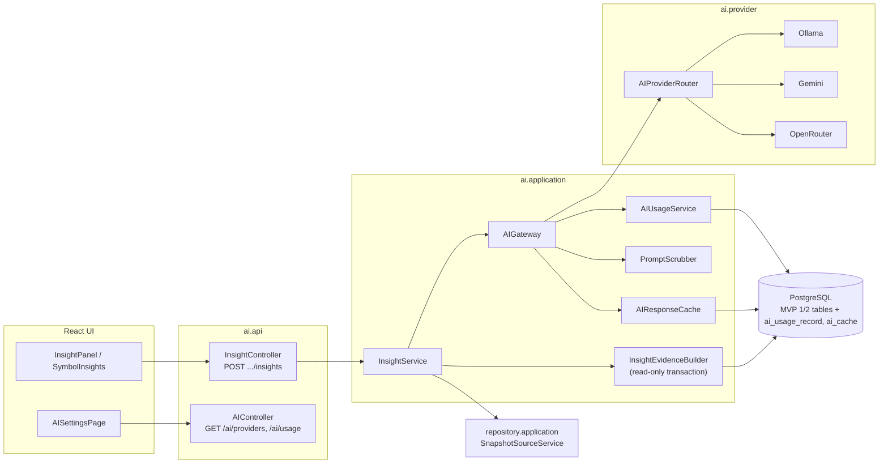

# MVP 3 Completion Report: AI-Powered Code Insights

**Date:** 2026-11-22
**Plan:** [implementationPlan.md](implementationPlan.md), Steps 3.1 to 3.5
**Branch:** `mvp3` (not merged, not pushed)
**Result:** All five steps implemented and tested. Backend `mvnw clean verify`: 704 tests, 0 failures, 2 skipped (the existing Semgrep-tagged tests); about 17.5 min. Frontend: 134 tests, lint, typecheck and build green. All ten MVP 3 exit criteria are ticked; the AI path was verified with WireMock in the tests and with a stand-in for the Ollama API in the Docker stack, **not with a real model** (none was available on the machine; see section 8).

## 1. Summary

| Item | Value |
|---|---|
| Commits | `85ad5da` step 3.1, `c8566c1` step 3.2, `110459b` step 3.3, `971d5df` step 3.4, `c1dcfa0` step 3.5, `e73e530` boundary and scrubber tests, `833f33c` private-key scrubbing fix, `5a07d49` load-tolerant adapter test timeouts, then this documentation commit |
| Backend tests | 704 tests, 0 failures, 2 skipped (the existing Semgrep-tagged tests); about 17.5 min (MVP 2 ended at 619; +85 new) |
| Frontend tests | 134 (MVP 2 ended at 124; +10) |
| Exit criteria | 10 of 10 ticked; "explanations available" verified with fakes only |
| Left | A real-model trial, hosted providers live, and a browser look at the new UI (section 8) |

## 2. Steps executed

| Step | What was built | Tests added | Result |
|---|---|---|---|
| 3.1 | `ai.provider`: `AIModelService`, `AIRequest`, `AIResponse` (nullable tokens + `UsageSource`), `AIStatus`, `AIProviderCapabilities`, `ProviderHealth`, `DataHandling`, `AIProperties` (`ai.*`), `AIProviderRouter`, `ProviderAvailability` (rate-limit cooldown, cached health) | `AIProviderRouterTests` (12) | Green |
| 3.2 | `ProviderHttp` (allowlist, no redirects, per-attempt timeout, capped body, retries only for connection errors and 5xx), `ProviderSupport`, `OllamaAIModelService`, `GeminiAIModelService`, `OpenRouterAIModelService`, conditional on `ai.enabled` and the provider flag; config in `application.yml`, `compose.yaml`, `.env.example` | `ProviderAdapterTests` (24, WireMock), `AIProviderWiringTests` (4); `BoundaryE2eTests` AI-disabled check updated | Green (659 tests) |
| 3.3 | `AIGateway` (guardrail sequence), `PromptScrubber`, `TokenEstimator`, `StructuredOutputValidator` (networknt 3.0.8), `AIResponseCache`, `AIUsageService`, `AIStatusService`; Flyway `V6__ai_usage_and_cache.sql`; `GET /api/v1/ai/providers`, `GET /api/v1/ai/usage` | `AIGatewayTests` (15, embedded PostgreSQL + scripted provider) | Green except the OpenAPI path count (fixed in 3.4, see issue 2) |
| 3.4 | Six templates `ai/prompt/*.v1.yml`, `PromptTemplateRegistry`, `PromptAssembler`, `InsightEvidenceBuilder`, `InsightService`, `InsightController`, `SnapshotSourceService` + `IngestionService.restoreWorkspace`, `SymbolQueryService` + `GET .../symbols/{symbolId}`, `symbolId` on layer classes | `PromptTemplateTests` (6), `InsightE2eTests` (6, WireMock Ollama), `AIDisabledE2eTests` (2); OpenAPI test extended | Green (688 tests) |
| 3.5 | `InsightPanel`, `InsightResult`, `MarkdownText` (react-markdown, no raw HTML/images/links), `AIGeneratedBadge`, `SymbolInsights`, `ModuleSummaryPanel`, `AIAvailabilityNote`, `AISettingsPage` (`/settings/ai`), sidebar link, preferred provider in `localStorage` | `InsightPanel.test.tsx` (6), `SymbolInsights.test.tsx` (2), `AISettingsPage.test.tsx` (2); `ArchitectureView.test` wrapped in a query client | Green (134 tests) |
| extra | Package boundaries for AI; scrubber layers; PEM private-key fix; timeout hardening | `PackageBoundaryTests` (+2), `PromptScrubberTests` (5), `PrivateKeyScrubbingTests` (9) | Green |

## 3. Design walkthrough

### 3.1 Big picture

AI is a read-only layer on top of the stored MVP 1/2 analysis. It never runs during an analysis, never writes findings and never changes a status. The orchestrator, analyzers and reports do not import `ai.*` (boundary test).



### 3.2 Request and data flow (`POST /api/v1/repositories/{repositoryId}/snapshots/{snapshotId}/insights`)

1. `InsightEvidenceBuilder.scope` resolves the snapshot exactly like the report endpoints (404 unless it belongs to the repository; the latest completed run) and returns plain values.
2. `InsightEvidenceBuilder.plan` validates the target (symbol, finding or module of that run: 404; wrong kind: 400) and builds the evidence plan: a TARGET block, the source ranges to read, DECLARATION blocks of directly related types (resolved MVP 2 edges in the order EXTENDS, IMPLEMENTS, INJECTS, FIELD_TYPE, CALLS, PARAM_TYPE, RETURN_TYPE; at most 6), FINDINGS blocks, limitations. Everything is sorted, so the same commit gives the same prompt and cache key.
3. `InsightService` asks the router whether a permitted, healthy provider exists. If not: `200` with `status: UNAVAILABLE` and the reason; nothing else happens (no download, no usage row).
4. Source ranges are read by `SnapshotSourceService` from the workspace; if it was deleted after the analysis (the default), it is rebuilt once from the commit's tarball with the ingestion limits.
5. `AIGateway.execute` applies the guardrails: renumber blocks E1..En; secret scrub; trim to `min(max-input-tokens, context - max-output)`; build system prompt (fixed guard + template + schema) and user prompt (task + data blocks); cache lookup; call budget; provider call; schema validation; drop evidence references that name no block (warning); redact strings in the answer; usage record; cache store.
6. The DTO carries the answer, `aiGenerated`, provider, model, prompt version, cache and fallback flags, every evidence block as sent (with GitHub permalinks), withheld-line count, warnings and limitations.

### 3.3 Components

| Class | Responsibility |
|---|---|
| `ai.provider.AIModelService` | `generate`, `getCapabilities`, `health`, `getProviderId`, `dataHandling`. Never throws for provider failures |
| `ai.provider.AIProviderRouter` | `route(RoutingContext)`: preferred → feature route → default, then `fallback-providers`; refuses hosted providers without acknowledgement or when the repository policy forbids hosted processing; skips rate-limited and unhealthy providers; returns reasons |
| `ai.provider.ProviderAvailability` | Rate-limit cooldown per provider (reset time from the API or `rate-limit-cooldown`), health cache (`health-cache-ttl`) |
| `ai.provider.ProviderHttp` | Base-URL allowlist and https check, `Redirect.NEVER`, HTTP/1.1, timeout per attempt, 4 MB body cap, retries ≤ `max-retries` for connection errors and 5xx only |
| `ai.provider.{ollama,gemini,openrouter}` | Request/response mapping, auth (Gemini `x-goog-api-key`, OpenRouter `Bearer`), usage mapping, error mapping (404 → UNAVAILABLE, 429/402 → RATE_LIMITED with reset, 4xx → ERROR without body), runtime capabilities (Ollama model list, Gemini `inputTokenLimit`, OpenRouter `context_length` and `supported_parameters`) |
| `ai.application.AIGateway` | The guardrail sequence; in-flight budget reservation per run |
| `ai.application.PromptScrubber` | Withholds whole PEM private-key blocks (found on the original lines), lines in stored secret-finding regions (SOURCE blocks only), lines matched by the secret scanner's rules (`GenericSecretScanAnalyzer.secretLines`), over-long lines; then `SecretRedactor` |
| `ai.application.StructuredOutputValidator` | JSON (optionally in one code fence) → draft 2020-12 validation |
| `ai.application.AIResponseCache` / `AIUsageService` | Cache by sha256 key with TTL and hourly purge; one usage row per call and cache hit with reported vs estimated tokens and cost only with configured prices |
| `ai.prompt.PromptTemplateRegistry` / `PromptAssembler` | Load and validate templates (file name must match id and version); guard, data blocks, delimiter neutralisation |
| `ai.application.InsightEvidenceBuilder` / `InsightService` | Evidence plans per insight type; orchestration |
| `repository.application.SnapshotSourceService` | Bounded line ranges from the workspace, rebuilding it once per snapshot under a lock |
| `architecture.application.SymbolQueryService` | `GET .../symbols/{symbolId}`: a type with its members |

### 3.4 Data model (Flyway `V6__ai_usage_and_cache.sql`)

- `ai_usage_record`: provider, model, feature, prompt version, `repository_id`/`snapshot_id`/`run_id` (FKs with `ON DELETE SET NULL`, so accounting survives deleting a repository), status, `cache_hit`, provider-reported `input_tokens`/`output_tokens` (nullable), `estimated_input_tokens`/`estimated_output_tokens`, `usage_source`, `estimated_cost` + `cost_source` + `currency` (null without pricing), latency, `detail` (redacted, never a prompt or body). Index `(run_id, cache_hit)` serves the call budget.
- `ai_cache`: `cache_key` = sha256(provider, model, prompt version, commit SHA, sha256(system + user + schema)) computed after scrubbing; content, validated `structured` (jsonb), answered model, `expires_at`.

### 3.5 API

```http
POST /api/v1/repositories/{repositoryId}/snapshots/{snapshotId}/insights
{"type": "EXPLAIN_CLASS", "targetId": "ecef2922-...", "provider": null}

200 {"type":"EXPLAIN_CLASS","targetLabel":"OwnerController","status":"OK","aiGenerated":true,
     "explanation":"...markdown...","structured":{"summary":"...","keyPoints":[],"risks":[],"evidenceRefs":["E1"],"missingEvidence":[]},
     "provider":"ollama","model":"...","promptVersion":"explain-class.v1","fromCache":false,"fallback":false,"reason":null,
     "evidence":[{"id":"E2","kind":"SOURCE","filePath":"src/.../OwnerController.java","startLine":48,"endLine":188,
                  "sourceUrl":"https://github.com/.../blob/<sha>/...#L48-L188","truncated":false,"text":"..."}],
     "withheldLines":0,"warnings":[],"limitations":[],"commitSha":"500158f...","generatedAt":"..."}
200 {"status":"UNAVAILABLE","aiGenerated":false,"reason":"AI insights are unavailable: AI is disabled (ai.enabled=false).", ...}
200 {"status":"SKIPPED","reason":"AI call budget reached: at most 10 provider calls per analysis ..."}
```

Types and targets: `EXPLAIN_CLASS` (type symbol), `EXPLAIN_METHOD` (method/constructor symbol), `EXPLAIN_FINDING` (finding id), `SUGGEST_REFACTORING` (type or method symbol), `SUMMARIZE_MODULE` (module path, e.g. `.`), `TECH_DEBT_SUMMARY` (none). Also `GET .../snapshots/{snapshotId}/symbols/{symbolId}`, `GET /api/v1/ai/providers` (no keys; health, data handling, acknowledgement, capabilities, limits, feature routes) and `GET /api/v1/ai/usage?provider=&feature=&status=&repositoryId=&snapshotId=&cacheHit=&page=&size=`. The architecture report's `layers[].classes[]` gained `symbolId`.

### 3.6 Frontend

`components/ai/*`: `InsightPanel` (one action, `useInsight` mutation, disabled with the reason when `useAIProviders().available` is false), `InsightResult` (badge, provider line, Markdown summary, lists, evidence `<details>` with the scrubbed text and GitHub links only), `MarkdownText` (`skipHtml`, `img` and `a` unwrapped), `SymbolInsights` (per class: explain, refactor, methods from the symbol endpoint), `ModuleSummaryPanel` (Overview tab), technical-debt panel (Code Quality tab), finding detail "Explain this finding". `/settings/ai` (`AISettingsPage`) shows providers, limits, the preferred provider (`lib/aiPreference.ts`, `localStorage` with try/catch, only active and permitted providers) and the usage table (`est.` for estimates). The default MSW handler answers `/api/v1/ai/providers` with AI disabled.

### 3.7 Configuration and extension points

- All keys under `ai.*` (README "AI insights (optional)" and the configuration table); env vars in `.env.example` and `compose.yaml`, all off by default.
- **New template version:** add `ai/prompt/<feature>.v2.yml` (file name must equal `id.v<version>.yml`); the registry serves the highest version, and the version is part of the cache key and usage rows.
- **New insight type:** add an `InsightType` with its feature id, a template, and a `plan` branch in `InsightEvidenceBuilder`.
- **New provider:** a `ProviderSupport` subclass in `ai.provider.<id>` with `@ConditionalOnExpression("${ai.enabled:false} and ${ai.providers.<id>.enabled:false}")`, an entry in `ProviderCatalog`, settings under `ai.providers.<id>`; hosted ones return `DataHandling.HOSTED` and default to https.

### 3.8 Where to start reading

1. `backend/src/main/java/com/repointelligence/ai/application/AIGateway.java`
2. `.../ai/provider/AIProviderRouter.java`, `AIModelService.java`, `ProviderHttp.java`
3. `.../ai/application/PromptScrubber.java`, `.../ai/prompt/PromptAssembler.java`, `backend/src/main/resources/ai/prompt/explain-class.v1.yml`
4. `.../ai/application/InsightService.java`, `InsightEvidenceBuilder.java`
5. `.../ai/provider/ollama/OllamaAIModelService.java` (then Gemini, OpenRouter)
6. `frontend/src/components/ai/InsightPanel.tsx`, `InsightResult.tsx`, `frontend/src/pages/AISettingsPage.tsx`
7. Tests: `AIGatewayTests`, `InsightE2eTests`, `PrivateKeyScrubbingTests`, `ProviderAdapterTests`

## 4. Issues faced and how they were resolved

1. **MVP 1 boundary test rejected the router.** `BoundaryE2eTests.theWholeFlowWorksWithNoAiConfigurationOrBeansAtAll` asserted that no bean name contains `aiprovider`; `aiProviderRouter` now exists by design. Evidence: failure at line 94 in the step 3.1 verify. Fix: the test now asserts `ai.enabled=false`, no `AIModelService` bean and no provider-named bean (the stronger, intended property). Verified in the 3.2 verify (659 green).
2. **OpenAPI path count.** `ApiDocumentationAndHealthTests` expects an exact set of paths; the step 3.3 commit (`110459b`) added two and failed that test in its verify (674 run, 1 failure). Fixed in step 3.4 by listing all four MVP 3 paths (16). Verified in the 3.4 verify (688 green). The 3.3 commit on its own is therefore red for that one test.
3. **`LazyInitializationException` on the insight endpoint.** `InsightService` used `ReportService.scope()` outside a transaction and touched the lazy `TrackedRepository` (open-in-view is off). Evidence: stack trace in `AIDisabledE2eTests`. Fix: `InsightEvidenceBuilder.scope()` resolves inside its read-only transaction and returns plain values. Verified by the same tests.
4. **Health-cache TTL used the provider's clock.** Router test failed because `FakeModelService` stamped `Instant.now()`. Fix: `ProviderAvailability` stamps every result with its own clock.
5. **Private-key leak (security review, HIGH).** Lines were withheld one by one and `SecretRedactor` ran afterwards; with the BEGIN/END lines withheld its multi-line PEM pattern no longer matched, and excerpts starting or ending inside a block never contained both markers, so base64 body lines could reach the provider. Fix (`833f33c`): `PromptScrubber.privateKeyLines` finds key blocks on the original lines first (BEGIN..END, excerpt start..END, BEGIN..excerpt end, runs of two or more base64-only lines plus a short tail line), and a stored `private-key` finding now covers 120 lines after its marker. Verified by `PrivateKeyScrubbingTests` (full block, mid-block start, mid-block end, body only, Java string concatenation, tab-indented quoted lines, region coverage, no false positive on ordinary code); five of these failed against the previous scrubber before the fix was restored. While writing it, a second bug was caught: Java `"\s"` is a space escape, not the regex `\s`, so two patterns matched spaces only; fixed and covered by the tab test.
6. **Insight E2E fixtures.** The injection comment sat in Javadoc above the class, outside the parser's class range (so it was never in the excerpt), and an `...EXAMPLE...` AWS key was skipped by the scanner's placeholder allowlist (still masked by `SecretRedactor`). Both were test-fixture issues; the comment moved into the method and the key became non-placeholder. The Javadoc gap is recorded as a limitation and recommendation C.4.
7. **"Unresolved compilation problems" in a test run.** An Eclipse-compiled class appeared in `target/test-classes` (the IDE's Java language server builds into the same directory). Runs with `clean` and the separate verification worktree were unaffected.
8. **Flaky under load.** One full verify ran while Docker was building, the backend was starting (up to 360 s under that load) and an analysis was running: three existing timing tests in `AnalysisRunApiTests` and my own `ProviderAdapterTests.aServerErrorIsRetriedExactlyMaxRetriesTimes` (2 s timeout → TIMEOUT) failed. My test was fixed at the cause (`5a07d49`: 10 s for status tests; the timeout test keeps 1 s against a 6 s delay). The existing tests were not changed; the final verify on an idle machine is the reference (section 5).

## 5. Verification

- **Backend:** `./mvnw -B clean verify` on a clean worktree of `5a07d49`, machine otherwise idle: 704 tests, 0 failures, 2 skipped (the existing Semgrep-tagged tests); about 17.5 min.
- **Frontend:** `pnpm install --frozen-lockfile`, `lint`, `typecheck`, `test --run` (134 passed), `build` green.
- **Docker** (Docker Desktop 29.7.2, existing volumes kept, no `GITHUB_TOKEN`): `docker compose up --build -d`; Flyway applied `V6 - ai usage and cache` to the existing database; all three services healthy. One forced analysis of spring-petclinic (`500158f`) through nginx: `COMPLETED` in about 1 min 45 s; all seven report sections present; architecture identical to MVP 2 (25 types, 413 relationships, 17 endpoints, 23 layered classes, every class now with `symbolId`); symbol endpoint lists `OwnerController`'s methods.
- **AI disabled (default):** `/api/v1/ai/providers` says disabled with the reason; insight → `200 UNAVAILABLE`, no evidence, no usage row; `/settings/ai` and deep links served with the CSP and security headers unchanged.
- **AI enabled with a stand-in Ollama** (a small Python HTTP server in the session scratchpad answering `/api/tags` and `/api/chat` with schema-shaped fake JSON; backend recreated with `AI_ENABLED=true AI_PROVIDERS_OLLAMA_ENABLED=true OLLAMA_CHAT_MODEL=fake-model`, reaching it through `host.docker.internal`): all six insight types returned `OK` through nginx; the first class explanation took 17.6 s (including rebuilding the workspace from the tarball under load), the repeat 0.6 s from the cache; the prompt for `OwnerController` was about 12.4 k characters (~3.1 k estimated tokens) with the guard as system prompt; usage rows recorded reported tokens and the cache hit; the 11th distinct call returned `SKIPPED` (budget 10) while a cached answer was still served; no prompt text and no errors in the backend log. The backend was then recreated with the default (AI off) and the stand-in stopped.
- **Cross-MVP matrix:** app starts without AI, health, migrations on embedded PostgreSQL and on the existing Docker volume, Docker run, Java analysis, non-Java generic analysis (`AIDisabledE2eTests`/MVP 1 E2E), capability matrix, commit scoping (insight targets must belong to the snapshot's latest run; 404 otherwise), fault isolation, redaction (now including prompts), malicious archives, architecture diagrams (unchanged backend output; frontend tests) all still pass.

## 6. Decisions (ADR style)

1. **Cache before budget.** *Context:* plan order is budget → cache. *Options:* keep; swap. *Choice:* scrub → bound → cache → budget. *Evidence:* a cache hit costs no provider call; refusing it after the budget is used up helps nobody. *Consequences:* the prompt (including any source download) is built before the budget check, so an exhausted budget still costs a workspace rebuild once.
2. **Every hosted provider needs acknowledgement, not only fallbacks.** *Context:* plan requires acknowledgement for hosted fallback. *Choice:* also for a hosted default or preferred provider; hosted only for public repositories unless `allow-hosted-for-private-repositories`. *Evidence:* Problem §9.2 "default to no hosted AI processing until configured". *Consequences:* one more setting to enable Gemini/OpenRouter.
3. **Retry only connection errors and 5xx.** *Options:* retry timeouts too. *Choice:* never retry timeouts or 4xx. *Evidence:* a slow model stays slow; 45 s × 2 would approach nginx's 120 s proxy timeout. *Consequences:* worst case about 45 s + 0.5 s + 45 s only for 5xx/connection errors.
4. **Gemini uses JSON mode plus our own validation**, not `responseSchema`. *Evidence:* Gemini's schema dialect is an OpenAPI subset; our schemas are JSON Schema 2020-12 and validated anyway. OpenRouter gets `json_schema` only when its model list says the model supports it; Ollama gets the schema as `format`.
5. **Source from a rebuilt workspace.** *Options:* per-file GitHub content API (ruled out by ADR-09), retain workspaces longer, rebuild from the tarball. *Choice:* rebuild once from the immutable tarball, removed by the regular sweep. *Consequences:* one GitHub request per snapshot per sweep interval; with 60 requests/hour this matters without a token; `ai.source.allow-download=false` switches it off.
6. **Data blocks with neutralised delimiters, no placeholders in templates.** Repository text is never substituted into instructions; `<<<`/`>>>` inside data become `< < <`/`> > >`, control characters in paths are flattened. Deterministic, so caching still works.
7. **Evidence sent is returned.** The DTO includes each block's scrubbed text, so the UI can show exactly what the model saw (Problem §MVP 3 "copy evidence").
8. **Tokens:** provider-reported counts stay null when not reported (plan test); the local estimate is stored in separate columns and labelled `ESTIMATED`. Cost only with both prices configured, labelled `REPORTED_TOKENS` or `ESTIMATED_TOKENS`.
9. **Preferred provider per browser.** Stored in `localStorage` and sent with each request; the server still applies every permission rule. A server-side per-repository setting is recommended later (C.4).
10. **Markdown without links or images.** Model-produced links and images are unwrapped to text; evidence links come only from backend-built GitHub permalinks.

## 7. Considerations

- **Security:** keys only from the environment, never returned (`apiKeyConfigured` boolean) or printed (`ProviderSettings.toString`), Gemini key in a header not the URL; outbound allowlist per provider, https for hosted, no redirects; prompts are not logged; secrets withheld in four ways before hashing; answers schema-validated and their strings redacted; AI text rendered without HTML; insight targets scoped to the snapshot's latest run. Residual risks: pattern-based secret detection can miss unusual secrets; a model can still produce misleading text (it is labelled and evidence-linked).
- **Performance:** class prompt for petclinic `OwnerController` ~3.1 k estimated tokens; cached repeat 0.6 s; evidence collection loads one run's findings and the target's members and edges (module summary loads all symbols of the run, bounded by the MVP 2 caps). The first insight after the workspace was deleted pays one tarball download.
- **Reliability:** every provider failure becomes a status; usage-recording failures are logged and never turn an answer into an error; rate limits back off until the reset; the budget reservation is in memory (single instance).
- **Testing:** unit (router, adapters via WireMock, scrubber, templates), integration on embedded PostgreSQL (gateway), end to end (insights with WireMock Ollama, AI disabled), frontend (panels, Markdown safety, settings, flow from a finding). Gaps: no real model, no live Gemini/OpenRouter, no browser run of the new UI.

## 8. Not done, not verified, open items

- **Real model:** not tried. To check: install Ollama, `ollama pull <model>`, set `AI_ENABLED=true`, `AI_PROVIDERS_OLLAMA_ENABLED=true`, `OLLAMA_CHAT_MODEL=<model>` in `.env`, `docker compose up -d`, then explain a few petclinic classes and watch `/settings/ai` for `INVALID_OUTPUT` (Appendix C.3).
- **Gemini and OpenRouter live:** only WireMock. Endpoint shapes follow the providers' documented REST APIs at the time of writing; verify current terms first. OpenRouter strict `json_schema` may reject `pattern`/`maxLength` for some models (`ai.providers.openrouter.structured-output=false`).
- **Browser look (human):** open http://localhost:5173 and check (a) **AI Settings** in the sidebar: providers table, Local/Hosted badges, setup guide when AI is off; (b) the Architecture tab/page: the note above the layers and the small **AI** button next to each class, which opens explain/refactor/methods; (c) a finding's detail panel: **Explain this finding** disabled with the reason; (d) with AI enabled (real or stand-in Ollama): the violet *AI-generated* badge, Markdown rendering, the evidence `<details>` blocks and their GitHub links, layout on a narrow window.
- **Javadoc not in excerpts**, budget per run only, per-browser preference: recorded in Appendix C.4.
- MVP 1/2 open items (GitHub-token smoke test, Semgrep CLI integration test, browser check for diagrams) are unchanged.

## 9. How to review and merge

```sh
git log --oneline main..mvp3
git diff --stat main..mvp3
cd backend && ./mvnw -B clean verify
cd ../frontend && npx -y pnpm@12.21.0 install --frozen-lockfile && npx -y pnpm@12.21.0 lint && npx -y pnpm@12.21.0 typecheck && npx -y pnpm@12.21.0 test --run && npx -y pnpm@12.21.0 build
cd .. && docker compose up --build -d      # then the browser checks in section 8
git checkout main && git merge --ff-only mvp3 && git push origin main
```

## 10. Anything else worth knowing

- The machine was heavily loaded during part of the verification (parallel Maven verify, Docker build): backend start-up took up to 360 s and timing tests failed; on an idle machine both are normal. The backend health check's 90 s start period can be too short on a slow host.
- The full backend verify now takes about 17.5 min on this machine (the MVP 2 baseline measured at the start of this MVP took about 4.5 min). The new Spring contexts with AI enabled (`AIGatewayTests`, `InsightE2eTests`) and the Docker stack idling on the same machine account for part of it; it was not profiled further. Sharing one AI-enabled context between the AI test classes would be the first thing to try.
- A small, honest stand-in for Ollama proved valuable: it exercised the whole Docker path (container → host, nginx proxy timeout, workspace rebuild, budget) without pretending to be a model; every answer it gives says it is fake.
- The secret scanner's placeholder allowlist (`EXAMPLE`) means "looks like a sample" lines are not withheld by the rules layer; `SecretRedactor` still masks well-known key formats there.
