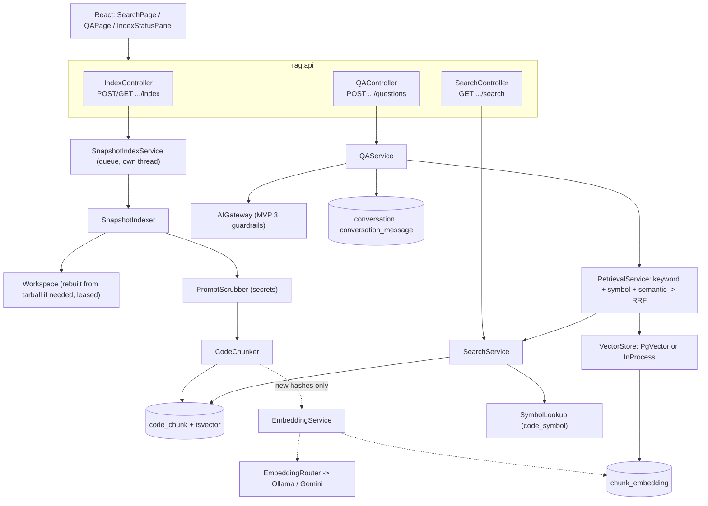

# MVP 4 Completion Report: RAG-Based Repository Q&A

**Date:** 2026-11-22
**Plan:** [implementationPlan.md](implementationPlan.md), Steps 4.1 to 4.4
**Branch:** `mvp4` (not merged, not pushed)
**Result:** All four steps implemented and tested. Backend `./mvnw -B clean verify`: 766 tests, 0 failures, 4 skipped (2 Semgrep-tagged, 2 opt-in `PgVectorStoreTests`), 13.5 min. Frontend lint, typecheck, 141 tests and build green. Docker stack rebuilt; one live analysis, indexing, text/symbol search and Q&A checked through nginx, with AI enabled (real Gemini) and with AI disabled. 7 of 7 exit criteria ticked.

## 1. Summary

| Item | Value |
|---|---|
| Commits (MVP 4) | `530b9c5` step 4.1, `c76c425` and `383122f` 4.1 fixes (workspace cleanup), `c1cab09` step 4.2, `63cfcdc` step 4.3, `dbd592b` step 4.4, `bec8dd1` docs; plus two docs commits about MVP 3 (`5fb331a`, `09b1181`) and this report |
| Backend tests | 766 run, 0 failures, 4 skipped (MVP 3 ended at 704: +62) |
| Frontend tests | 141 (MVP 3 ended at 134: +7) |
| Exit criteria | 7 of 7 ticked (semantic retrieval verified with a stand-in embedder and the in-process store only, see section 8) |
| Left | A real embedding model trial, pgvector queries against the Docker database (`PgVectorStoreTests`), and a human look at the new pages (section 8) |

## 2. Steps executed

| Step | What was built | Tests added | Result |
|---|---|---|---|
| 4.1 | Flyway `V7__rag_index.sql` (`snapshot_index`, `code_chunk` with a generated `tsvector`, `chunk_embedding`); `rag.chunking` (`CodeChunker`, `JavaChunker`, `TextChunkers`, `LineWindows`); `rag.embedding` (`EmbeddingService`, `EmbeddingStore`); embedding adapters on the existing Ollama and Gemini services plus `EmbeddingRouter` in `ai.provider`; `rag.indexing` (`SnapshotIndexService`, `SnapshotIndexer`, `ChunkStore`); `rag.vectorstore`; `db/Dockerfile` (pgvector); `WorkspaceLeases`; `POST/GET .../index` | `CodeChunkerTests`, `RagSchemaTests`, `EmbeddingAdapterTests`, `RagIndexE2eTests` (chunks, redaction, incremental by hash, model change) | Green after two fixes (section 4) |
| 4.2 | `SearchController` (`GET .../search`), `SearchService`, `SymbolLookup`, `QueryTerms`, `RetrievalService` (RRF), `RagScopes`; `rag-eval/questions.yml` | `QueryTermsTests`, `RagSearchE2eTests`, `RagIsolationE2eTests`, `RetrievalEvaluationTests`, opt-in `PgVectorStoreTests` | Green |
| 4.3 | `QAService`, `QAController` (`POST .../questions`), `answer-question.v1.yml`, `Conversation`/`ConversationMessage` and V8 migration, `GatewayRequest.CallBudget` | `RagQaE2eTests` (WireMock model: grounded, invalid citation, insufficient evidence, injection chunk, AI unavailable) | Green |
| 4.4 | `SearchPage`, `QAPage`, `IndexStatusPanel`, `SearchResultsList`, header links on the repository page, API client and types | `SearchPage.test.tsx`, `QAPage.test.tsx` | Green |

## 3. Design walkthrough

### 3.1 Big picture

Search and Q&A are a read layer on top of the stored MVP 1/2 analysis. Indexing is a separate, optional job per snapshot (not part of the analysis pipeline), so the MVP 1 orchestrator and its tests are unchanged. Symbol search needs no index at all (it reads MVP 2 `code_symbol`); text search needs the index but no model; semantic retrieval and Q&A add an embedding model and a chat model, both optional and configured independently.



### 3.2 Request and data flow

**Index** (`POST /api/v1/repositories/{repositoryId}/snapshots/{snapshotId}/index`): the snapshot is checked against the repository; a `snapshot_index` row is set to `QUEUED` and the job goes to a bounded queue (`rag.indexing.queue-capacity`). The job leases the workspace (`WorkspaceLeases`, the hourly sweeper skips leased ones), rebuilding it from the immutable tarball if it was swept (`rag.indexing.allow-download`), reads text files (size, count, excluded-file limits), scrubs each with the same `PromptScrubber` used for AI prompts, chunks them, replaces the snapshot's `code_chunk` rows, and, if an embedding model is configured, embeds only content hashes that have no vector yet for the current model and version. The final status is written after the lease is released and a workspace rebuilt only for indexing is removed. Status is `COMPLETED`, `COMPLETED_WITH_WARNINGS` or `FAILED`; embeddings have their own status (`COMPLETED`, `PARTIAL`, `NOT_CONFIGURED`, `UNAVAILABLE`, `FAILED`).

**Search** (`GET .../search?q=&type=symbol|text&language=&module=&fileType=&limit=`): `type=symbol` is an exact identifier lookup in `code_symbol` (simple name, qualified name or `Type.member`; exact case first, types before members). `type=text` builds a `tsquery` from identifier tokens only (`QueryTerms`; user query syntax never reaches `to_tsquery`), requiring every word, with camelCase parts matching and a light query-side prefix stem. Without an index it answers `NOT_INDEXED` with a reason; non-Java symbol search is `NOT_SUPPORTED`.

**Question** (`POST .../questions`): retrieval (keyword and symbol chunks plus, if vectors exist for the current model, the cosine nearest chunks), fused by reciprocal rank fusion (`rrf-k` 60), top 8. Nothing retrieved: explicit "not enough evidence" with what was searched, no model call. Otherwise `answer-question.v1` is assembled (question, bounded summary of the last 3 turns, `CHUNK` data blocks) and sent through `AIGateway` (scrub, token budget, cache, per-snapshot call budget, schema validation, usage record). Each citation id is checked against the chunks that were actually sent; unknown ones are removed and reported; an answer with no valid source becomes `INSUFFICIENT_EVIDENCE`. With no model the status is `UNAVAILABLE` and the response carries deterministic search results for the question's words. The exchange is stored in `conversation` / `conversation_message`.

### 3.3 Components

| Package / class | Responsibility |
|---|---|
| `rag.api.IndexController`, `SearchController`, `QAController` | Thin REST layer, DTOs `IndexStatusDTO`, `SearchResponseDTO`, `SearchResultDTO`, `QuestionRequestDTO`, `QuestionAnswerDTO` |
| `rag.chunking.CodeChunker` | Picks a chunker by language; `JavaChunker` (JavaParser: class header with fields, each method, Javadoc included, bodiless methods stay in the type chunk), `TextChunkers` (YAML/properties by top-level section, Markdown by heading), `LineWindows` (labelled 60-line windows, 10 overlap); long units split at `max-chunk-lines` |
| `rag.indexing.SnapshotIndexService` / `SnapshotIndexer` | Job queue and run; `ChunkStore` is the JDBC access to `code_chunk` (always filters by snapshot and repository) |
| `rag.embedding.EmbeddingService` / `EmbeddingStore` | Hash + model + version cache, batching, only missing hashes embedded |
| `ai.provider.EmbeddingModelService`, `EmbeddingRouter` | Embedding capability on the Ollama and Gemini adapters; one provider (`ai.embedding.provider`), no fallback, hosted only when acknowledged |
| `rag.vectorstore.VectorStore` | `PgVectorStore` (`<=>` on `real[]` cast to `vector`) or `InProcessVectorStore` (exact cosine, capped by `max-in-process-vectors`); chosen by `rag.retrieval.vector-store` |
| `rag.retrieval.SearchService`, `SymbolLookup`, `QueryTerms`, `RetrievalService`, `RagScopes` | Deterministic search, fusion, snapshot/repository scoping |
| `rag.qa.QAService` | Orchestrates retrieval, prompt, gateway, citation validation, conversation storage |
| `ai.application.GatewayRequest.CallBudget` | Per-feature call budget so Q&A does not consume the insight budget |
| `repository.infrastructure.storage.WorkspaceLeases` | Keeps the sweeper away from workspaces in use |

### 3.4 Data model

- `V7__rag_index.sql`: `snapshot_index` (one row per snapshot, status, embedding status/model/version/dimensions, counts, warnings jsonb); `code_chunk` (path, language, file type, module, class, method, `chunk_type`, lines, scrubbed `content`, `content_hash`, `redacted`, generated stored `tsv` with weights A symbol names, B path, C content, GIN index); `chunk_embedding` keyed `(content_hash, embedding_model, embedding_model_version)` with `dimensions` and `real[]`. pgvector is created only when available (guarded `DO` block).
- `V8__conversations.sql`: `conversation` (repository, snapshot, title) and `conversation_message`, both cascading from the repository and snapshot.

### 3.5 API

```
POST /api/v1/repositories/{rid}/snapshots/{sid}/index        -> status {status: QUEUED, embeddingStatus: PENDING, ...}
GET  /api/v1/repositories/{rid}/snapshots/{sid}/index        -> {status: NOT_INDEXED | QUEUED | INDEXING | COMPLETED | COMPLETED_WITH_WARNINGS | FAILED,
                                                                 embeddingStatus, embeddingModel, chunkCount, embeddedChunks, reusedEmbeddings, newEmbeddings, warnings[]}
GET  .../search?q=OwnerController&type=symbol                -> {status: OK|NOT_INDEXED|NOT_SUPPORTED, reason, commitSha, source, results: [{kind, name, qualifiedName, filePath, startLine, endLine, snippet, sourceUrl, ...}]}
POST .../questions {"question": "...", "conversationId"?: "...", "provider"?: "..."}
   -> {conversationId, status: OK|INSUFFICIENT_EVIDENCE|UNAVAILABLE|..., aiGenerated, answer, sources: [{filePath, startLine, endLine, snippet, sourceUrl}],
       searched, searchResults, provider, model, promptVersion, fromCache, reason, warnings, limitations, commitSha}
```

A repository or snapshot mismatch (for example another repository's id) returns 404.

### 3.6 Frontend

`/repositories/:id/search` (`SearchPage`: symbol/text toggle, language/module/file-type filters, results via `SearchResultsList` with GitHub links at the commit, snippets as plain text) and `/repositories/:id/qa` (`QAPage`: conversation with follow-ups, AI-generated badge, validated sources with the excerpt that was sent, "not enough evidence", "AI unavailable" and "no embedding provider" notes pointing to Search). `IndexStatusPanel` is on both pages (state, chunk and embedding numbers, warnings, "Index this snapshot", polling while a job runs). Data comes through the TanStack Query hooks in the API client; conversations are held in component state only.

### 3.7 Configuration and extension points

`rag.indexing.*`, `rag.retrieval.*`, `rag.qa.*`, `ai.embedding.*`, `ai.providers.<id>.embedding-model` (see README). Environment: `AI_EMBEDDING_PROVIDER`, `OLLAMA_EMBEDDING_MODEL`, `GEMINI_EMBEDDING_MODEL`, `RAG_VECTOR_STORE`, `RAG_MAX_QUESTIONS_PER_SNAPSHOT`. New language chunker: add a case in `CodeChunker`. New embedding provider: implement `EmbeddingModelService` on a provider adapter. New eval question: append to `backend/src/test/resources/rag-eval/questions.yml`; raise thresholds when retrieval improves. New prompt version: a new `answer-question.v2.yml` (the version is part of the cache key).

### 3.8 Where to start reading

1. `backend/src/main/resources/db/migration/V7__rag_index.sql`, `V8__conversations.sql`
2. `rag/indexing/SnapshotIndexer.java`, then `rag/chunking/CodeChunker.java`, `JavaChunker.java`
3. `rag/retrieval/SearchService.java`, `QueryTerms.java`, `RetrievalService.java`
4. `rag/qa/QAService.java`, `ai/prompt/answer-question.v1.yml`
5. `rag/vectorstore/*`, `ai/provider/EmbeddingRouter.java`
6. `backend/src/test/java/com/repointelligence/e2e/Rag*E2eTests.java`, `RetrievalEvaluationTests`
7. `frontend/src/pages/SearchPage.tsx`, `QAPage.tsx`, `components/rag/*`

## 4. Issues faced and how they were resolved

1. **A rebuilt workspace stayed behind after indexing (`c76c425`).** Symptom: in the full run `BoundaryE2eTests` reported a snapshot directory left in the shared E2E workspace root. Cause: an index job rebuilds a deleted workspace from the tarball and nothing removed it until the hourly sweep. Fix: the job deletes a workspace it rebuilt unless a run or reader holds it; source excerpts for insights take a lease too. Verified by the boundary test and `RagIndexE2eTests`.
2. **Job finished before its cleanup (`383122f`).** Symptom: `RagIndexE2eTests` read `COMPLETED` and still found the workspace. Cause: the final state was committed inside `index()` and cleanup ran afterwards in `run()`; a polling client could see a finished job before cleanup. Fix: `index()` returns its outcome and `run()` writes it after the lease is released and the workspace removed.
3. **Two timing tests failed under load in the first full verify of this session** (`AnalysisRunApiTests.cancellingARunningRunEndsItCancelled`, `...theJobAlwaysSeesTheCommittedRunSoSeveralQuickSubmissionsNeverRace`, 766 run, 2 failures). Cause: I ran the frontend test suite (about 180 s of CPU in 19 jsdom environments) at the same time; the same tests were already known to be load-sensitive (MVP 3 report, issue 8). Evidence: both pass when `AnalysisRunApiTests` runs alone, and the next full verify on an idle machine was 766 run, 0 failures. No test was changed. Recommendation: make these two tests wait on a condition rather than fixed deadlines.

## 5. Verification

- **Backend:** `./mvnw -B clean verify` (idle machine): 766 tests, 0 failures, 0 errors, 4 skipped; BUILD SUCCESS; 13:28 min. Spotless green. Retrieval evaluation (12 questions, k=5): keyword+symbol recall@5 0.833 / MRR 0.722; semantic (deterministic hashing stand-in) 0.528 / 0.461; hybrid 0.750 / 0.597 (report in `backend/target/rag-eval/report.md`).
- **Frontend** (`npx -y pnpm@12.21.0`): `install --frozen-lockfile`, `lint`, `typecheck`, `test --run` (141 passed), `build` all green.
- **Docker** (Docker Desktop 29.7.2, existing volumes kept): `docker compose up --build -d`; the database image now builds with pgvector 0.8.7 (`select extname` shows `vector 0.8.7`); Flyway applied `V7 rag index` and `V8 conversations` to the existing volume; all three services healthy. One forced analysis of spring-petclinic (commit `500158f`) through http://localhost:5173 completed.
  - Symbol search `OwnerController` found the class right after the analysis (no index). Text search before indexing answered `NOT_INDEXED` with a reason.
  - `POST .../index`: `COMPLETED_WITH_WARNINGS`, 382 chunks from 117 files, 15 files skipped, embeddings `NOT_CONFIGURED` ("embedding provider ollama is not enabled"), warnings listed (one file over 256 KB, 9 files with possible secrets withheld).
  - Text search `findByLastName` returned `ClinicServiceTests.shouldFindOwnersByLastName`; filters `language=Java&fileType=TEST` returned test files only. A search with another repository's id returned 404.
  - **With the developer's local AI configuration (Gemini `gemini-3.5-flash-lite`)**: the question "How are owners searched by last name?" returned `OK`, `aiGenerated: true`, an answer about `processFindForm`, and one source `OwnerController.java` lines 94-130 with a commit-pinned GitHub link (that range is the method). One provider call; this is a real-model run of keyword-only retrieval (no embedding model configured).
  - **AI disabled** (`AI_ENABLED=false docker compose up -d --no-deps backend`, then restored): `/api/v1/ai/providers` says disabled with a reason; the same question returned `UNAVAILABLE`, `aiGenerated: false`, 8 deterministic search results; symbol and text search still `OK`.
  - Pages `/repositories/{id}/search`, `/repositories/{id}/qa`, `/settings/ai` served `200` with the CSP (`script-src 'self'`, `frame-ancestors 'none'`), `nosniff` and `Cache-Control: no-cache` unchanged.
- **Cross-MVP matrix:** app starts without AI (`AIDisabledE2eTests`, Docker run with AI off); health `UP`; migrations on embedded PostgreSQL (`SchemaMigrationTests`, 14 tests) and on the existing Docker volume; Docker run; Java analysis (live); non-Java generic analysis (MVP 1 E2E tests, not re-run live to save the GitHub rate limit); capability matrix present in the live report; commit scoping (`RagIsolationE2eTests`, 404 on a wrong repository); failed analyzer isolation, archive safety and redaction (existing tests, green); report, findings, architecture, dependencies, tests, coverage endpoints `200` on the live snapshot; AI insights (MVP 3 tests green; `/settings/ai` served); deterministic search and grounded Q&A (above). Architecture diagram rendering in a browser was not re-checked (section 8).

## 6. Decisions (ADR style)

1. **pgvector is optional; vectors are `real[]`.** *Context:* the plan's open decision (stock embedded PostgreSQL has no pgvector; one `vector(N)` table per dimension). *Options:* custom embedded binaries; native test database; schema that works with or without the extension. *Choice:* one `chunk_embedding` table with a `dimensions` column and `real[]`, cast to `vector` for `<=>` when the extension exists; exact in-process cosine otherwise; Docker Compose database built with pgvector. *Evidence:* tests must build without Docker or a native install; the same schema runs in all environments. *Consequences:* no approximate (HNSW) index yet (recommended in C.5); semantic tests use the in-process store, and `PgVectorStoreTests` is opt-in (`PGVECTOR_TEST_DB_URL`).
2. **Database image on `postgres:16-alpine` plus checksum-pinned pgvector source.** *Options:* `pgvector/pgvector` (Debian). *Choice:* build on alpine. *Evidence:* switching C library under an existing `pgdata` volume can silently invalidate text-index collation; the user's volume must keep working. *Consequences:* first image build compiles pgvector (needs network).
3. **Embedding provider selected separately from the chat provider, no fallback.** Vectors of different models are not comparable; hosted embedding needs the same data-handling acknowledgement as hosted chat.
4. **Java chunks come from JavaParser, not from `code_symbol`.** The symbol graph exists only for Spring/Java production code, while the index covers test sources, Javadoc and other languages.
5. **`simple` text-search configuration with identifiers indexed whole and split at camelCase.** Exact identifiers matter more than stemmed prose; stemming is a light query-side prefix only (limitation: *policies* does not match *policy*; see C.5).
6. **Q&A has its own call budget and no run id** (`GatewayRequest.CallBudget`), so questions never exhaust an analysis run's insight budget.
7. **Citations are validated against what was sent; an answer without a valid source is not shown as grounded.** Insufficient evidence is an explicit status, never a confident answer.
8. **Indexing is a separate opt-in job**, not part of the analysis, to keep MVP 1 deterministic and rate-limit friendly; an unindexed snapshot reports `NOT_INDEXED` rather than empty results.
9. **Conversations are stored server-side but the UI keeps them in memory.** A reload/list endpoint is a recommended follow-up.

## 7. Considerations

- **Security:** chunk content is scrubbed before it is stored (same scrubber as AI prompts; files with possible secrets are withheld or masked and counted as warnings); user query syntax never reaches `to_tsquery`; every query filters by snapshot and repository in the storage layer; repository text and snippets are rendered as plain text; prompts treat chunks as data blocks with neutralised delimiters (MVP 3 assembler); embedding calls respect the provider allowlist, acknowledgement and key handling of MVP 3. The Docker database image downloads pgvector from GitHub, verified by SHA-256.
- **Performance:** petclinic indexed to 382 chunks from 117 files in seconds without embeddings; in-process vector search is exact but memory bound (`max-in-process-vectors` 50,000); pgvector path uses a sequential scan without an index. The indexing queue is bounded.
- **Reliability:** an index job always ends with a final status (including `FAILED`); embedding failure leaves keyword search usable (`embeddingStatus` explains); model errors become statuses, never 500s; workspace leases prevent the sweeper deleting files in use.
- **Testing:** unit (chunker, query terms, stores), embedded-PostgreSQL integration, E2E on a fixture with a WireMock model and a stand-in embedder, a retrieval evaluation with thresholds, frontend page tests. Gaps: no real embedding model, no pgvector in default CI, eval set is one fixture (12 questions), Q&A answer quality is not scored (only retrieval).

## 8. Not done, not verified, open items

- **Real embedding model:** semantic and hybrid numbers use a lexical hashing stand-in; with it hybrid (0.750) is below keyword+symbol (0.833). Try `ollama pull nomic-embed-text`, set `AI_PROVIDERS_OLLAMA_ENABLED=true OLLAMA_EMBEDDING_MODEL=nomic-embed-text AI_EMBEDDING_PROVIDER=ollama`, re-index and compare recall (C.5).
- **pgvector query path:** extension confirmed present in the Docker database, but `PgVectorStoreTests` was skipped (needs `PGVECTOR_TEST_DB_URL`; create `repointel_vector_test` in the Compose database).
- **Browser look (human required):** open http://localhost:5173, a repository, then **Search code** and **Ask a question**. Check: the index status panel and "Index this snapshot" button; symbol search for `OwnerController` and text search for `findByLastName` with filters; result links open GitHub at the commit; Q&A answer shows the AI-generated badge and source links; with AI off, the "AI unavailable" note points to Search; layout in light and dark. I verified these only through HTTP responses and jsdom tests.
- **Non-Java generic analysis and Mermaid diagram rendering** were not re-checked live this time (existing tests green; no browser).
- **Gemini free-tier quota** (20/day on some models) limits repeated live Q&A; the real-model check used one call.
- Conversation list/reload, automatic indexing after analysis, stemmed prose search, symbols for other languages: Appendix C.5.

## 9. How to review and merge

```sh
git log --oneline main..mvp4
git diff --stat main..mvp4
cd backend && ./mvnw -B clean verify
cd ../frontend && npx -y pnpm@12.21.0 install --frozen-lockfile && npx -y pnpm@12.21.0 lint && npx -y pnpm@12.21.0 typecheck && npx -y pnpm@12.21.0 test --run && npx -y pnpm@12.21.0 build
cd .. && docker compose up --build -d      # then the browser checks in section 8
git checkout main && git merge --ff-only mvp4 && git push origin main
```

Note: `.claude/agents/mvp-executor.md` has an uncommitted edit of yours in the working tree; it was deliberately not committed.

## 10. Anything else worth knowing

- Do not run the frontend tests while the backend verify runs: the two load-sensitive timing tests in `AnalysisRunApiTests` can fail (issue 3).
- The Docker `.env` in this checkout enables Gemini, so the default stack answers questions with the real model; set `AI_ENABLED=false` to see the deterministic fallback.
- Earlier MVP 4 commits carry a different model name in their trailer than this session's commits; this is expected (the work was done in two runs).
- Retrieval quality is tracked separately from answer quality on purpose; adding an answer-quality evaluation with a real model is the natural next measurement.
