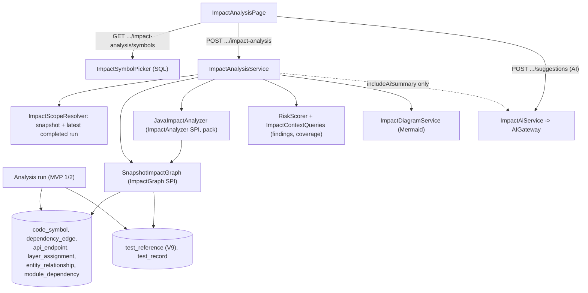

# MVP 5 Completion Report: Intelligent Code Impact Analysis

**Date:** 2026-11-24
**Plan:** [implementationPlan.md](implementationPlan.md), Steps 5.1 to 5.3
**Branch:** `mvp5` (not merged, not pushed)
**Result:** All three steps implemented and tested. Backend `./mvnw -B clean verify`: 800 tests, 0 failures, 4 skipped (2 Semgrep-tagged, 2 opt-in `PgVectorStoreTests`). Frontend lint, typecheck, 147 tests and build green. Docker stack rebuilt; one live analysis of spring-petclinic through http://localhost:5173 with an impact analysis (with and without the AI summary path). 6 of 6 exit criteria ticked.

## 1. Summary

| Item | Value |
|---|---|
| Commits | `bcda010` step 5.1, `618c2e2` step 5.2, `1a50777` step 5.3, plus the docs commit that adds this report |
| Backend tests | 800 run, 0 failures, 4 skipped (MVP 4 ended at 766: +34) |
| Frontend tests | 147 (MVP 4 ended at 141: +6, five page tests and the golden Mermaid chain) |
| Exit criteria | 6 of 6 ticked |
| Left | A human look at the new page and its diagram, a real-model check of the AI summary and suggestions on more than one repository, and the open items in section 8 |

## 2. Steps executed

| Step | What was built | Tests added | Result |
|---|---|---|---|
| 5.1 | Flyway `V9__test_references.sql` (`test_reference`); `TestReferenceExtractor` and `JavaTestAnalyzer` 1.1.0 (what each test class names); `ImpactGraph` SPI and `impact.graph.SnapshotImpactGraph` (bounded breadth-first traversals at method and type level, supertypes and subtypes, ambiguous callers, endpoints, layers, entity links, module dependents, tests, completeness stats); `ImpactProperties` | `SnapshotImpactGraphTests` (12: depth limit, cycles, type lifting, snapshot isolation, caps, modules, tests), `ImpactGraphPerformanceTests` | Green after two query rewrites (section 4) |
| 5.2 | `ImpactAnalyzer` SPI, `JavaImpactAnalyzer`, `ImpactAnalysisService`, `RiskScorer`, `ImpactSymbolPicker`, `ImpactDiagramService`, `ImpactAiService` (summary and target suggestions), `ImpactController`, templates `summarize-impact.v1` and `suggest-impact-targets.v1`, fixture `spring-boot-payments` | `JavaImpactAnalyzerTests` (6), `ImpactE2eTests` (9), `ImpactAiE2eTests` (4), package-boundary tests, extended OpenAPI and template-count tests | Green |
| 5.3 | `ImpactAnalysisPage`, `ImpactResultView`, API client, hooks, route and header links | `ImpactAnalysisPage.test.tsx` (5), golden `impactChain.mmd` parsed by the real Mermaid | Green |

## 3. Design walkthrough

### 3.1 Big picture

Impact analysis is a read layer over the stored MVP 1/2 analysis. Nothing about it runs during an analysis except one addition: the Java test analyzer also records which production types and methods each test names, because tests are not in `code_symbol`. The graph is relational PostgreSQL; the result never depends on AI.



### 3.2 Request and data flow

1. **Analysis (changed part).** `JavaTestAnalyzer` parses test files with JavaParser and, with the production type names of the same commit, records `TestReferenceResult`s (type uses, `new T()`, calls on a field, parameter or local whose declared type is a production type, `var x = new T()`, static calls). The orchestrator persists them into `test_reference` (analyzers still never persist). `config_summary.testReferences` marks runs that have them.
2. **Pick.** `GET .../impact-analysis/symbols?q=` searches `code_symbol` for classes, interfaces, enums, records, methods and constructors (simple name, qualified name or `Type.method`, wildcards escaped), ranked exact, prefix, contains. Without symbols (non-Java) it answers `NOT_SUPPORTED`.
3. **Analyze.** `POST .../impact-analysis {targetSymbolId, depth?, changeDescription?, includeAiSummary?, provider?}`. The target must be a type, method or constructor of the latest completed run of that snapshot (404 otherwise, depth 1 to `impact.max-depth` else 400). `JavaImpactAnalyzer.analyze` runs:
   - **Method target:** seeds are the method (DETECTED), the methods it overrides or implements in project supertypes (same name and arity; POSSIBLE, listed as `OVERRIDES`), and methods with an AMBIGUOUS call whose recorded candidates include it (POSSIBLE). A reverse traversal over resolved CALLS edges follows callers to the depth.
   - **Type target:** reverse traversal over every resolved relationship except imports, members lifted to their type; supertypes are POSSIBLE seeds.
   - Endpoints whose handler (method target) or controller (type target) is affected; entities and repositories the target uses (direct dependencies) or that are linked to affected types (`entity_relationship`); modules containing affected symbols and modules that depend on the target's module (Maven, transitive); tests (below); limitations.
4. **Confidence** is the weakest link of the shortest path: DETECTED (resolved call, injection or inheritance), LIKELY (type use only), POSSIBLE (dispatch, ambiguous overload).
5. **Tests**, one row per test class with its best relation: `DIRECT_CALL` (calls the target method by name and arity, or any method of a type target), `NAMING_CONVENTION` (MVP 1 mapping), `TYPE_REFERENCE` (names the class only, POSSIBLE), `AFFECTED_COMPONENT` (tests of affected components, LIKELY when they call an affected method).
6. **Risk, regression areas, diagram.** `RiskScorer` adds six visible factors (below); regression areas list endpoints, direct tests, layers of direct dependents, dependent modules and an explicit gap when no test names the target; `ImpactDiagramService` writes a Mermaid `flowchart LR` through `MermaidWriter` (synthetic ids, escaped labels, 30 nodes).
7. **AI (optional).** With `includeAiSummary`, `ImpactAiService` routes (no permitted provider: `aiSummary.status = UNAVAILABLE`, nothing sent), builds TARGET, optional CHANGE_DESCRIPTION, IMPACT, RISK, LIMITATIONS and SOURCE blocks and calls `AIGateway` (all MVP 3 guardrails). `POST .../suggestions` retrieves candidate symbols deterministically from the description's words, sends them as CANDIDATE blocks and keeps only suggestions that cite a block that was sent.

**Risk score** (maximum points): dependency depth (15, 5 per hop), number of dependents (25, steps 5/12/19/25), public API exposure (20, by endpoints reached), security relevance (20, 8 per high or critical finding and 3 per other in the files of the target and affected components), test presence (15: 0 direct, 8 related only or unknown, 15 none found), measured coverage (5, from a committed JaCoCo report, 2 when none). Level: LOW under 30, MEDIUM under 60, else HIGH. It is labelled "Heuristic risk score ... not a probability" in the API, the UI and the AI prompt.

### 3.3 Components

| Class | Responsibility |
|---|---|
| `analysis.spi.ImpactAnalyzer`, `ImpactGraph`, `ImpactQuery`, `ImpactResult` | The SPI. `ImpactGraph` is a read-only, snapshot- and run-scoped view; analyzers never see repositories or entities |
| `analysis.packs.java.JavaImpactAnalyzer` | Java rules: callers, dispatch (name and arity over project supertypes), ambiguous overloads, endpoints, related data, modules, tests, limitations |
| `analysis.packs.java.TestReferenceExtractor`, `JavaTestAnalyzer` | Test source to production references (resolved through imports, package and wildcard imports; unresolved names are dropped) |
| `analysis.domain.TestReference`, `AnalysisResultWriter` | Persistence of the references by the orchestrator side |
| `impact.graph.SnapshotImpactGraph`, `ImpactGraphFactory` | PostgreSQL implementation: two-phase traversals, hierarchy, lookups, completeness stats |
| `impact.application.ImpactAnalysisService`, `ImpactScopeResolver` | Orchestration, validation, DTO mapping, regression areas |
| `RiskScorer`, `ImpactContextQueries` | Score and its inputs (findings, coverage) |
| `ImpactSymbolPicker`, `ImpactDiagramService`, `ImpactAiService` | Picker, Mermaid chain, optional AI parts |
| `impact.api.ImpactController` + DTOs | REST layer |
| `architecture.application.MermaidWriter` | Made public for reuse (no behaviour change) |

### 3.4 Data model

`V9__test_references.sql`: `test_reference(snapshot_id, run_id, test_symbol, test_file_path, test_method, referenced_type, referenced_member, argument_count, reference_kind, line_number, confidence)`, cascading from snapshot and run, indexed by `(snapshot_id, run_id, referenced_type)`. No other schema change: the graph reuses the V5 tables and their existing indexes.

### 3.5 API

```
GET  /api/v1/repositories/{rid}/snapshots/{sid}/impact-analysis/symbols?q=&limit=
     -> {status: OK|NOT_SUPPORTED, reason, symbols: [{id, kind, name, qualifiedName, filePath, line, layer}]}
POST /api/v1/repositories/{rid}/snapshots/{sid}/impact-analysis
     {targetSymbolId, depth?: 1..6, changeDescription?, includeAiSummary?: bool, provider?}
     -> {status, target, depth, components: [{id, kind, name, qualifiedName, layer, depth, viaId, relationships, confidence, reason, filePath, line, sourceUrl}],
         endpoints, relatedData, modules, tests: [{testSymbol, methods, relation, confidence, via, sourceUrl}], regressionAreas,
         risk: {label, score, maxScore, level, factors: [{id, label, value, points, maxPoints, explanation}], note},
         limitations, truncated, totalDependents, diagram: {chain, note}, aiSummary: null | {status, aiGenerated, summary, keyPoints, regressionFocus, provider, model, promptVersion, fromCache, detail, warnings}}
POST .../impact-analysis/suggestions {changeDescription, provider?} -> {status: OK|UNAVAILABLE|..., aiGenerated, suggestions: [{symbolId, name, qualifiedName, reason, ...}], warnings}
```

A wrong repository or snapshot id, or a symbol of another snapshot, is 404.

### 3.6 Frontend

`/repositories/:id/impact?snapshot=` (`ImpactAnalysisPage`, inside `SnapshotPageFrame`): symbol picker (always), depth, "Analyze impact". When AI is available a change-description box with "Suggest symbols" (each needs "Use this symbol") and "Analyze and summarize with AI"; when not, `AIAvailabilityNote` replaces only that box. `ImpactResultView` renders the risk table, the affected-components tree (nested by `viaId`, confidence badges, GitHub links at the commit), endpoints, related data, modules, tests, regression areas, limitations, `MermaidDiagram` (strict mode) and the marked AI summary through `MarkdownText`. All repository text is plain text. Links were added to the snapshot frame and the repository overview.

### 3.7 Configuration and extension points

`impact.*` in `application.yml` (`default-depth` and `max-depth` also via `IMPACT_DEFAULT_DEPTH` and `IMPACT_MAX_DEPTH` in `.env.example` and `compose.yaml`). New language: implement `ImpactAnalyzer` in a pack (a Spring bean; the service picks the first whose `supports` accepts the target), and make its analyzers produce symbols and edges. New risk factor: add it in `RiskScorer` (and its test). New prompt: a `*.v2.yml` template.

### 3.8 Where to start reading

1. `backend/src/main/resources/db/migration/V9__test_references.sql`
2. `analysis/packs/java/TestReferenceExtractor.java`, then `JavaTestAnalyzer.java`
3. `analysis/spi/ImpactGraph.java`, `ImpactAnalyzer.java`, `ImpactResult.java`
4. `impact/graph/SnapshotImpactGraph.java` (the query shapes and their comments)
5. `analysis/packs/java/JavaImpactAnalyzer.java`
6. `impact/application/ImpactAnalysisService.java`, `RiskScorer.java`, `ImpactAiService.java`
7. Tests: `JavaImpactAnalyzerTests`, `SnapshotImpactGraphTests`, `ImpactE2eTests`, `ImpactAiE2eTests`, fixture `spring-boot-payments/EXPECTED.md`
8. `frontend/src/pages/ImpactAnalysisPage.tsx`, `components/impact/ImpactResultView.tsx`

## 4. Issues faced and how they were resolved

1. **A graph traversal that ran for minutes (measured).** Symptom: `ImpactGraphPerformanceTests` hung; `jstack` showed `SnapshotImpactGraph.dependents`. Root cause: the first CTE joined the recursive CTE to itself to recover predecessors, and the planner (which cannot estimate a recursive CTE) chose nested loops over a CTE scan. A second version carried the predecessor through the recursion, so a hub was expanded once per predecessor. A third version filtered with `= ANY(CAST(:text AS uuid[]))`, which re-evaluated the cast per row. Fix: phase 1 is a recursive query with one row per (node, depth) that only joins real indexed tables; phase 2 fetches the edges between consecutive depths with `unnest` CTEs joined by index, and Java picks the predecessors. Verified by the performance test (section 5).
2. **`'\'` compiled silently.** A tool wrote `ESCAPE '\'` inside a Java string, which is a valid `\'` escape, so the SQL had the wrong escape character. Found while fixing a different compile error; the picker now uses `!` as the LIKE escape (no backslashes), and `ImpactE2eTests.pickerQueriesAreEscapedAndRanked` checks `%` and `_` return nothing.
3. **Wrong test expectations, not wrong code (4 times).** Method signatures hold parameter types only (`calculatePayment(Order)`), the second-overload test correctly does not count as calling the first, a type target counts any call to a method as direct, and LIKELY sorts before POSSIBLE. The tests were corrected to the specification.
4. **Existing tests extended for new behaviour** (not weakened): `ApiDocumentationAndHealthTests` (19 to 22 paths, three new paths asserted), `PromptTemplateTests` (7 to 9 templates, both new ones asserted), `PackageBoundaryTests` (impact may use `ai`; two new boundary tests).
5. **Spotless failure in the final verify** (an edited file changed line endings); fixed with `spotless:apply`, re-checked clean. A first verify attempt was lost when the machine's clock jumped and the test JVM died; it was rerun in full.

## 5. Verification

- **Backend:** `./mvnw -B clean verify`: 800 run, 0 failures, 0 errors, 4 skipped. Spotless clean.
- **Performance (synthetic repository, embedded PostgreSQL, depth 3 and 5; 22,000 symbols, 64,000 edges, relationships skewed so a few hubs are reached by most of the code):**

| Traversal | Reached rows | Time |
|---|---|---|
| Hub method, depth 3 | 18,044 | 0.68 s |
| Hub type, depth 3 | 6,206 | 1.70 s |
| Hub method, depth 5 | 28,129 | 1.01 s |
| Hub type, depth 5 | 6,206 | 1.48 s |
| Typical method, depth 5 | 193 | 71 ms |
| Typical type, depth 5 | 7,415 | 0.98 s |

  Agreed budgets: worst case 12 s, typical 2 s. A graph database is not justified by these numbers. (The first versions took 58 s and minutes, see issue 1.)
- **Frontend** (`npx -y pnpm@12.21.0`): `install --frozen-lockfile`, `lint`, `typecheck`, `test --run` (147 passed), `build` all green.
- **Docker** (existing volumes kept; `docker compose up --build -d`; V9 applied; all three services healthy): `spring-petclinic` (commit `500158f`) analysed with force rescan through http://localhost:5173. Picker for `OwnerRepository` returned the interface and its methods. Impact of `OwnerRepository.findByLastNameStartingWith(String, Pageable)` at depth 3: dependents `OwnerController.findPaginatedForOwnersLastName` (depth 1) and `processFindForm` (depth 2), both DETECTED; endpoint `GET /owners`; tests `OwnerControllerTests` and `ClinicServiceTests` (direct calls) and three type-reference tests; risk 27 LOW with six factors; 7 limitations; a Mermaid chain. With `includeAiSummary` and the developer's local Gemini configuration the summary returned `OK`, AI-generated (one provider call). The new pages `/repositories/{id}/impact|search|qa` serve 200 with the unchanged CSP and `no-cache`. Report, architecture, dependencies, tests, search and AI-provider endpoints answer 200.
- **Cross-MVP matrix:** app starts without AI (`ImpactE2eTests` run with AI off, `AIDisabledE2eTests`); health, migrations (`SchemaMigrationTests`, V9 on the Docker volume), Docker run, Java analysis (live), non-Java analysis (`ImpactE2eTests` react fixture and MVP 1 tests), commit scoping (`SnapshotImpactGraphTests`, `ImpactE2eTests` 404s), analyzer isolation, archive safety, redaction (existing tests green), diagrams (golden files parsed by Mermaid), AI insights and Q&A (existing tests green), impact (above).

## 6. Decisions (ADR style)

1. **`ImpactAnalyzer` takes an `ImpactGraph`, not an `AnalysisContext`.** *Context:* the architecture doc sketched `analyzeImpact(AnalysisContext, ImpactQuery)`, but impact runs at request time and there is no workspace. *Options:* rebuild a workspace and re-parse per request; query stored facts. *Choice:* a read-only graph SPI implemented in the core, Java rules in the pack. *Evidence:* the plan itself asks for recursive queries over `code_symbol` and `dependency_edge`. *Consequences:* a new language needs symbols and edges stored first. `architecture.md` §20 records this.
2. **Tests are linked by a new fact table, not by adding test sources to `code_symbol`.** Including tests (`include-tests`) would change every MVP 2 count, layer list and golden diagram. `test_reference` is raw, unresolved at write time and resolved against symbols at read time; the cost is that references name types and methods, not exact overloads (name and argument count).
3. **Relational graph, two-phase traversals.** Measured, see section 5; no graph database.
4. **Confidence is the weakest link; dispatch and ambiguity are always POSSIBLE.** Honest over complete: a caller of an interface method is never shown as a proven caller of one implementation.
5. **The risk score is a visible sum, labelled heuristic.** Weights are a judgment, so every factor shows value, points and reason; nothing hides in a model.
6. **AI is opt-in per request.** The graph result is returned without waiting for a model, and `includeAiSummary` costs a provider call only when asked. A free-text description never selects the target: suggestions are limited to symbols that were sent as candidates and need a click.
7. **`impact` may import `ai` (like `rag`), nothing imports `impact`.** Boundary tests updated and extended.
8. **A run without test references says so** (`testReferencesAvailable`) instead of reporting "no tests".

## 7. Considerations

- **Security:** the picker escapes LIKE wildcards; every query filters by snapshot and run in the graph class; the symbol id of another snapshot is 404; repository text (names, paths, reasons, test names) is rendered as plain text; the Mermaid chain uses synthetic node ids, escaped labels and strict mode; the AI summary goes through the gateway (secret scrub, budgets, schema, usage); the change description is a delimited data block and delimiters inside it are neutralised (tested); the AI summary is rendered without HTML, images or links. Repository code is only parsed.
- **Performance:** section 5. Phase 2 of a type traversal scans edges that target the reached types; row caps (`impact.max-graph-rows`, `max-components`, `diagram-nodes`) bound output and say so when hit.
- **Reliability:** an analyzer failure is a 500-free path only for unknown input (404/400); AI failures become statuses inside `aiSummary`; a missing test analysis or pre-V9 run becomes a limitation, not a wrong answer.
- **Testing:** unit (extractor via E2E, risk scorer via E2E, analyzer on a hand-drawn graph), embedded-PostgreSQL integration, E2E on a fixture through the real pipeline, WireMock model tests, performance gate, frontend page tests. Gaps: no dedicated `RiskScorer` unit test beyond the E2E assertions on sums and ids; `TestReferenceExtractor` is tested only through the pipeline; no browser test; the fixture is small and the eval is one repository plus petclinic by hand.

## 8. Not done, not verified, open items

- **Browser look (human required):** open http://localhost:5173, a Java repository, **Impact analysis**. Check: picker results and selection state; the tree nesting and badges; the risk table; that the Mermaid chain draws (it was checked only with the real Mermaid parser, not rendered in a browser; remember the MVP 2 CSP issue); light and dark; the AI box hidden when AI is off (`AI_ENABLED=false`).
- **Real-model quality:** one live summary call; suggestions were checked with WireMock only. Try a few descriptions on petclinic.
- **Older snapshots** have no test references until re-analysed with force rescan (stated in the limitations).
- **Not linked:** tests that reach code only through HTTP, calls on unknown receivers, Spring wiring beyond what MVP 2 detects. See Appendix C.6.
- The plan's problem statement lists `POST /repositories/{id}/impact-analysis`; the implementation is snapshot-scoped like all other repository-derived APIs.

## 9. How to review and merge

```sh
git log --oneline main..mvp5
git diff --stat main..mvp5
cd backend && ./mvnw -B clean verify
cd ../frontend && npx -y pnpm@12.21.0 install --frozen-lockfile && npx -y pnpm@12.21.0 lint && npx -y pnpm@12.21.0 typecheck && npx -y pnpm@12.21.0 test --run && npx -y pnpm@12.21.0 build
cd .. && docker compose up --build -d      # then the browser checks in section 8
git checkout main && git merge --ff-only mvp5 && git push origin main
```

## 10. Anything else worth knowing

- Do not run the frontend tests while the backend verify runs (timing-sensitive tests, see MVP 3 and 4 reports).
- The performance test seeds about 86,000 rows and takes about 1.5 minutes; it is part of the normal build.
- `docs/architecture.md` section 20 lists the deliberate deviations.
- The quality of a recursive-CTE plan cannot be judged from its text: measure with realistic hubs. That was the single most expensive lesson of this MVP.
