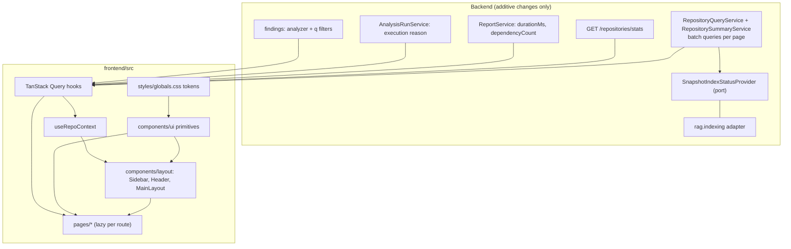

# MVP 7 Completion Report: UI Redesign (Google Stitch Designs)

**Branch:** `mvp7` (from `main` at `4425c65`). **Status:** implemented except the Investigations screens, which need MVP 6 (not built). Not merged, not pushed.

## 1. Summary

The whole frontend was rebuilt from the Stitch designs in `stitch_repointel_ui_platform/` (PNGs and `DESIGN.md` as the specification; the exported `code.html` files were never used). It now has design tokens with a real light theme, self-hosted fonts, an inline-SVG icon set, a primitive library, an app shell, and every screen of Step 7.0.1 except Investigations. Backend work is limited to the additive API changes of Step 7.3. No analyzer, AI gateway, search or impact rule changed.

- **Tests:** backend 810 run, 0 failures, 4 skipped (as before), Spotless clean. Frontend 29 files, 313 tests (was 147 at MVP 5), ESLint and `tsc` clean, production build green. Playwright browser check: 5 tests (2 smoke in both themes, 3 responsive) green against a live backend.
- **Exit criteria:** 8 of 10 ticked and verified; 2 left unticked with reasons (Investigations screens, the Investigation progress screen). Plan checkboxes: all ticked ones were verified by a test or a run; see the plan for the unticked ones and why.
- **Not possible here:** Docker is not installed on the machine, so `docker compose up --build` was not run. The stack was approximated with the real backend (`spring-boot:test-run`, embedded PostgreSQL) and a small Node server that serves `frontend/dist` with the headers parsed from `frontend/nginx.conf` and proxies `/api`. A human must still run the Docker stack (section 8).

Commits on `mvp7` (oldest first):

| Hash | Subject |
|---|---|
| `5e9f69b` | docs: add MVP 7 (UI redesign) to the plan and a deployment plan (the two files that were uncommitted when the run started, kept as they were) |
| `ed15912` | feat(backend): repository list summary, dashboard stats, report extras and execution reasons (step 7.3) |
| `4dc4dd7` | feat(frontend): design foundation with tokens, fonts, icons, theme and primitives (step 7.1) |
| `52525ae` | feat(frontend): app shell, routing, dashboard, add repository and analysis progress (steps 7.2, 7.4, 7.5) |
| `16f47bf` | feat(frontend): report header, overview, findings drawer, dependencies, tests and AI insight card (steps 7.6-7.8, 7.10A) |
| `b5bf198` | feat(frontend): architecture page with themed pan/zoom diagram cards, layer accordions and endpoint filters (step 7.9) |
| `a46d406` | feat(frontend): AI settings page with real environment variable names (step 7.10) |
| `376381b` | feat(frontend): code search and ask pages with index bar, citations and degraded modes (step 7.11) |
| `0ff19c8` | feat(frontend): change impact analysis page with risk bands, grouped components and view filters (step 7.12) |
| `e7b7a57` | test(frontend): axe accessibility checks in both themes, not-supported states and production bundle scan (step 7.14) |
| `b52d762` | feat(frontend): optional Playwright browser check, shell and index-bar tests; fix data: fonts blocked by the CSP and mobile overflow (step 7.14) |
| `653d32a` | docs: README screenshots and a manual browser-check workflow |
| `0a565b9` | fix(frontend): pagination range on a short last page; tests for stack evidence, re-analyze, module summary, priorities, dependencies, coverage and drawer focus |
| `37e1cbb` | docs(plan): tick verified MVP 7 items, add verification note and follow-ups |

## 2. Steps executed

| Step | What was built | Tests added | Result |
|---|---|---|---|
| 7.0 Intake | Decisions applied through the run (section 6); deviations from the designs (section 7) | n/a | done |
| 7.1 Foundation | `styles/globals.css` tokens (light `:root`, dark `.dark`), Geist and JetBrains Mono via `@fontsource-variable/*`, `components/ui/icons.tsx` (70 icons), theme provider, ~40 primitives, dev-only `/dev/components` | `styles/contrast.test.ts` (8), `components/ui/primitives.test.tsx` (34), `lib/theme.test.tsx` (4), `test/bundle.test.ts` (4) | done |
| 7.2 Shell | `components/layout/*`, `hooks/useRepoContext.ts`, lazy routes, not-found, Investigations placeholders | `Shell.test.tsx` (13) | done; Architecture item stays visible with a reason (7.2 and 7.9 item 10 disagree) |
| 7.3 Backend | `summary` per repository, `GET /repositories/stats`, run duration and `dependencyCount` on the report, execution `reason`, findings `analyzer` and `q` | `RepositorySummaryApiTests` (9), `ReportApiTests` (+1), OpenAPI path count | items 1-3 done; item 4 (investigations) not built; item 5 (insight refresh) not built |
| 7.4 Dashboard, Add | KPI tiles, filterable rows, retry, example chips, inline errors | `DashboardPage.test.tsx` (12), `AddRepositoryPage.test.tsx` (+3) | done |
| 7.5 Progress | Stepper, analyzer table with reasons, local timer, confirmed cancel, three terminal variants | `AnalysisProgress.test.tsx` (21) | done |
| 7.6 Overview | Header, six cards, seven-column matrix, stack with evidence, anatomy donut, entry points, limitations, module summary | `ReportDashboard.test.tsx`, `CapabilityMatrix.test.tsx`, `ReportParts.test.tsx` | done |
| 7.7 Findings | URL-synced filter bar, grouped list or table, drawer with prev/next, redacted secrets, separate AI explanation | `ReportDashboard.test.tsx` (16), `ReportParts.test.tsx` | done |
| 7.8 Dependencies, Tests | Filterable table with version-source labels; coverage that says "unavailable" | `ReportParts.test.tsx` | done |
| 7.9 Architecture | Themed pan/zoom/full-screen diagram cards, layer accordions with AI actions, endpoint filters, cycles, patterns, not-supported state | `ArchitectureView.test.tsx`, `MermaidDiagram.test.tsx`, `ArchitecturePage.test.tsx` | done |
| 7.10 AI card, settings | Insight card in every state (Cancel, five failures, AI off), AI Settings with real env var names | `InsightStates.test.tsx` (10), `AISettingsPage.test.tsx` (4) | done; light-theme card review is manual |
| 7.11 Search, Ask | One index bar, URL-synced search with highlights, Q&A with clickable citations, degraded cards | `SearchPage.test.tsx` (6), `QAPage.test.tsx` (5), `IndexStatusPanel.test.tsx` (7) | done |
| 7.12 Impact | Scope panel, hop control, view filters, risk bands and tiles, grouped components, tests table, Export JSON | `ImpactAnalysisPage.test.tsx` (9) | done |
| 7.13 Investigations | **Not built** (needs MVP 6); placeholder pages | n/a | deferred |
| 7.14 Cross-cutting | axe on every main page in both themes, Python "not supported" states, bundle scan, Playwright smoke and responsive checks | `test/a11y.test.tsx` (32), `e2e/*.spec.ts` (5) | done except the Docker run |
| 7.15 Docs | README, architecture, overview, Stitch notes, plan, this report | `AISettingsPage.test.tsx` checks the env var names against `README.md` | done |

## 3. Design walkthrough

### 3.1 Big picture



### 3.2 Request and data flow

1. `main.tsx` imports the two font packages (Vite emits them as files), calls `applyTheme()` (class on `<html>` before first render; the CSP forbids an inline script) and renders `App`: `ThemeProvider` > `QueryClientProvider` > router.
2. Routes are lazy (`routes/index.tsx`), so Mermaid is fetched only on pages that draw diagrams. `MainLayout` renders the skip link, the sidebar (docked at 1280 px and wider, otherwise an overlay), the header and the page.
3. `useRepoContext` reads the repository id from the URL, the snapshot from `?snapshot=`, and uses the same cached queries as the pages (repository, snapshots, report, coverage), so the sidebar badges and breadcrumb add no requests.
4. The Dashboard calls `GET /repositories` (each item now carries `summary`) and `GET /repositories/stats`. Submit and Retry call `POST /repositories/analyze` with `forceRescan` and navigate to `/repositories/:id?snapshot=&run=`.
5. The report route shows `AnalysisProgress` while the snapshot's run is active. It polls `GET /analysis-runs/{id}`; when the status changes it invalidates the snapshot and repository queries, so a finished run switches to the report without a reload. Otherwise it renders the tab named by `?tab=`.
6. Findings filters are URL state; severity, module, file, analyzer, text and sort go to the server (`GET .../findings`), grouping and the same-location merge are client side. The drawer reuses the finding from the page, and its AI explanation is a separate `InsightPanel`.

### 3.3 Components

Backend (`backend/src/main/java/com/repointelligence/`):

| Class | Responsibility |
|---|---|
| `repository.application.RepositorySummaryService` | Builds `RepositorySummaryDTO` for a whole page of repositories with a fixed number of queries: latest completed runs, technologies, executions, finding counts, dependency counts, index states. `null` per category when not analyzed |
| `repository.application.RepositoryQueryService` | `list` now batches the latest snapshot and run per page (it was N+1); `stats()` for the tiles |
| `repository.application.SnapshotIndexStatusProvider` + `rag.indexing.SnapshotIndexStatusAdapter` | A port so the repository module can show index state without importing RAG (the boundary test stays green) |
| `report.application.ReportService`, `ReportSpecifications` | `run.durationMs`, `analyzerSetHash`, `dependencyCount`; findings `analyzer` and `q` |
| `analysis.application.AnalysisRunService` | `ExecutionDTO.reason` (error summary, else the first limitation) |

Frontend (`frontend/src/`):

| Path | Responsibility |
|---|---|
| `styles/globals.css` | Tokens, tone classes (`.tone-critical` ... `.tone-ai`), AI surface, dot grid, reduced-motion rules |
| `components/ui/` | `icons`, `Badge` family, `Button`, `Controls`, `Data`, `CodeBlock`, `Flow` (Stepper, Drawer), `Charts`, `Layout` (Card, StatCard, UnavailableState, Notice, Skeleton) |
| `components/layout/` | `Sidebar` (+ `navModel.ts` badge rules), `Header` (`aiPill`), `MainLayout` |
| `components/ai/` | `InsightPanel` (trigger and stages), `InsightResult` (success and failures), `MarkdownText` (safe Markdown, fenced diff, `[E2]` citations), `ModuleSummaryPanel`, `SymbolInsights` |
| `components/report/`, `findings/`, `dependencies/`, `tests/`, `architecture/`, `impact/`, `rag/`, `analysis/` | The screens' parts |
| `pages/` | One lazy page per route; `InvestigationsPage` is the placeholder |

### 3.4 Data model

No migration. The new API fields are computed from existing tables (`analysis_run`, `analyzer_execution`, `technology_finding`, `analysis_finding`, `dependency_record`, `snapshot_index`).

### 3.5 API

- `GET /api/v1/repositories` and `/{id}`: each repository gets `summary` (null until a run has completed):
  `{snapshotId, commitSha, primaryLanguage, primaryLanguageShare, frameworks[], dependencyCount|null, findingsBySeverity: {CODE_QUALITY: {...}|null, SECURITY: {...}|null}, openFindings|null, indexStatus, latestRunStatus, analysisDurationMs|null, analyzedAt}`.
- `GET /api/v1/repositories/stats`: `{repositoriesTotal, repositoriesAnalyzed, indexedForSearch, openFindings|null, activeRuns}`.
- `GET .../reports/{snapshotId}`: `run.startedAt`, `run.durationMs`, `run.analyzerSetHash`, top-level `dependencyCount` (null when no dependency analyzer completed).
- `GET /api/v1/analysis-runs/{id}`: each execution has `reason`.
- `GET .../snapshots/{id}/findings`: new `analyzer` (exact) and `q` (case-insensitive over title, rule and path; LIKE wildcards are literal).

### 3.6 Frontend

Routes: `/`, `/repositories/new` (`?example=owner/name` prefills), `/repositories/:id` (`?tab=overview|dependencies|code-quality|security|tests|architecture`, `?snapshot=`, `?run=`), `/arch`, `/search`, `/qa`, `/impact`, `/settings/ai`, Investigations placeholders, `/dev/components` (dev only), and a not-found page. Old URLs resolve as before.

### 3.7 Configuration and extension points

- **New token or tone:** add the hue and its label colour to both `:root` and `.dark` in `globals.css` (`--t-<name>`, `--t-<name>-fg`), add a `.tone-<name>` line and add the name to the `tones` list in `styles/contrast.test.ts`; the test then checks it on every surface.
- **New icon:** add a path to `P` in `components/ui/icons.tsx`.
- **New AI entry point:** use `InsightPanel` (it gives the disabled pattern, Cancel and the failure states for free).
- **Optional browser check:** `pnpm e2e` with `E2E_BASE_URL` and optionally `E2E_SCREENSHOTS=<dir>`.
- No new environment variable. `AI_MAX_CALLS_PER_ANALYSIS` was added to the README (the AI Settings page names it and a test compares page and README).

### 3.8 Where to start reading

1. `frontend/src/styles/globals.css`, then `frontend/src/components/ui/Badge.tsx` and `Layout.tsx`.
2. `frontend/src/components/layout/MainLayout.tsx`, `Sidebar.tsx`, `hooks/useRepoContext.ts`, `components/layout/navModel.ts`.
3. `frontend/src/pages/DashboardPage.tsx`, `components/analysis/AnalysisProgress.tsx`.
4. `frontend/src/pages/RepositoryOverviewPage.tsx`, `components/report/OverviewTab.tsx`, `CapabilityMatrix.tsx`.
5. `frontend/src/components/findings/FindingsList.tsx` and `FindingDetailPanel.tsx`.
6. `frontend/src/components/ai/InsightPanel.tsx`, `InsightResult.tsx`, `MarkdownText.tsx`.
7. `backend/.../repository/application/RepositorySummaryService.java` and `RepositoryQueryService.java`.

## 4. Issues faced and how they were resolved

| # | Symptom | Root cause and evidence | Fix and verification |
|---|---|---|---|
| 1 | Playwright: `CSP violation: font-src data`, 2 failures (found only in a real browser) | Vite inlines assets under 4 KB as `data:` URIs; a small font subset was inlined, and the nginx CSP (`default-src 'self'`, no `font-src`, `data:` only for images) blocks it. Unit tests and the first bundle scan could not see it | `vite.config.ts` `build.assetsInlineLimit` returns `false` for font files; `bundle.test.ts` now fails on any `url(data:font...)`. The CSP was **not** relaxed. Re-ran Playwright: zero violations |
| 2 | Pagination showed "Showing 21-30 of 60" on the last page | `Pagination` computed the first row from the rows on the page, not the page size. Found by writing the dependencies pagination test | `pageSize` prop, passed by every caller; test added |
| 3 | At 390 px the report, architecture and AI Settings pages scrolled sideways (175, 10 and 2 px) | A select with a very long option text (snapshot selector), a mono file path and an unbreakable `<code>` env var name. Located with a probe that hides elements one by one and re-measures `scrollWidth` | `max-w-[calc(100vw-3rem)]` on selects, `overflow-wrap:anywhere` on paths, `break-all` on the code, `flex-wrap` on pagination and the architecture header, `min-w-0` on cards. `responsive.spec.ts` guards 1440, 1024 and 390 px |
| 4 | After a run finished, the progress screen stayed and the header said "Fetching code" | The header and page derive state from the snapshot query, which was not refreshed when the run status changed | `AnalysisProgress` invalidates the snapshots, repository and repositories queries on a status change; verified live (progress switches to the report on its own) |
| 5 | `ApiDocumentationAndHealthTests` failed (22 paths expected, 23 found) | The new `/repositories/stats` endpoint. A legitimate extension | Changed the expected count to 23 and added an assertion for the new path |
| 6 | axe violations on 8 page variants | A `role="alert"` on an `<li>`, `role="listitem"` on a `<section>`, and heading levels jumping h2 to h4 | Alert wrapped in a `div`, plain `group` role, headings corrected; axe is green on every main page in both themes |
| 7 | Contrast test failed for muted text and light-theme tone labels | `DESIGN.md` values fail 4.5:1: light muted `#94A3B8` (2.6:1 on white), dark muted `#64748B` on the canvas, and the light tone label colours on their tints | Tokens adjusted (section 6, ADR-3) until every pair passes; the test reads `globals.css` itself so it cannot drift |
| 8 | A react-hooks lint error for setState in effects (theme, layout) and a ref read during render | Patterns the new `react-hooks` rules reject | Theme resolved by derivation plus a listener that only updates `systemDark`; menu open state keyed by path; the drawer's return element kept in state |
| 9 | The Drawer re-focused its first control on every parent render | The focus effect depended on callback identities | Callbacks are held in refs; the effect depends on `open` and `overlay` only |
| 10 | Several existing tests asserted old markup (tab list, "Search octo/demo", `Not enough evidence`) | The redesign changed navigation and wording, by design | Adapted to assert behaviour (roles, text, URL); none were deleted or weakened (list in section 5) |

## 5. Verification

- **Backend:** `./mvnw -B clean verify`: 810 tests, 0 failures, 4 skipped, Spotless clean (run twice; the first run's single failure was issue 5).
- **Frontend:** `pnpm lint`, `pnpm typecheck`, `pnpm test --run` (29 files, 313 tests), `pnpm build`.
- **Existing tests changed and why:** `ReportDashboard.test.tsx` (tabs moved to the sidebar: pages are opened with `?tab=`, plus new cases), `RepositoryOverviewPage.test.tsx` (the full SHA is a `title`, not text), `DashboardPage.test.tsx`, `AnalysisProgress.test.tsx`, `AISettingsPage.test.tsx`, `SearchPage.test.tsx`, `QAPage.test.tsx`, `ImpactAnalysisPage.test.tsx`, `ArchitectureView.test.tsx`, `ArchitecturePage.test.tsx`, `SymbolInsights.test.tsx`, `CapabilityMatrix.test.tsx`, `App.test.tsx`: new wording, roles and flows (each still asserts the same product behaviour). `ApiDocumentationAndHealthTests`: path count 22 to 23.
- **Live run (no Docker):** real backend, `frontend/dist` served with the headers of `nginx.conf`. One analysis of `spring-projects/spring-petclinic` with `forceRescan: true` (`COMPLETED_WITH_WARNINGS`, 4.5 s: Semgrep unavailable, vulnerability lookup not configured, as expected). Checked through the proxy: repository `summary` (dependencyCount 28, openFindings 4), `/stats`, report `run.durationMs`, `dependencyCount`, findings `q` and `analyzer`, execution `reason`s. Then Playwright (Chromium) in dark and light: dashboard, overview, four tabs, architecture, search, impact, AI settings and the not-found page with no console error, no CSP violation, no request to another origin, fonts from the app origin and the Mermaid SVG not black; indexing, text search and an impact analysis on `OwnerController`; the progress screen through to the report.
- **Contrast (WCAG AA), results:** all text colours reach 4.5:1 on canvas, surface and raised in both themes; every one of the 15 tone label colours reaches 4.5:1 on its 12% tint over each surface in both themes; the primary button, AI text on its surface and the focus ring pass. Full list is the test `styles/contrast.test.ts`.
- **Bundle sizes (main vs this branch, `pnpm build`):** entry JS 585.5 kB (172.1 kB gzip) to 349.4 kB (109.7 kB gzip) because pages are now route-split; CSS 20.0 kB to 36.2 kB; Mermaid still lazy (94.4 kB core). Largest page chunks: report 61.3 kB, `MarkdownText` 119.6 kB (react-markdown, loaded only where AI text is shown), architecture 29.4 kB, impact 23.7 kB. `dist` total 4,065 kB to 4,421 kB, of which 11 font files are about 160 kB.
- **Cross-MVP matrix:** AI off by default (the live run had AI disabled and every AI entry showed the disabled pattern), health and migrations (backend suite), Java repo analysed, capability matrix, one-commit scoping, Mermaid diagrams render in a browser, search and impact through the new pages. Not verified: `docker compose up --build`.

### Exit criteria

- [ ] All screens of 7.0.1 implemented in dark and light: Investigations (start / history, report, audit trail) are not built (need MVP 6); everything else is.
- [ ] Screens Stitch did not deliver built: Investigation progress needs MVP 6; Dependencies, Security coverage, Tests & Coverage and the Python "not supported" states are built.
- [x] No design element violates a product rule (section 7 lists what was dropped or changed; tests assert no `0` for null, no percentage confidence, no test status)
- [x] AI text only in the AI-violet treatment with badge, provider / model and evidence
- [x] No external fonts, scripts, icons or images; CSP unchanged (`git diff main -- frontend/nginx.conf` is empty); no violations in the Chromium run; fonts self-hosted
- [x] AI Settings uses the real environment variable names (test against `README.md`)
- [x] Everything works with AI disabled; every AI entry point shows the same disabled pattern
- [x] WCAG AA contrast (test), visible focus and keyboard operation (primitive tests, axe), status never by colour alone (icon and text on every badge)
- [x] All existing routes and query strings still work; all previous MVP features still work (backend 810 tests; live checks)
- [x] README, architecture and API docs updated

## 6. Decisions (ADR style)

**ADR-1: build MVP 7 although MVP 6 is missing.** Context: the plan says MVP 7 needs MVP 0-5 and that only Step 7.13 and Step 7.3 item 4 need MVP 6. Options: stop, or ship without those. Choice: ship without; Investigations routes show an explicit "not available" page, never mock data. Evidence: the plan's own prerequisite text. Consequence: the nav items stay visible (with the AI marker) and lead to a placeholder; the hash-chain, types and history endpoints still have to be built with MVP 6.

**ADR-2: tokens as CSS variables mapped into Tailwind's theme.** Options: Tailwind `dark:` variants per class; or semantic variables switched by a `.dark` class. Choice: semantic variables (`bg-surface`, `text-fg-2`, `.tone-*`). Evidence: one place to change a colour, the contrast test can read the file, a component never needs to know the theme. Consequence: Tailwind colour utilities (`slate-*`) must not be used in components any more.

**ADR-3: where `DESIGN.md` fails WCAG AA, the values were changed.** Muted text: light `#94A3B8` to `#5B6B80`, dark `#64748B` to `#8392A8`. Light-theme tone label colours were darkened (for example critical `#9F1239`, high `#9A3412`, medium `#78350F`), primary link text `#1D4ED8` (light) and `#93B4FF` (dark), AI text `#5B21B6` (light). Evidence: `contrast.test.ts` failed with the original pairs. Consequence: the light theme is slightly stricter than the Stitch light values.

**ADR-4: batch queries and a port for the dashboard.** The repository list needed language, counts and index state per row. Options: N+1 per row; a view; batch queries. Choice: `RepositorySummaryService` with a constant number of queries, verified by a Hibernate statistics test (a page of 10 costs the same number of statements as a page of 2). The index state comes through `SnapshotIndexStatusProvider`, implemented in `rag`, because the boundary test forbids the repository module from importing RAG. Consequence: `RepositoryQueryService.list` also lost its own N+1.

**ADR-5: the summary describes the latest completed run, not the newest snapshot.** A new commit being analysed would otherwise blank the dashboard row. `latestSnapshot.latestRun` still shows what is happening now.

**ADR-6: Architecture sidebar item visible with a reason.** Plan 7.2 says hide it unless the analyzer ran; 7.9 item 10 says it stays visible. Choice: visible, with a marker and the reason, so the "not supported" state is reachable.

**ADR-7: findings search and analyzer filter are server side.** The designs need a search over rule, message and path. Filtering one page client side would be wrong across pages, so the findings endpoint got `analyzer` and `q`. Consequence: a small backend change outside the list in 7.3, tested in `ReportApiTests`.

**ADR-8: AI is never started implicitly on Impact.** The design shows a digest card. Choice: keep two explicit actions (Analyze impact, Analyze and summarize with AI) so no model call happens without a click; the digest card appears only when the summary exists.

**ADR-9: client-side Cancel for AI requests.** The request is abandoned and a late answer ignored (the tooltip says the server may still finish). Consequence: a cancelled call can still count against the call budget.

**ADR-10: no Regenerate button.** Step 7.3 item 5 (`refresh: true`) is optional and was not built; the plan allows the button to be omitted.

**ADR-11: Playwright is an optional devDependency and command.** It is excluded from Vitest (`exclude: ['e2e/**']`) and from `tsc`, and `pnpm test` never starts a browser. Because the browser check found a real CSP bug that no unit test could, it is worth keeping; the CI workflow is manual-only and not yet run in Actions.

## 7. Deviations from the designs (Step 7.0.3 checklist)

Dropped because nothing backs them: user avatar; "Daemon", "Sandboxed", "Host Memory", "SQLite", worker and warnings tiles; Sync All; SLOC; the sample repositories; the analysis log stream, exit codes and webhook trigger; Git blame and licence analyzers; Export SARIF, Configure Rules, OWASP filter and remediation time; Compare and memory in Impact; run-test button and pass/fail (tests are never run); follow-up chips in Ask; Save Policy and the usage sparkline; thumbs, keyboard shortcuts and the live probe in the AI card; health score, confidence percentages, Share, "Merkle root".
Changed: sidebar badges are real counts (or a labelled marker, never 0; coverage only when a committed report exists); the anatomy donut counts files, not lines; limitation cards are data driven; the confidence badge shows `DETECTED / LIKELY / POSSIBLE` only; the Impact toggles are view filters; "Hard Evidence" became "Sources"; Test Connection became Re-check health; AI Settings uses the real env var names; the suggested test command is copyable text labelled "not run by RepoIntel".
Interpretation choices: "Resolved Entry Points" shows path and the signal "entry-point rule" with no confidence or snippet, because the structure report carries neither; the capability matrix cell reads "Clean 0" only for completed code-quality and security categories whose counts are all zero; the Search language and module filters are text inputs (there is no facets endpoint).

## 8. Not done, not verified, open items

- **Investigations (7.13)** and the investigation parts of 7.3: need MVP 6.
- **Docker stack not run** (no Docker on this machine). Manual check: `docker compose up --build -d`, open http://localhost:5173, run `E2E_BASE_URL=http://localhost:5173 pnpm e2e` from `frontend/` after `npx playwright install chromium`, analyse spring-petclinic first.
- **A human still has to look at the visuals.** Check in a browser, in both themes: the dashboard rows; the overview capability matrix (all seven columns, horizontal scroll, tooltips on focus); a finding's drawer (evidence highlight, Prev/Next, J/K); the architecture diagram cards (zoom, fit, full screen with Esc, theme switch re-renders); the AI Settings page with AI off and on; the progress screen; the impact page; and widths 1440, 1024 and 390 px. Compare against the Stitch PNGs.
- **Not exercised with a real model:** the AI card was tested with mocks and the disabled path only; no Ollama or hosted provider was run. The light-theme AI card and a mixed-health provider table need a human review against the spec sheet.
- **`browser-check.yml`** has not run in GitHub Actions.
- Search and analyzer filters apply across all pages (server side), but the symbol picker is a text box with a result list, not a combobox with arrow keys.

## 9. How to review and merge

```sh
git log --oneline main..mvp7
git diff main...mvp7 --stat
cd backend && ./mvnw -B clean verify
cd ../frontend && npx -y pnpm@12.21.0 install --frozen-lockfile && npx -y pnpm@12.21.0 lint && npx -y pnpm@12.21.0 typecheck && npx -y pnpm@12.21.0 test --run && npx -y pnpm@12.21.0 build
docker compose up --build -d      # then http://localhost:5173 and the list in section 8
git checkout main
git merge --ff-only mvp7
git push origin main
```

Optional: `npx playwright install chromium` and `E2E_SCREENSHOTS=shots pnpm e2e` (against a running stack) to regenerate the screenshots in `docs/screenshots/`.

## 10. Anything else worth knowing

- The working tree had an uncommitted `docs/implementationPlan.md` (the MVP 7 plan) and an untracked `docs/deployment-plan.md` when the run started. They were committed unchanged as the first commit on `mvp7` (`5e9f69b`), not discarded.
- The pnpm lockfile gained `@fontsource-variable/geist`, `@fontsource-variable/jetbrains-mono` (5.3.0, SIL OFL 1.1), `vitest-axe` 0.1.0, `axe-core` 4.14.1 and `@playwright/test` 1.65.1.
- For spring-petclinic the primary language on the dashboard is CSS (54.4%, Likely) because the detector measures bytes; Java is 27.5% (Detected). The UI shows the API's data; see the follow-up in plan Appendix C.7.
- Writing the pagination and shell tests found a real bug (issue 2); the browser run found issue 1. Both are reminders that jsdom is not enough for the CSP and layout.
