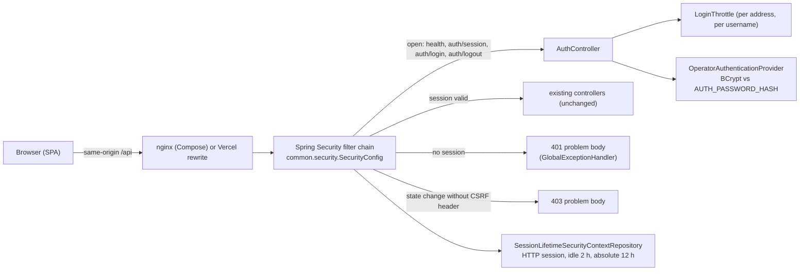

# MVP 8 Completion Report: Login (Server-Enforced Authentication)

**Branch:** `mvp8` (created from `main` at `97ebde4`, not from `mvp7`: see section 10). **Status:** steps 8.1 to 8.4 and 8.6 implemented and verified; step 8.5 (Railway and Vercel wiring) is documentation only, because nothing could be deployed from this machine. Not merged, not pushed.

## 1. Summary

The application now has a real login. With `AUTH_ENABLED=true` the **backend** answers `401` to every `/api/**` call that has no valid session (the login page is only the interface for that rule); with the default `AUTH_ENABLED=false` the application behaves exactly as before. One operator account comes from `AUTH_USERNAME` and `AUTH_PASSWORD_HASH` (BCrypt); the session is server-side in an `HttpOnly` cookie; state-changing calls need a CSRF header; failed logins are throttled; startup fails closed.

- **Tests, auth off (default):** final `./mvnw -B clean verify -Dtest='!ImpactGraphPerformanceTests'`: BUILD SUCCESS, **862 tests, 0 failures, 4 skipped**, Spotless clean. The excluded `ImpactGraphPerformanceTests` (a 2 s latency budget) **fails identically on unmodified `main`** on this machine (checked in a separate worktree), so it was not touched. Frontend: 35 files, 388 tests, 0 failures (313 at MVP 7; 69 are new from this MVP, 6 are `vercelConfig.test.ts` from an untracked file that is not part of this MVP); ESLint, `tsc` and the production build are clean.
- **Tests, auth on:** `./mvnw verify -Dspring.profiles.active=authon -Dtest='!ImpactGraphPerformanceTests'` (every MockMvc request signed in, behind the real filter chain): BUILD SUCCESS, **862 tests, 0 failures, 4 skipped**, Spotless clean. Run again after the last code change
- **Real browser:** Playwright (Chromium) against the built app and the real backend with the login on: sign in, wrong password, reload keeps the session, sign out, expired session back to the wanted page, no console or CSP errors. Served by a Node stand-in for nginx with the same security headers (Docker is not installed here).
- **Exit criteria:** 8 of 10 ticked and verified, 2 left unticked with reasons (section 5).
- **Not possible here:** Docker (so `docker compose up` with the login on or off was not run), a Railway or Vercel deployment (so the Vercel rewrite's cookie behaviour is unverified).

Commits on `mvp8` (oldest first):

| Hash | Subject |
|---|---|
| `8703073` | docs: deployment plan wording (Vercel rewrite instead of proxy) |
| `ff61359` | feat(backend): server-enforced single-user login (steps 8.1-8.2) |
| `f783674` | test(backend): run the whole suite behind the login; hardening checks (step 8.3) |
| `dea84e4` | feat(frontend): login page, session guard, CSRF and 401 handling (step 8.4) |
| `50b62cb` | fix: hash tool prints LF only; Playwright login check uses exact labels and an expiry flow |
| `5f9a09b` | fix(backend): do not add Spring Security default headers when the login is on |
| (last) | docs: MVP 8 completion report, README, architecture, overview, plan (steps 8.5-8.6) |

The "docs and defaults" commit the task asked for already existed as `97ebde4` on `main` (see section 10); the only uncommitted change left was a wording fix in `docs/deployment-plan.md`, which is `8703073`.

## 2. Steps executed

| Step | What was built | Tests added | Result |
|---|---|---|---|
| 8.1 Decisions | The table of the plan as built (section 6), plus the measured deviations | none (no code) | done |
| 8.2 Backend | `common.security` (properties, validator, provider, throttle, session repository, config, controller, problem handlers), 4 exception types, prod profile, redaction extension, OpenAPI, `backend/tools/HashPassword.java` | `AuthIntegrationTests` 16, `AuthDisabledTests` 3, `AuthProdProfileTests` 2, `AuthStartupValidatorTests` 11, `LoginThrottleTests` 7, `OperatorAuthenticationProviderTests` 3, +3 in `SecretRedactorTests`, +2 package-boundary tests, +1 OpenAPI test | green |
| 8.3 Hardening | The whole suite runs behind the login (`authon` profile); AI, search, Q&A, impact and analysis endpoints are 401 without a session; the analysis rate limit still applies after login; dependency review | `AuthHardeningTests` 2 | green both ways |
| 8.4 Frontend | `/login` and every state, session guard, safe `next`, CSRF and 401 handling in `api/client.ts`, user menu with Sign out, shell text no longer says "no auth" when a login is required | 69 tests in 5 new files plus extensions of `client.test.ts` and `contrast.test.ts`; Playwright `e2e/auth.spec.ts` (2 flows) | green; browser flows verified |
| 8.5 Deployment wiring | Documented only: the Railway variables, the plain Vercel rewrite and the rotation procedure were already in `docs/deployment-plan.md`; one correction made (Secure cookie) | none | not executable here |
| 8.6 Documentation | README Authentication section, architecture section 21, overview section 4e, plan ticks, this report | none | done |

## 3. Design walkthrough

### 3.1 Big picture



The login is a gate in front of the existing application. No feature package knows about it (`PackageBoundaryTests` enforces that `common.security` imports only `common.*` and that nothing else imports it except the shared `SecretRedactor`).

### 3.2 Request and data flow

1. The SPA starts and calls `GET /api/v1/auth/session` (always 200). The reply is `{authRequired, authenticated, username?}` and, when a login is required, the readable `XSRF-TOKEN` cookie.
2. `RequireSession` shows a splash while that call is in flight. If `authRequired && !authenticated` it navigates to `/login?next=<safe path>`. If `authRequired=false` (local use) it renders the app and no login UI exists anywhere.
3. The user submits the form: `POST /api/v1/auth/login` with `X-XSRF-TOKEN`. The CSRF filter checks the header against the cookie (403 otherwise). `AuthController` asks `LoginThrottle` (429 with `Retry-After` when locked), then `OperatorAuthenticationProvider` (constant-time username comparison, one BCrypt comparison always). A failure is recorded and answered with the single message "Invalid username or password" (401). A success clears the counters, invalidates any earlier session, creates a new one (new id), sets its idle timeout and saves the security context through `SessionLifetimeSecurityContextRepository`, which also stamps the login time.
4. Every later request carries the `REPOINTEL_SESSION` cookie. On each request the repository checks idle time and age against the injectable `Clock`; an expired session is invalidated and the request continues anonymous, which the chain answers with 401.
5. A 401 from any non-auth endpoint reaches `api/client.ts`, which calls the expiry handler once: cancel queries, clear the cache, mark the session signed out, navigate to `/login?expired=1&next=<where the user was>`. After signing in again the user lands on `next`.
6. Sign out: `POST /api/v1/auth/logout` invalidates the session on the server and clears both cookies; the SPA clears its cache (the AI provider preference in `localStorage` is kept), re-reads the session (which issues a fresh CSRF cookie) and goes to `/login`.

### 3.3 Components

Backend, `backend/src/main/java/com/repointelligence/common/security/` unless noted:

| Class | Responsibility |
|---|---|
| `AuthProperties` | `auth.*` record: `enabled`, `username`, `passwordHash`, `session.{idleTimeout, absoluteTimeout}`, `throttle.{maxFailures, window, maxTrackedKeys}`. `toString` never prints the hash or username |
| `AuthStartupValidator` | `@PostConstruct`: with `auth.enabled=true`, refuse to start unless the username is non-blank and the hash matches `^\$2[aby]\$\d{2}\$.{53}$`. Messages name the variable, never the value. No `@Pattern` on the property on purpose: Spring's binding errors print the rejected value |
| `SecurityConfig` | The `SecurityFilterChain`. Disabled: permit-all, no CSRF, no headers, stateless. Enabled: cookie CSRF, no default security headers (nginx and Vercel own them), session context repository, 401/403 handlers, `/actuator/health`, the three auth paths and `/error` open, `anyRequest().authenticated()`. Also the `AuthenticationManager`, `CsrfTokenRepository` and `LoginThrottle` beans |
| `OperatorAuthenticationProvider` | One account; `MessageDigest.isEqual` on SHA-256 of the username; always one BCrypt `matches` against the configured hash; rejects passwords over 72 bytes (BCrypt's limit) after still doing the comparison |
| `LoginThrottle` | Two independent keys (`ip:` and `user:`), five failures lock a key for the window, refused attempts are not counted, success clears both, bounded memory (oldest key evicted first) |
| `SessionLifetimeSecurityContextRepository` | Wraps `HttpSessionSecurityContextRepository`; stores `LOGIN_AT` and `LAST_SEEN` in the session and enforces idle and absolute lifetimes with the application `Clock`. A session without those markers is never trusted |
| `ProblemSecurityHandlers` | Hands 401 and 403 to the `handlerExceptionResolver`, so they use `GlobalExceptionHandler`'s RFC 9457 body (`timestamp`, `requestId`) and send no `WWW-Authenticate` |
| `AuthController` | `GET /session`, `POST /login`, `POST /logout`; `Cache-Control: no-store`; 404 for login when disabled |
| `common/exception/*` | `AuthenticationRequiredException` (401), `InvalidCredentialsException` (401), `AccessForbiddenException` (403), `LoginThrottledException` (429, extends `SubmissionRateLimitException`, so `GlobalExceptionHandler` already sets `Retry-After` and `retryAfterSeconds`) |
| `SecretRedactor` (extended) | Also masks `Cookie`, `Set-Cookie`, `Proxy-Authorization`, `X-XSRF-TOKEN` headers, `REPOINTEL_SESSION`/`JSESSIONID`/`XSRF-TOKEN` by name, and BCrypt hashes |
| `config/OpenApiConfig` | `sessionCookie` security scheme and a `401` response on every operation outside `/api/v1/auth/` |
| `backend/tools/HashPassword.java` | Creates the hash with no extra tool (reads the password without echo) |

Frontend, `frontend/src/`:

| File | Responsibility |
|---|---|
| `api/auth.ts`, `hooks/useSession.ts` | `getSession`, `login`, `logout`; `useSession` (TanStack Query, `staleTime: Infinity`), `useLogin` (fetches the session first if the CSRF cookie is missing), `useLogout` |
| `api/client.ts` | `credentials: 'same-origin'`; `X-XSRF-TOKEN` from the cookie on `POST`/`PUT`/`PATCH`/`DELETE`; `setUnauthorizedHandler`; never fires for `/api/v1/auth/*` |
| `lib/sessionExpiry.ts` | The one-time 401 handling; re-armed by a new sign-in |
| `lib/safeNext.ts` | Accepts only an in-app path: single leading `/`, no `//`, no backslash, no whitespace or control characters, nothing that decodes to `//`, resolves to the same origin, never `/login` |
| `components/auth/RequireSession.tsx` | The guard |
| `components/auth/UserMenu.tsx` | Username and Sign out in the header; Escape closes and returns focus |
| `pages/LoginPage.tsx` | The screen and its states |
| `routes/index.tsx` | `/login` outside the shell; everything else under `RequireSession` |
| `components/layout/Header.tsx`, `Sidebar.tsx`, `ThemeToggle.tsx` | The theme toggle was extracted so the login page can use it; "Local single-user, no auth" texts change when a login is required |

### 3.4 Data model

None. No table, no migration (the account is configuration; sessions are in memory). That is a design goal of the plan, not an omission.

### 3.5 API

| Endpoint | Request | Response |
|---|---|---|
| `GET /api/v1/auth/session` | none | `200 {"authRequired":true,"authenticated":false}`, or `{"authRequired":true,"authenticated":true,"username":"operator"}`; with the login off `{"authRequired":false,"authenticated":false}`. Sets `XSRF-TOKEN` |
| `POST /api/v1/auth/login` | `{"username","password"}` and `X-XSRF-TOKEN` | `200` session body and `Set-Cookie: REPOINTEL_SESSION=...; Path=/; HttpOnly; SameSite=Lax`; `401 {"detail":"Invalid username or password",...}`; `429` with `Retry-After` and `retryAfterSeconds`; `400` malformed; `403` without the CSRF header; `404` when the login is off |
| `POST /api/v1/auth/logout` | `X-XSRF-TOKEN` | `204`, cookies cleared |
| everything else under `/api/**` | | `401` problem body without a session (`{"detail":"Authentication is required. Sign in to continue.","status":401,...}`); `403` for a state-changing call without the CSRF header |

### 3.6 Frontend

`/login` is a centered 400 px card with the brand mark, "Sign in", Username, Password with a show/hide toggle (`aria-label="Show password"`, `aria-pressed`), the Sign in button, and a footer with the theme toggle and the version (injected from `package.json` by `vite.config.ts`). States: idle; submitting (busy button, read-only fields); wrong credentials (`role="alert"` "Invalid username or password", password cleared, focus back on the password field); throttled (alert plus a live countdown from the server's `retryAfterSeconds`, button disabled until zero); `?expired=1` note; server or network error (a generic message, never the server's text). All data comes from `GET /api/v1/auth/session` and `POST /api/v1/auth/login` through TanStack Query.

### 3.7 Configuration and extension points

| Key | Variable | Default |
|---|---|---|
| `auth.enabled` | `AUTH_ENABLED` | `false` |
| `auth.username` | `AUTH_USERNAME` | empty |
| `auth.password-hash` | `AUTH_PASSWORD_HASH` | empty |
| `auth.session.idle-timeout` / `absolute-timeout` | `AUTH_SESSION_IDLE_TIMEOUT` / `AUTH_SESSION_ABSOLUTE_TIMEOUT` | `PT2H` / `PT12H` |
| `auth.throttle.max-failures` / `window` / `max-tracked-keys` | | 5 / `PT15M` / 10000 |
| `server.servlet.session.cookie.*` | | name `REPOINTEL_SESSION`, `http-only`, `same-site: lax`; `secure: true` in `prod` |

`compose.yaml` passes the three `AUTH_*` variables (default `false`); `.env.example` documents them and the `$$` rule. To add a second authentication mechanism, add an `AuthenticationProvider` to the `ProviderManager` in `SecurityConfig`; to change where sessions live (survive redeploys), replace the HTTP session store (Spring Session JDBC, Appendix C.8) and keep `SessionLifetimeSecurityContextRepository`.

To create a hash and run locally with the login on (the commands this MVP verified):

```sh
# hash (from backend/); the password is read without echo, 12+ characters
./mvnw -q dependency:build-classpath -Dmdep.outputFile=target/cp.txt -DincludeScope=runtime
java -cp "$(cat target/cp.txt)" tools/HashPassword.java          # Git Bash; PowerShell: java -cp (Get-Content target/cp.txt) tools/HashPassword.java

# backend, bash (single quotes around the hash)
AUTH_ENABLED=true AUTH_USERNAME=operator AUTH_PASSWORD_HASH='<the hash>' ./mvnw spring-boot:test-run
# frontend (frontend/): npx -y pnpm@12.21.0 dev   -> http://localhost:5173, sign in as operator

# Docker Compose: put AUTH_ENABLED=true, AUTH_USERNAME and AUTH_PASSWORD_HASH in .env with every $ written $$
```

### 3.8 Where to start reading

1. `docs/implementationPlan.md`, MVP 8, steps 8.1 to 8.6.
2. `backend/.../common/security/SecurityConfig.java`, then `AuthController.java`.
3. `OperatorAuthenticationProvider.java`, `LoginThrottle.java`, `SessionLifetimeSecurityContextRepository.java`, `AuthStartupValidator.java`.
4. `backend/src/test/.../common/security/AuthIntegrationTests.java` and `support/AuthTestClient.java` (the real-HTTP browser stand-in), then `support/AuthEnabledMockMvcSupport.java` and `src/test/resources/application-authon.yml`.
5. `frontend/src/api/client.ts`, `lib/sessionExpiry.ts`, `hooks/useSession.ts`, `components/auth/RequireSession.tsx`, `pages/LoginPage.tsx`, `lib/safeNext.ts`.
6. `frontend/e2e/auth.spec.ts`.

## 4. Issues faced and how they were resolved

| # | Symptom | Root cause (evidence) | Fix and verification |
|---|---|---|---|
| 1 | The task described uncommitted edits on `mvp7`; the repository was clean on `main` | The edits (AI default `gemini`, README, `.env.example`, `compose.yaml`, the plan's MVP 8 text) were already in commit `97ebde4` on `main`; `git branch -a` shows no `mvp7` | Branched `mvp8` from `main`. The only uncommitted change that appeared during the run was a wording fix to `docs/deployment-plan.md`; committed as `8703073` |
| 2 | `SupplierDeferredSecurityContext` does not compile | The class is package-private in Spring Security 7.1.2 | Implemented `DeferredSecurityContext` directly (`LazyContext`) |
| 3 | The `prod` profile failed to start (`found duplicate key management`) | `application-prod.yml` already had a `management:` block and I appended a second | Merged into one block; `AuthProdProfileTests` loads the real `prod` profile |
| 4 | The plan expects `forward-headers-strategy=framework` to make the session cookie `Secure` | Measured with a throwaway real-HTTP test: with `framework` and `X-Forwarded-Proto: https` the `XSRF-TOKEN` cookie got `Secure` but `REPOINTEL_SESSION` did not (Tomcat decides its own cookie from its own request) | `server.servlet.session.cookie.secure: true` in `application-prod.yml`; `AuthProdProfileTests.sessionCookieIsSecureHttpOnlyAndSameSiteLax`; deployment plan corrected |
| 5 | `safeNext.test.ts` "backslash host" failed (`'/\evil.com'` returned `/evil.com`) | The shell here collapsed `\\` inside a heredoc, so the test string had a single backslash, which JavaScript read as `\e` | Built the string with `String.fromCharCode(92)`; also wrote `safeNext.ts` with the editor tool rather than a heredoc |
| 6 | Lint: `no-control-regex` and `react-hooks/set-state-in-effect` | A regex with `\u0000` and a `setNow` in an effect body | Replaced the regex by a code-point loop (`hasUnsafeCharacter`); the countdown now refreshes `now` only inside the interval callback and in the 429 handler |
| 7 | `ImpactGraphPerformanceTests` failed (`typical TYPE traversal` 3217 ms > 2000 ms) | Not caused by this MVP: the same test fails the same way on unmodified `main` (checked in a separate git worktree, which was removed afterwards). It is a machine-dependent latency budget | Not touched; excluded with `-Dtest='!ImpactGraphPerformanceTests'` for the green runs; recorded in Appendix C.8 |
| 8 | Several frontend tests timed out or reported impossible durations (`43888405ms`) in one run | The machine's clock jumped about 15 hours (sleep) in the middle of the run; the same files pass in isolation and in the next full run | Re-ran: 35 files, 388 tests green |
| 9 | Playwright: the page never redirected to `/login` and was blank | My Node stand-in for nginx compared a forward-slash path with a backslash path (`startsWith` failed), so every asset was a 404 | Resolved `DIST` with `path.resolve`; the real nginx config was never involved |
| 10 | Playwright: `getByLabel('Password')` matched two elements | Playwright's label match is a substring match, so it also matched the button labelled "Show password" | Specs use `{ exact: true }`. Testing Library's exact match was unaffected, which is why unit tests passed. The accessible names themselves are correct and distinct |
| 11 | Playwright: one console error "Failed to load resource ... 401" | The browser logs the deliberate wrong-password 401 itself | The spec ignores that one message for `/api/v1/auth/login` only; any other console error, including a 401 from another URL, still fails it |
| 12 | The expiry flow test sent the user to `/login?next=...` without `expired=1` | A full page load re-reads the session (signed out); `expired=1` only arises from a 401 on an in-app request | The flow now clicks an in-app link whose data request is the 401 |
| 13 | Files `backend/railway.toml`, `frontend/vercel.json` and `frontend/src/test/vercelConfig.test.ts` appeared untracked during the run | Created by someone else outside this session at 00:50 (not by me) | Left untracked and uncommitted. They run in the frontend suite (6 tests, green). See section 10 |

## 5. Verification

Commands and results:

- `./mvnw -B clean verify -Dtest='!ImpactGraphPerformanceTests'` (auth off, default): BUILD SUCCESS, 862 tests, 0 failures, 4 skipped, Spotless check included. An earlier full run (before `AuthHardeningTests` existed) ran 861 tests with the one pre-existing performance failure.
- `./mvnw -B verify -Dspring.profiles.active=authon -Dtest='!ImpactGraphPerformanceTests'`: BUILD SUCCESS, 862 tests, 0 failures, 4 skipped, Spotless clean (the contexts started in that run log `The following 1 profile is active: "authon"`).
- Frontend (from `frontend/`, `npx -y pnpm@12.21.0 ...`): `lint`, `typecheck`, `test --run` (35 files, 388 tests), `build`; the production-bundle scan (`src/test/bundle.test.ts`) passes.
- Manual, against the real backend (`spring-boot:test-run`, `AUTH_ENABLED=true`, a cost-12 hash made with `tools/HashPassword.java`): `GET /api/v1/repositories` without a session: 401 problem body, no `WWW-Authenticate`; `/actuator/health`: 200; `/swagger-ui.html` and `/v3/api-docs`: 401 (non-prod); login without the CSRF header: 403; wrong password: 401 with the generic message; correct login: 200 and `Set-Cookie: REPOINTEL_SESSION=...; Path=/; HttpOnly; SameSite=Lax`; repositories with the cookie: 200; a POST with the cookie but without the header: 403. Starting with `AUTH_ENABLED=true` and no username refuses to start with a message naming `AUTH_USERNAME`.
- Manual, through the Node stand-in for nginx (port 5173, same CSP and headers as `frontend/nginx.conf`): login, then `POST /api/v1/repositories/analyze` for `spring-projects/spring-petclinic` with `forceRescan: true`, polled to `COMPLETED_WITH_WARNINGS` (one live GitHub run, no token).
- Playwright (`e2e/auth.spec.ts`, Chromium): both flows pass; zero console errors other than the deliberate wrong-password 401, zero CSP violations.
- Dependency review (step 8.3 item 4): `mvn dependency:tree` shows `spring-boot-starter-security` 4.1.2 pulling Spring Security 7.1.2 (`config`, `core`, `crypto`, `web`) and `spring-aop` 7.0.10, all managed by the Boot BOM. An OSV.dev query for the four `spring-security-*` artifacts at 7.1.2 returned no known vulnerabilities on 2026-11-26. The project has no OWASP plugin, so this is a point-in-time check, not a gate.
- Cross-MVP matrix: the whole existing backend suite (MVP 1 to 7 tests) and frontend suite pass with the login off, and the backend suite also passes with it on. Earlier reports and pages render in the shell (frontend tests for every page, axe in both themes).

### Exit criteria

| # | Criterion | Status and how it was verified |
|---|---|---|
| 1 | With `AUTH_ENABLED=true` every `/api/**` call except the auth endpoints answers 401 without a session, from Railway directly and through Vercel | **Not ticked.** Verified directly against the backend and through a stand-in for nginx, with a list of 9 paths in `AuthIntegrationTests`, 16 endpoints in `AuthHardeningTests` and curl. Not verified from a Railway URL or through Vercel |
| 2 | With `AUTH_ENABLED=false` nothing changes: previous tests and Docker Compose behave as before | **Not ticked.** All previous tests pass (one pre-existing performance-budget failure, identical on `main`); `AuthDisabledTests` pins open behaviour. Docker Compose could not be run |
| 3 | Refuses to start with a missing or malformed hash | **Ticked.** `AuthStartupValidatorTests` (missing, blank user, 5 malformed forms, message never contains the value) and a manual start |
| 4 | `HttpOnly` cookie, new session id per login, CSRF, throttling with `Retry-After`, one generic message | **Ticked.** Real-HTTP tests |
| 5 | No password, hash, session id or CSRF token in logs, URLs, error bodies or browser storage | **Ticked** (logs: planted values in `AuthIntegrationTests`; browser storage: unit test and Playwright; the password only travels in the POST body; `SecretRedactorTests`) |
| 6 | Login page in both themes with every state, keyboard operable, WCAG AA, no CSP errors | **Ticked** (unit tests for each state, axe in both themes, token contrast test for the pairs used, Playwright CSP check). A human still has to look at it, section 8 |
| 7 | Expired session or 401 returns to `/login` once, then back (safe `next`) | **Ticked** (`sessionExpiry.test.ts`, `safeNext.test.ts`, `RequireSession.test.tsx`, Playwright) |
| 8 | Vercel plain `/api` rewrite; no shared-secret proxy in the plan or the code | **Ticked.** No proxy code exists; the plan text names the secret pair only to say it is deleted |
| 9 | `/actuator/health` open; Swagger and OpenAPI not exposed in `prod` | **Ticked** (`AuthProdProfileTests`) |
| 10 | README, architecture, deployment plan and completion report updated | **Ticked** (deployment plan: one correction) |

## 6. Decisions (ADR style)

**D1. Wrong username still does one BCrypt comparison, against the real hash (plan: a dummy hash).** Context: wrong user and wrong password must cost the same. Options: a dummy hash (plan); the real hash. Choice: the real hash. Evidence: a dummy hash generated at startup would have its own cost factor, which can differ from the operator's, so the timing would differ; the real hash always has the real cost. `OperatorAuthenticationProviderTests` checks the median ratio (0.4 to 2.5, not a strict equality). Consequence: none visible.

**D2. A lock is a fixed window from the fifth failure, not a sliding count.** Options: sliding window of failures; lock for the window once the limit is hit. Choice: lock; refused attempts are not counted and do not extend the lock. Evidence: with a sliding window a victim hammered during the lock would never get back in; the plan's text ("after 5 failures in 15 minutes answer 429 with Retry-After") fits both. Consequence: a stranger can lock the operator out for 15 minutes by guessing; accepted for a single-user tool and listed in the class comment.

**D3. Session lifetimes enforced in our own `SecurityContextRepository`, on the injectable `Clock`.** Options: only Tomcat's inactivity timeout and `getCreationTime`; our own timestamps. Choice: own timestamps (plus Tomcat's timeout set to the same idle value as a backstop). Evidence: the plan requires tests that move time; the container's clock cannot be moved. Consequence: a session without our markers is never trusted, which also means `user()` test principals work only because Spring Security's test repository comes first.

**D4. Plain (non-masked) CSRF token handler.** Options: Spring's default XOR handler (BREACH protection) with the SPA workaround; the plain handler. Choice: plain. Evidence: the cookie holds the raw token the SPA copies into a header, the API returns JSON and no HTML page embeds the token; with the XOR handler the raw cookie value is rejected. Consequence: none for this API.

**D5. Real HTTP for the login tests, MockMvc only for the "whole suite signed in" mode.** Evidence: MockMvc has no servlet container, so cookie attributes, session ids and invalidation cannot be tested with it (issue 4 could not have been found). The `authon` profile reuses all existing MockMvc tests behind the real filter chain by adding `user()` and `csrf()` to every request (`AuthEnabledMockMvcSupport`, a plain `@Configuration` on the test classpath conditional on `auth.enabled=true`, so the default run is untouched). Consequence: that mode proves the filter chain does not break any endpoint, not that each endpoint's own 401 behaves; `AuthHardeningTests` covers that for the sensitive ones.

**D6. `anyRequest().authenticated()` (fail closed), with `/error` open.** Options: permit unknown paths (static SPA files); deny. Choice: authenticated. Evidence: the backend serves no SPA files; an unknown path answering 404 to the public tells nothing but is also not needed. Consequence: an unknown path signed out is 401, not 404.

**D7. 401 and 403 produced through the application's exception handling.** Evidence: reusing `GlobalExceptionHandler` gives the same body shape (`requestId`, `timestamp`) as every other error and no duplicate JSON code. Consequence: CSRF is checked before authorization, so a state-changing call with no session and no token is 403 rather than 401 (the SPA always has the token after its first session call).

**D8. Logout is an open path (CSRF-protected), login is 404 when the login is off.** Consequence: logging out with an already-expired session is a harmless 204; the login endpoint cannot be used to "enable" anything when the feature is off.

**D9. `Secure` set unconditionally in `prod`** (issue 4). Consequence: running the `prod` profile over plain HTTP locally gives a session cookie the browser will not send back; production is HTTPS only.

**D10. The hash tool is a source-launch Java file, not a CLI in the application.** Options: `htpasswd` only; a Spring Boot runner; a plain `.java` file using the project's own classpath. Choice: the file under `backend/tools/` plus `htpasswd` for those who have it. Evidence: this Windows machine has no `htpasswd`; the file adds nothing to the packaged application. Consequence: needs a one-time `dependency:build-classpath`.

## 7. Considerations

**Security.** Threats from step 8.1 and their controls as built: password guessing (BCrypt, throttle on two keys, one generic message, equal timing); session theft (`HttpOnly`, `Secure` in prod, idle and absolute lifetimes, server-side logout); CSRF (cookie-to-header, 403 otherwise; `SameSite=Lax` as depth); fixation (old session invalidated, new id; tested over real HTTP); open redirect (`safeNext`, 27 inputs in `safeNext.test.ts`); credential leakage (never logged, tested with planted values; not in URLs, not in bodies; `AuthProperties.toString` and `LoginRequest.toString` hide secrets; the startup message names the variable only); cost abuse by strangers (gate in front, the analysis rate limit unchanged behind it and strangers do not spend it: tested); clickjacking (CSP `frame-ancestors 'none'` and `X-Frame-Options: DENY` stay with nginx and Vercel; Spring Security's own default headers are switched off so the backend does not send a duplicate, invalid second `X-Frame-Options`). Residual risks: per-address throttle can be evaded by spoofing `X-Forwarded-For` (the per-username key still holds); an attacker can lock the operator out (D2); sessions are lost on restart; no second factor; the CSRF token does not rotate at login (Appendix C.8).

**Performance.** One BCrypt comparison (cost 12; typically a few hundred milliseconds, not measured here) per login attempt; throttling means at most 5 per key per window reach the check. The session check is a map lookup plus two attribute reads per request. The throttle is a `synchronized` map bounded at 10,000 keys. Not benchmarked beyond the test timings.

**Reliability.** The application refuses to start with a bad configuration rather than coming up open. A restart ends all sessions (documented). If the session endpoint cannot be reached the SPA shows a retry state instead of guessing "signed out".

**Testing strategy and gaps.** Real HTTP for the login behaviours, unit tests with a movable clock for time, the whole suite signed in, Testing Library plus MSW for the UI, a real browser for flows and CSP. Gaps: the Docker stack and a Railway/Vercel deployment were not run; the browser check used a stand-in for nginx; the throttle's behaviour behind a real proxy chain was not exercised; the `$$` escaping rule for `.env` is taken from the Compose documentation, not from a run; no load test of the login.

## 8. Not done, not verified, open items

Manual checks for the developer:

1. **Docker Compose, login off (default):** `docker compose up --build -d`, open http://localhost:5173: no login page, header and sidebar read "Local". Expected: unchanged behaviour. Then `docker compose ps` healthy.
2. **Docker Compose, login on:** set `AUTH_ENABLED=true`, `AUTH_USERNAME` and `AUTH_PASSWORD_HASH` (with `$$`) in `.env`, `docker compose up -d --force-recreate backend`. Expected: the page redirects to `/login`, sign in works, `docker compose logs backend` shows no password or hash. If the backend exits with a message about `AUTH_PASSWORD_HASH`, the `$$` escaping is wrong. Note that behind nginx the per-address throttle sees the nginx container's address for everyone.
3. **Look at the login page** at 1440, 1024 and 390 px in both themes, in the wrong-credentials, throttled (make 5 wrong attempts) and `?expired=1` states, and the header user menu with the keyboard (Tab, Enter, Escape). Screenshots taken during this run are in the session scratchpad only.
4. **Railway and Vercel (step 8.5 checks):** from outside, `curl https://<railway>/api/v1/repositories` must be 401, `/actuator/health` 200, `/swagger-ui.html` 404; through Vercel check that `Set-Cookie` arrives host-only, `HttpOnly`, `Secure`, that the `X-XSRF-TOKEN` header and `Retry-After` pass the rewrite, and the rewrite's time limit for AI calls (`docs/deployment-plan.md` 4.3). Nothing about Vercel's behaviour was verified here.
5. Run `ImpactGraphPerformanceTests` on a quieter machine; on this one it fails on `main` too.

Not done: step 8.5 execution; the optional CI job for the browser check; everything in Appendix C.8.

## 9. How to review and merge

```sh
git log --oneline main..mvp8
git diff main...mvp8 --stat
# backend (from backend/)
./mvnw -B clean verify                                    # (ImpactGraphPerformanceTests may fail on a slow machine, also on main)
./mvnw -B verify -Dspring.profiles.active=authon          # whole suite signed in
# frontend (from frontend/)
npx -y pnpm@12.21.0 install --frozen-lockfile && npx -y pnpm@12.21.0 lint && npx -y pnpm@12.21.0 typecheck && npx -y pnpm@12.21.0 test --run && npx -y pnpm@12.21.0 build
# optional browser check against a running stack with the login on
E2E_AUTH_USERNAME=operator E2E_AUTH_PASSWORD='...' npx -y pnpm@12.21.0 e2e e2e/auth.spec.ts
# then
git checkout main && git merge --ff-only mvp8 && git push origin main
```

Before merging, decide what to do with the three untracked files that are not part of this MVP (`backend/railway.toml`, `frontend/vercel.json`, `frontend/src/test/vercelConfig.test.ts`); they were not added to any commit here.

## 10. Anything else worth knowing

- **Branch base.** The request said `mvp7` with uncommitted edits. There is no `mvp7` branch and the tree was clean on `main`, whose head `97ebde4` already contains the edits (AI default `gemini`, README, `.env.example`, `compose.yaml`, the plan, `docs/deployment-plan.md`). So there was nothing to put in a separate "docs and defaults" commit except a later wording fix to `docs/deployment-plan.md` (`8703073`). Nothing was lost.
- **Foreign files.** `backend/railway.toml`, `frontend/vercel.json` (with a `REPLACE-WITH-RAILWAY-DOMAIN` placeholder) and `frontend/src/test/vercelConfig.test.ts` appeared during the run. They look like the first part of the deployment plan's Phase 1 and match this MVP (plain `/api` rewrite, same CSP as nginx, one replica). Their test passes; they are untracked.
- **Frontend compatibility.** The new frontend calls `GET /api/v1/auth/session` at start; against an older backend that is a 404 and the shell shows its "Cannot reach the server" retry state. Deploy the backend first (the deployment plan already says so).
- **A `LOCAL` badge** in the sidebar becomes `SECURED` when a login is required, and "Local · read-only analysis" in the header drops "Local"; both were previously static text that would have been wrong on a public deployment.
- **Things I would do differently:** write the real-HTTP test helper first (it found the `Secure` cookie issue immediately) and run the Playwright check as soon as the page existed instead of after the unit tests.
